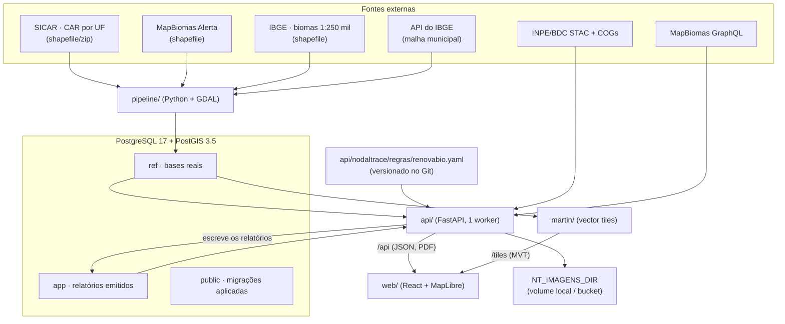

# NodalTrace — documentação de dados

Referência completa de **todos os dados** do NodalTrace: de onde vêm, como são carregados, como o banco é estruturado
(tabela por tabela, coluna por coluna), quem lê e quem escreve cada coisa, como o backend os consome para produzir o
que o app mostra, e como tudo isso fica no Google Cloud. Escrito para que uma pessoa ou um agente de IA consiga
continuar o trabalho sem reler o repositório inteiro.

| | |
|---|---|
| **Descreve** | a `dev` em 2026-10-21, com o app trabalhando só com dados reais (as operações simuladas saíram) |
| **Como foi verificado** | leitura do código de `db/`, `pipeline/`, `api/`, `martin/`, `deploy/`, `run.sh` e `docker-compose.yml`; dicionário de `ref` pelo `pg_dump --schema-only` do banco em execução; migrações aplicadas a um banco novo e a um banco local já carregado (CAR do RS, MapBiomas, biomas) |
| **Caminhos** | relativos à raiz do repositório |

Quando algo não foi lido linha a linha no código, aparece marcado **(não reconferido)**. Quando um número depende do
ambiente (quantos estados do CAR foram carregados, por exemplo), a seção diz de onde ele veio e como medir de novo.

---

## Sumário

0. [Comece aqui: onde o dado mora e como chega ao app](#0-comece-aqui-onde-o-dado-mora-e-como-chega-ao-app)
1. [Visão geral](#1-visão-geral)
2. [Classificação dos dados](#2-classificação-dos-dados)
3. [Fontes externas](#3-fontes-externas)
4. [Banco: infraestrutura](#4-banco-infraestrutura)
5. [Schemas e migrações](#5-schemas-e-migrações)
6. [Dicionário de dados: schema `ref`](#6-dicionário-de-dados-schema-ref)
7. [Dicionário de dados: schema `app`](#7-dicionário-de-dados-schema-app)
8. [Dicionário de dados: `public`](#8-dicionário-de-dados-public)
9. [Funções SQL do schema `ref`](#9-funções-sql-do-schema-ref)
10. [Ingestão: a pipeline](#10-ingestão-a-pipeline)
11. [Análises e relatórios](#11-análises-e-relatórios)
12. [Consumo pela API](#12-consumo-pela-api)
13. [Regras de cálculo](#13-regras-de-cálculo)
14. [Escritas feitas pela API](#14-escritas-feitas-pela-api)
15. [Vector tiles (Martin)](#15-vector-tiles-martin)
16. [Frontend: o que consome e o que guarda](#16-frontend-o-que-consome-e-o-que-guarda)
17. [Google Cloud](#17-google-cloud)
18. [Ciclo de vida e operações](#18-ciclo-de-vida-e-operações)
19. [Consistência, concorrência e idempotência](#19-consistência-concorrência-e-idempotência)
20. [Segurança e privacidade dos dados](#20-segurança-e-privacidade-dos-dados)
21. [Convenções](#21-convenções)
22. [Pegadinhas, dívidas e riscos](#22-pegadinhas-dívidas-e-riscos)
23. [Como inspecionar](#23-como-inspecionar)
24. [Onde mexer](#24-onde-mexer)
25. [Glossário](#25-glossário)

---

## 0. Comece aqui: onde o dado mora e como chega ao app

Esta seção responde às perguntas que quem chega ao projeto faz primeiro, e que não ficam óbvias lendo o código.

### 0.1 O repositório não tem dados

O Git (GitHub) guarda **só código**: o repositório inteiro tem uns 3 MB de histórico e cerca de 400 arquivos (código,
migrações SQL, as regras do RenovaBio, fontes). **Nenhum CAR, alerta ou bioma está no
Git**: `dados/` é ignorado pelo `.gitignore`, menos o `dados/README.md`. Os motivos: as bases são grandes (o CAR de 14
estados ocupa ~9,5 GB no banco, e os arquivos brutos mais ainda), são públicas (qualquer um baixa do SICAR, do MapBiomas e
do IBGE) e mudam com o tempo (o banco guarda o histórico de versões de cada imóvel).

Um clone novo, sem nada em `dados/`, sobe o app com o mapa sem imóveis nem alertas.

### 0.2 Onde cada coisa fica fisicamente

| O quê | Onde | Tamanho típico | Some quando |
|---|---|---|---|
| Código | a pasta do repositório | ~3 MB (+ `node_modules`: ~440 MB no `web/`, ~135 MB no `attestor/`) | — |
| Arquivos brutos das bases (shapefiles, zips) | `dados/` (ou a pasta de `DADOS_DIR` no `.env`, que pode estar num disco externo) | GBs | você apaga; **pode apagar depois de carregar** |
| **O banco (PostGIS)** com as bases carregadas e os relatórios emitidos | volume Docker `nodaltrace_pgdata` | GBs (2,7 GB só com o RS; ~14 GB com 14 UFs), mais o log de recuperação do Postgres (até 8 GB) | `./run.sh reset`, `./run.sh limpar`, ou o "Clean / Purge data" e o "Reset to factory defaults" do Docker Desktop |
| Cache de imagens de satélite | volume Docker `nodaltrace_imagens` | cresce com o uso | `./run.sh reset` |
| As imagens Docker (Postgres, GDAL, Martin, API…) | dentro do Docker | ~4 GB | `docker system prune` |

**Os volumes Docker não ficam na pasta do repositório.** No Mac e no Windows, o Docker Desktop roda uma máquina virtual
Linux, e o disco dela é um arquivo só (no Mac, `~/Library/Containers/com.docker.docker/Data/vms/0/data/Docker.raw`,
que o Finder mostra com o tamanho máximo, por exemplo 64 GB, mas só ocupa o que está em uso). Por isso a pasta do
projeto mostra centenas de MB enquanto o banco tem GBs: o banco está no disco do Docker. No Linux, os volumes ficam em
`/var/lib/docker/volumes/`.

### 0.3 O caminho do dado, do arquivo baixado ao app

```
 arquivos baixados                 pipeline (contêiner)                 PostGIS (contêiner db)
 dados/AREA_IMOVEL/RS/*.shp  ──►   lê de /dados (a pasta é montada,  ──► grava em ref.* no volume
 dados/alerts_with_…/*.shp         não copiada para a imagem)            pgdata: fica para sempre
 dados/BIOMAS/*.shp                + baixa municípios da API do IBGE
                                                                              │
 API + Martin (contêineres) ◄─────────────────────────────────────────────────┘ leem ref a cada pedido;
          │                                                                     a API grava os relatórios em app
          ▼
 navegador (localhost:5173)
```

- **A carga é feita uma vez por base**, não a cada subida. O `./run.sh` só carrega o que encontra em `dados/`; com a
  pasta vazia, ele avisa "Pulando…" e o app usa o que já está no banco.
- **A pasta `dados/` não vai para dentro de nenhuma imagem**: o Compose a monta em `/dados` no contêiner da pipeline,
  que lê os arquivos e grava no banco. Depois disso os arquivos podem sair dali.
- **Deixar os arquivos em `dados/` tem custo**: a cada `./run.sh` (comando `all`), a pipeline importa o CAR de novo
  (minutos por estado). Não cria versões novas (o mesmo arquivo dá 0 mudanças), mas gasta tempo. MapBiomas e biomas
  reconhecem o mesmo arquivo pelo hash e não fazem nada. No dia a dia, use `./run.sh infra` e `./run.sh web`, que não
  carregam nada.
- A única ida à internet da pipeline é a malha municipal do IBGE (`servicodados.ibge.gov.br`).

### 0.4 Local e nuvem são dois sistemas independentes

| | Local (`./run.sh`) | Nuvem (`app.nodaltrace.com`) |
|---|---|---|
| Banco | PostGIS no Docker da sua máquina (`127.0.0.1:5433`) | Cloud SQL `nodaltrace-db` |
| De onde veio o dado | da pipeline, a partir dos arquivos em `dados/` | de uma cópia de algum banco local (`deploy/gcp.sh dump` + `importar`), mais o que foi carregado ou criado na nuvem depois |
| Credenciais | a senha local do `.env` | conta de serviço + senha no Secret Manager ([17.5](#175-como-o-app-se-autentica-no-google-cloud)) |

- **O app local nunca fala com o Google Cloud.** Rodar localmente não precisa de login no `gcloud` porque nada vem da
  nuvem.
- **Os dois bancos não se sincronizam.** O que você cria localmente (os relatórios) não aparece
  na nuvem, e vice-versa. O único movimento é manual e num sentido só: local → nuvem, por `dump` + `importar`, e só
  num banco da nuvem vazio ([22](#22-pegadinhas-dívidas-e-riscos)).
- **Saber se o seu banco local está igual ao da nuvem exige acesso ao projeto**: `gcloud auth login` com uma conta que
  tenha papel no projeto, `deploy/gcp.sh proxy` em outro terminal e `deploy/gcp.sh conferir`, que compara as linhas
  tabela a tabela. O `conferir` não é só leitura: também roda `ALTER ROLE nodaltrace SET jit = off` e `ANALYZE` na
  nuvem.
- Dois desenvolvedores com o mesmo código podem ter bancos locais bem diferentes: depende de quais arquivos cada um
  carregou e quando.

### 0.5 Clone novo numa máquina nova

**O que é preciso**: Docker (Docker Desktop no Mac e no Windows), Node 22.12+, e para dados reais os arquivos das bases
(ver [0.6](#06-de-onde-tirar-os-arquivos)). No Windows, tudo dentro do WSL 2. O `./run.sh diagnostico` confere a
máquina sem mudar nada.

**O que cada parte do app precisa no banco:**

| Parte do app | Precisa de |
|---|---|
| Mapa, busca e detalhe dos imóveis | CAR das UFs que interessam |
| Alertas no mapa, critério EUDR do imóvel, análises de desmatamento e do RenovaBio | **MapBiomas Alerta** |
| Bioma no mapa, no detalhe do imóvel e na análise de bioma | biomas do IBGE |

Sem nenhuma base, o app sobe e o mapa abre sem imóveis.

Os municípios do IBGE entram sozinhos com o CAR (com internet).

**Passo a passo:**

1. `git clone …` e `cd nodaltrace-demo`.
2. Copie os arquivos para `dados/` **exatamente** na estrutura de `dados/README.md` (ou aponte `DADOS_DIR` no `.env`
   para a pasta onde eles estão).
3. `./run.sh`: diagnóstico, imagens (alguns minutos na primeira vez), migrações, **carga** (do RS, minutos; dos 14
   estados, ~3 min de CAR e ~11 min de MapBiomas, segundo o README), o resumo das bases carregadas e o frontend.
4. Abra `http://localhost:5173`: o app abre direto no mapa.
5. Depois disso, os arquivos de `dados/` podem ser apagados ou movidos; o banco guarda tudo. No dia a dia:
   `./run.sh infra` e `./run.sh web`.

**Quão fácil e sem erro isso é (avaliação em 2026-10-20):**

| Parte | Situação |
|---|---|
| Subir o app sem dados | **conferido** (2026-10-20) num clone novo no macOS (bash 3.2) e num Linux Debian (bash 5): sobe sem erro e o diagnóstico aponta o que falta |
| Migrar um banco novo | **conferido** (2026-10-21): as migrações de `db/` aplicadas a um banco vazio deixam só `ref`, `app` e `public` |
| Ler um banco já carregado | **conferido** (2026-10-21) no macOS, com o CAR do RS e o MapBiomas: todos os testes da API passam |
| Carregar os arquivos brutos num clone novo, com o código atual | **não conferido de ponta a ponta.** A carga desta máquina foi feita em 08–09/10 por uma versão anterior da pipeline. O cruzamento alerta × imóvel foi recalculado depois com a função atual e funcionou. A pipeline tem testes de unidade, mas nenhum teste com os arquivos reais |
| Conseguir os arquivos | **o ponto mais frágil**: não há um link único e versionado. Ver [0.6](#06-de-onde-tirar-os-arquivos) |

**Onde um clone novo costuma tropeçar:**

1. **Estrutura de pastas errada → a carga pula sem erro.** O CAR tem de estar em `dados/AREA_IMOVEL/<UF>/` (ex.:
   `dados/AREA_IMOVEL/RS/AREA_IMOVEL_1.shp`). **Versões antigas da pipeline aceitavam o arquivo direto em
   `dados/AREA_IMOVEL/`** (foi assim a carga de 08/10 desta máquina); a atual não: o `./run.sh` só avisa "Pulando CAR:
   nenhum estado em …/AREA_IMOVEL/<UF>/". Uma cópia antiga das bases (inclusive a do Drive da equipe) pode estar nesse
   formato: crie a pasta da UF e mova os arquivos para ela.
2. **Nome de arquivo diferente do esperado → a carga pula.** O MapBiomas tem de estar em
   `alerts_with_intersections/alerts_with_intersections.shp` e os biomas em `BIOMAS/lml_bioma_e250k_v20250911_A.shp`.
   Com outro nome, use `ALERTAS_ARQUIVO=/dados/<caminho>` ou `BIOMAS_ARQUIVO=/dados/<caminho>` no `./run.sh dados` (o
   caminho é o de dentro do contêiner, começando em `/dados`).
3. **Shapefile incompleto.** Cada `.shp` precisa dos irmãos com o mesmo nome (`.shx`, `.dbf`, `.prj`, e `.cpg` quando
   houver). O `.zip` do SICAR pode ficar fechado; o do MapBiomas e o dos biomas, não.
4. **Sem MapBiomas, o app fica sem alertas.** O mapa não mostra alertas, o critério EUDR do imóvel fica nulo e as
   análises de desmatamento e do RenovaBio aparecem indisponíveis ou pendentes.
5. **Sem internet na carga do CAR**: os municípios não entram (aviso) e os nomes dos imóveis saem sem acento, como o
   SICAR grava. Rode `docker compose run --rm pipeline municipios --uf RS` depois.
6. **Pouco disco ou pouca memória no Docker.** O banco com 14 UFs passa de 14 GB, mais o log do Postgres (até 8 GB) e os
   arquivos brutos. Confira o limite de disco e de memória em Docker Desktop → Settings → Resources; o `./run.sh`
   reduz a memória do Postgres sozinho abaixo de 7 GB.
7. **Docker Desktop resetado**: "Clean / Purge data" ou "Reset to factory defaults" apagam o banco. Volta só com os
   arquivos e a carga de novo.

Por que cada um desses tropeços acontece no código, e a direção da correção:
[22.2](#222-riscos-da-carga-de-dados-para-a-refatoração).

### 0.6 De onde tirar os arquivos

| Origem | O que tem | Como |
|---|---|---|
| **Drive do Google da equipe** | as bases que a equipe usa (foi de lá que esta máquina carregou em 08–09/10) | **URL: a preencher.** Confira a estrutura de pastas ao copiar (item 1 acima) |
| Bucket da nuvem `gs://<projeto-gcp>-dados/` | as bases que os jobs da pipeline da nuvem leem, no mesmo layout de `dados/` (e o `dump/` do banco) | com acesso ao projeto: `gcloud storage ls gs://<projeto-gcp>-dados/` e `gcloud storage cp -r gs://…/AREA_IMOVEL/RS dados/AREA_IMOVEL/` |
| Fontes oficiais | SICAR (consulta pública, download por estado, tema "Área do Imóvel"), MapBiomas Alerta, IBGE (biomas 1:250.000, edição 2025) | links e nomes em `dados/README.md` |

Para saber o que um banco já tem: `./run.sh diagnostico` (com o banco no ar, lista o CAR por UF, o MapBiomas e os biomas),
`GET /saude` e `GET /analises/camadas`, ou as consultas da seção [23](#23-como-inspecionar).

---

## 1. Visão geral

O NodalTrace mostra num mapa os imóveis rurais do CAR e diz, para cada um, a situação de conformidade: a situação do
cadastro no SICAR, os alertas de desmatamento do MapBiomas contra o corte da EUDR (regulamento europeu contra
desmatamento), o bioma do IBGE e as regras de imóvel do RenovaBio. **Todos os dados são reais** (CAR do SICAR,
MapBiomas Alerta, IBGE, imagens do INPE). A partir de uma seleção de imóveis, o app emite um relatório imutável, com PDF.



### Os cinco princípios da arquitetura de dados

1. **O banco é a única fonte persistente.** A pipeline escreve em `ref`; a API escreve só os relatórios
   (`app.relatorio`).
2. **As bases reais e o que o app grava ficam em schemas separados.** `ref` tem o território real; `app`, os
   relatórios. O relatório aponta para os imóveis **por código do CAR (texto), sem chave estrangeira** (o imóvel tem
   várias versões).
3. **A API não guarda resultado calculado.** Cada pedido consulta `ref` e aplica as regras na hora; nada é montado em
   memória entre pedidos. O frontend só exibe: status, evidências e rótulos vêm prontos da API.
4. **As regras ficam num lugar só.** `api/nodaltrace/dominio/conformidade.py` (situação do CAR, corte da EUDR, bioma) e
   `api/nodaltrace/regras/renovabio.yaml` com `dominio/renovabio.py`. A única cópia fora da API é o corte da EUDR nas
   funções de tile, conferido por `tests/test_paridade.py`.
5. **Os tiles só conhecem `ref`.** O Martin serve as bases reais direto do PostGIS, sem passar pela API.

---

## 2. Classificação dos dados

| Classe | O que é | Onde mora | Quem escreve | Ciclo de vida | Natureza |
|---|---|---|---|---|---|
| **Referência real** | CAR (imóveis rurais), alertas do MapBiomas, cruzamento alerta × imóvel, biomas e municípios do IBGE | schema `ref` | pipeline | até `limpar`/`reset`; o CAR guarda histórico (SCD2); MapBiomas e biomas guardam só a carga vigente | real, público |
| **Registros emitidos** | relatórios de análise, numa série por banco, e o registro de cada um na rede | `app.relatorio`, `app.serie`, `app.ancoragem` | API | até `limpar`/`reset` (só INSERT no relatório) | derivado, com raiz de Merkle |
| **Controle** | migrações aplicadas | `public.migracao` | pipeline (`migrar`) | permanente | controle |
| **Derivado em tempo de requisição** | status e evidência de cada critério do imóvel, resultado das análises, datas sugeridas das imagens | memória da requisição | API | a requisição | derivado |
| **Cache de imagens** | recortes das imagens do INPE e cobertura das cenas do CBERS | `NT_IMAGENS_DIR` (volume `imagens` local; bucket `<projeto>-imagens` na nuvem) | API | permanente | derivado de dado público |
| **Na rede (Solana devnet)** | uma conta por relatório: raiz de Merkle, série, número, emissão, versão das regras, número substituído | contas do SAS | attestor | permanente (imutável; a devnet não garante o histórico) ([14.1](#141-registro-na-solana)) | derivado, público |
| **No navegador** | preferências: tema, mapa-base, fonte das imagens históricas, ajustes do mapa | `localStorage` | frontend | por navegador | preferência |

---

## 3. Fontes externas

### 3.1 Carregadas pela pipeline (arquivos em `dados/`, montados em `/dados`)

`dados/` fica fora do Git (`dados/README.md` descreve a estrutura; de onde tirar os arquivos e como eles chegam ao
banco: [0.3](#03-o-caminho-do-dado-do-arquivo-baixado-ao-app) e [0.6](#06-de-onde-tirar-os-arquivos)). A pasta pode
estar em outro disco: `DADOS_DIR` no `.env` (com aspas se tiver espaço no nome). Na nuvem, o mesmo layout fica no bucket
`gs://<projeto-gcp>-dados/`, montado em `/dados` (somente leitura) pelo job `nt-pipeline`.

| Base | Arquivo esperado | Comando | Destino | Leitura |
|---|---|---|---|---|
| **CAR — SICAR**, tema "Área do Imóvel" | `AREA_IMOVEL/<UF>/*.shp` ou `*.gpkg` (ou os `.zip` do SICAR, lidos com `/vsizip/`); várias partes por UF entram numa carga só, em ordem numérica (`_2` antes de `_10`); com `.shp` e `.zip` lado a lado, valem os descompactados | `pipeline car [--uf …] [--arquivo …] [--publicado-em AAAA-MM-DD] [--paralelo 4]` | `ref.car_carga`, `ref.car_imovel` (+ `ref.car_alerta` dos imóveis novos/alterados) | `.dbf` em latin-1 sem `.cpg` (`SHAPE_ENCODING=LATIN1`); reprojetado para EPSG:4326; `-makevalid`; `PRECISION=NO` (o `.dbf` declara `numeric(33,31)`) |
| **MapBiomas Alerta** (alertas validados com geometria) | `alerts_with_intersections/alerts_with_intersections.shp` | `pipeline mapbiomas --alertas … [--publicado-em AAAA-MM-DD]` | `ref.camada`, `ref.feicao_ambiental_<camada>`, `ref.car_alerta` | SIRGAS 2000 → 4326; `.cpg` UTF-8; só as colunas `ALERTCODE, ALERTHA, SOURCE, DETECTAT, ALERTCLASS` (o `.dbf` tem mais de 50) |
| **IBGE — Biomas e Sistema Costeiro-Marinho 1:250.000** (edição 2025) | `BIOMAS/lml_bioma_e250k_v20250911_A.shp` | `pipeline biomas --arquivo … [--edicao 2025]` | `ref.bioma_carga`, `ref.bioma`, `ref.bioma_parte`, `ref.bioma_limite` | SIRGAS 2000 (EPSG:4674) → 4326; colunas `cd_bioma`, `nm_bioma`; os 6 biomas terrestres |
| **IBGE — malha municipal** | (baixada na hora; precisa de internet) | `pipeline municipios --uf XX` (o `car` chama sozinho para as UFs sem municípios) | `ref.municipio` | `servicodados.ibge.gov.br/api/v3/malhas/estados/<cod>` (GeoJSON, qualidade intermediária) + `api/v1/localidades/estados/<cod>/municipios` (nomes oficiais); descomprime gzip se o IBGE mandar |

Mapeamento de colunas do CAR (staging → `ref.car_imovel`):

| SICAR (`.dbf`) | `ref.car_imovel` | Transformação |
|---|---|---|
| `cod_imovel` | `cod_imovel` | — (linhas sem código ou com geometria vazia saem) |
| — | `cod_ibge` | `split_part(cod_imovel, '-', 2)::int` |
| `municipio` | `municipio` | como vem (sem acento) |
| `num_area` | `area_ha` | `float8` |
| `mod_fiscal` | `mod_fiscal` | `float8` |
| `ind_status` | `status` | AT, PE, SU, CA |
| `ind_tipo` | `tipo` | IRU, AST, PCT |
| `des_condic` | `condicao` | texto |
| `dat_criaca` | `criado_sicar` | `to_date(…, 'DD/MM/YYYY')` |
| `dat_atuali` | `atualizado_sicar` | idem |
| geometria | `geom`, `geom_3857` | `ST_Multi(ST_CollectionExtract(geom, 3))`; 3857 por `ST_Transform` |

Mapeamento do MapBiomas (staging → `ref.feicao_ambiental`): `ALERTCODE` → `externo_id` (texto, via `::bigint::text`),
`DETECTAT` → `data_evento`, `ALERTHA` → `atributos.area_ha`, `SOURCE` (lista) → `atributos.fontes` (array), `ALERTCLASS`
→ `atributos.classe`. Um registro por `ALERTCODE` (`DISTINCT ON`, o de menor `fid`); sem código ou sem data, fica de
fora.

**Base prevista e não carregada:** embargos do IBAMA. `ref.camada.tipo` aceita `'embargo'` e a análise `embargo` existe
no catálogo, mas não há comando de carga: a análise aparece "indisponível".

### 3.2 Consultadas pela API em tempo real (imagens históricas)

| Fonte | Endpoint | O que traz | Cache |
|---|---|---|---|
| INPE/BDC STAC, coleção `mosaic-s2-brazil-3m-1` (Sentinel-2, mosaico trimestral, 10 m) | `https://data.inpe.br/bdc/stac/v1` + COGs em `https://data.inpe.br/` | asset `visual`, recortado pela API com rio-tiler (os COGs do INPE não liberam CORS) | busca STAC 1 h em memória; recorte em disco |
| INPE/BDC STAC, coleção `CB4A-WPM-PCA-FUSED-1` (CBERS-4A, 2 m) | idem | asset `tci`; a API mede a cobertura real de cada cena e só lista datas com ≥ 98% | idem + `cbers4a/cobertura/*.json` |
| MapBiomas Alerta GraphQL | `https://plataforma.alerta.mapbiomas.org/api/v2/graphql` (`ruralProperty`; de reserva, `pointInformation`) | imagens antes/depois de cada alerta; **o navegador carrega a imagem direto do MapBiomas** | resposta 1 h em memória |

Só endereços em `https://data.inpe.br/` são seguidos (os links vêm das respostas do STAC).

### 3.3 Consultadas pelo navegador direto (não passam pela API)

| Fonte | Para quê |
|---|---|
| Mapbox (`mapbox.satellite`, `mapbox.country-boundaries-v1`) | mapa de satélite, só no Brasil, pelo protocolo próprio `nt-mapbox://`; token `VITE_MAPBOX_TOKEN` |
| OpenFreeMap (`tiles.openfreemap.org`) | mapa neutro e glyphs das fontes |
| `web/public/geo/uf.json` e `web/src/map/brasil.json` (estáticos) | linhas das UFs, contorno do Brasil e máscaras do que fica fora dele |
| URLs de imagem do MapBiomas | imagens dos alertas na comparação |
| RPC da Solana devnet (`VITE_SOLANA_RPC`) | a página pública de verificação lê a conta do relatório direto da rede, sem passar pela API ([14.1](#141-registro-na-solana)) |

### 3.4 Dados versionados no Git

| Arquivo | Conteúdo |
|---|---|
| `api/nodaltrace/regras/renovabio.yaml` | regras do RenovaBio, versão `2026-10-09`, status `draft` |
| `docs/atestacao/vetores.json` | vetores de teste do contrato: árvores de Merkle e um relatório completo (folhas, raiz, provas, nonce, campos e bytes no SAS, PDAs) |
| `api/nodaltrace/regras/versoes.json` | as versões das regras de decisão, com o hash dos parâmetros de cada uma ([11.2](#112-emissão-e-documento)) |
| `web/public/geo/uf.json`, `web/src/map/brasil.json` | UFs do IBGE e, gerados delas por `web/scripts/geo.mjs`, o contorno do Brasil e as máscaras do que fica fora dele, para o mapa |

---

## 4. Banco: infraestrutura

| | Local (Compose) | Nuvem (Cloud SQL) |
|---|---|---|
| Motor | `imresamu/postgis:17-3.5.2-bullseye` fixada por digest: PostgreSQL 17.5, PostGIS 3.5.2, Debian 11 (glibc 2.31), amd64 e arm64 | instância `nodaltrace-db`, `POSTGRES_17`, edição ENTERPRISE, `db-custom-2-8192` (2 vCPU, 8 GB), zonal, SSD 30 GB com aumento automático |
| Banco / usuário | `nodaltrace` / `nodaltrace`, senha `POSTGRES_PASSWORD` do `.env` (padrão `nodaltrace`) | `nodaltrace` / `nodaltrace`, senha aleatória (`openssl rand -hex 24`) guardada só no Secret Manager |
| Acesso | `127.0.0.1:5433` (só loopback); `./run.sh psql` | só por conector/proxy (`--connector-enforcement REQUIRED`); `deploy/gcp.sh proxy` abre em `127.0.0.1:5434` |
| Ajustes | `shared_buffers=${PG_SHARED_BUFFERS:-3GB}`, `effective_cache_size=${PG_EFFECTIVE_CACHE_SIZE:-8GB}`, `maintenance_work_mem=${PG_MAINTENANCE_WORK_MEM:-1GB}`, `work_mem=64MB`, `max_wal_size=8GB`, `max_parallel_workers_per_gather=4`, `random_page_cost=1.1`, `jit=off`; `shm_size 1g`. O `./run.sh` grava valores proporcionais no `.env` quando o Docker tem menos de 7 GB | flags `work_mem=64MB`, `maintenance_work_mem=1GB`, `random_page_cost=1.1`, `max_parallel_workers_per_gather=4`; `shared_buffers` e `effective_cache_size` o Cloud SQL deriva da máquina; `jit=off` no papel `nodaltrace` (`ALTER ROLE`, feito pelo `conferir`) |
| Backup | nenhum: o volume `pgdata` é a única cópia | backup diário às 05:00 (UTC), point-in-time recovery com 7 dias de log, `--deletion-protection` |
| Extensões | `postgis`, `postgis_topology`, `postgis_tiger_geocoder`, `fuzzystrmatch`, `plpgsql` (as três do meio vêm na imagem e o código não usa) | as que o dump leva: o `dump` exclui `tiger`, `tiger_data`, `topology` e as extensões `postgis_tiger_geocoder`, `postgis_topology`, `fuzzystrmatch` |

Schemas que existem e **não são do projeto**: `tiger`, `tiger_data`, `topology` (extensões da imagem PostGIS) e
`ogr_system_tables` (criado pelo `ogr2ogr` na primeira importação; o `limpar` o remove).

Volumes de referência:

| Medida | Banco local com só o CAR do RS (2026-10-20) | Banco com 14 UFs (medido em 2026-10-16, **não reconferido**) |
|---|---|---|
| Imóveis vigentes do CAR | 677.839 | 6.557.926 (AM BA GO MA MG MS MT PA PI PR RS SC SP TO) |
| Alertas do MapBiomas (camada vigente) | 528.300 | 528.300 (2019-01-01 a 2026-06-01) |
| Pares alerta × imóvel | 12.431 | 831.057 |
| Municípios | 497 | 4.358 |
| Partes de bioma por nível 0/1/2 | 384 / 783 / 9.953 | 384 / 783 / 9.953 |
| Tamanho do banco | 2,7 GB | 14 GB (`car_imovel` 9,2 GB, `car_alerta` 3,5 GB, `feicao_ambiental` 1,5 GB) |

---

## 5. Schemas e migrações

### 5.1 Os schemas

| Schema | Conteúdo |
|---|---|
| `ref` | dados reais + funções de território e de tiles |
| `app` | o que o app grava: os relatórios emitidos (1 tabela + 1 sequência) |
| `public` | `migracao` (migrações aplicadas) e `spatial_ref_sys` (PostGIS) |

### 5.2 Como as migrações são aplicadas

Arquivos `db/0NN_*.sql`, aplicados por `pipeline migrar` (`pipeline/nt_pipeline/migrar.py`; a pasta vem de
`db/nt_db/migracoes.py`):

1. Cria `public.migracao(nome, aplicada_em)` se faltar e lê as já aplicadas.
2. Percorre os arquivos em ordem de nome; pula os aplicados.
3. **Cada migração roda na sua própria transação**, junto com o registro em `public.migracao` (commit depois de cada
   uma). Uma migração que falha não deixa meio aplicada nem fica registrada.

Não há trava contra dois `migrar` ao mesmo tempo. Num banco que tinha as operações simuladas, a `026` apaga os schemas
delas (`cadeia_<id>`, `analise_<id>`, com os relatórios e as atestações gravados neles) e `public.mock_dataset`.

### 5.3 As migrações

| Migração | Schema | O que faz |
|---|---|---|
| `001_ref` | ref | `ref.car_carga`, `ref.car_imovel` (SCD2, particionado por UF), `ref.municipio`, `ref.camada`, `ref.feicao_ambiental` (particionado por camada) |
| `003_tiles` | ref | `ref.meio_pixel`, `ref.car_tiles` |
| `004_ambiental` | ref | colunas de carga em `camada`; `externo_id`/`geom_3857` em `feicao_ambiental`; `ref.car_alerta`; `ref.camada_vigente`; `ref.alerta_tiles`; `ref.car_alerta_tiles` |
| `006_alertas_grade` | ref | `ref.alerta_tiles` sem filtro de área |
| `007_biomas` | ref | `ref.bioma_carga`, `ref.bioma`, `ref.bioma_parte`, `ref.bioma_limite`, `ref.biomas_da_geom`, `ref.bioma_tiles` |
| `009_sem_agregados` | ref | remove os agregados do CAR por município/H3 (o CAR só aparece do zoom 10) |
| `013_sem_grade_alertas` | ref | remove a grade distante dos alertas |
| `018_sem_sobreposicoes` | ref | remove o que a 017 criava |
| `019_car_descartados` | ref | `car_carga.descartados` |
| `020_ref_propriedades` | ref | funções de território: `ruido`, `poligonos_limpos`, `unidades_da_geom`, `alertas_da_geom`, `local_da_geom` |
| `023_sem_app_zae` | ref | remove APPs, zoneamento da palma e tipos PRODES/DETER de `camada` |
| `024_car_alerta_calculado` | ref | `ref.cruzar_car_alerta`: o cruzamento alerta × imóvel é calculado pelo NodalTrace, não o publicado pelo MapBiomas |
| `026_sem_operacoes_simuladas` | app | apaga as operações simuladas (ver 5.2) e cria o schema `app`: `app.relatorio_seq`, `app.relatorio` |
| `027_tiles_mais_leves` | ref | as quatro funções de tile simplificam cada geometria uma vez só (`ST_Simplify`), leem a camada vigente uma vez por tile, levam só os atributos que o mapa usa e mandam como pontos os alertas menores que um pixel abaixo do zoom 10 |
| `028_datas_das_bases` | ref | `dados_ate` e `publicado_em` em `car_carga` e `camada` ([6.1](#61-refcar_carga--uma-carga-do-car-de-uma-uf), [6.4](#64-refcamada--camadas-ambientais-cada-carga-do-mapbiomas-é-uma)), com `dados_ate` tirado dos dados nas cargas já feitas |
| `029_car_resumo` | ref | `ref.car_resumo` ([6.9](#69-refcar_resumo--a-ficha-de-cada-imóvel-calculada-na-carga)) e as funções que a mantêm (`atualizar_car_resumo`, `resumir_alertas`, `resumir_biomas`); monta a tabela com o que já está carregado (no RS inteiro, cerca de um minuto) |
| `030_tiles_car_com_id` | ref | `ref.car_tiles` leva o id da versão como id da feição e não leva mais o código do imóvel |
| `031_relatorio_ancorado` | app | apaga os relatórios de antes (só de teste local) e `app.relatorio_seq`; cria `app.serie`, `app.relatorio` (folhas de Merkle, raiz, série, número, correção; só INSERT) e `app.ancoragem` ([7](#7-dicionário-de-dados-schema-app)) |

A numeração tem buracos: a `017` nunca existiu; `002`, `005`, `008`, `010` a `012`, `014` a `016`, `021`, `022` e
`025` eram das operações simuladas e saíram do repositório (bancos antigos ainda as têm em `public.migracao`, sem
efeito).

### 5.4 Regras para escrever uma migração nova

- Arquivo novo `db/0NN_nome.sql`, com o próximo número. **Nunca edite uma migração já aplicada**: ela não roda de novo
  em bancos que já a têm (inclusive o da nuvem).
- SQL sempre qualificado: `ref.tabela` para as bases reais, `app.tabela` para o que o app grava. A API não define
  `search_path`.
- Função nova de tile exige reiniciar o Martin (`./run.sh migrar` já faz; na nuvem, `deploy/gcp.sh migrar` publica
  uma revisão nova).
- Mudou o corte da EUDR em `api/nodaltrace/dominio/conformidade.py`? `ref.alerta_tiles`, `ref.car_alerta_tiles` e
  `ref.resumir_alertas` precisam de uma migração nova com a mesma data (`tests/test_paridade.py` acusa a diferença); depois
  dela, rode `ref.resumir_alertas` de cada UF para refazer o resumo já gravado.
- Na nuvem: `deploy/gcp.sh migrar` (job `nt-migrar`).

---

## 6. Dicionário de dados: schema `ref`

Tipos como no banco. "Nulo" = aceita `NULL`.

### 6.1 `ref.car_carga` — uma carga do CAR de uma UF

| Coluna | Tipo | Nulo | Padrão | Descrição |
|---|---|---|---|---|
| `id` | integer | não | `nextval('car_carga_id_seq')` | PK |
| `uf` | char(2) | não | | UF carregada |
| `arquivo` | text | não | | partes carregadas, separadas por `, ` |
| `data_referencia` | date | não | | a data que a carga representa: `publicado_em` ou, sem ela, `dados_ate`; vira o `valido_de`/`valido_ate` das versões e não pode ser anterior à da última carga da UF. Nas cargas anteriores à `028` é o dia em que a carga rodou. Nenhuma tela nem relatório a mostra como data dos dados |
| `dados_ate` | date | sim | | até onde vão os dados: a atualização mais recente de um imóvel no arquivo (`dat_atuali`), sem as datas depois do dia da carga. É a que o app e os relatórios mostram como "dados até" |
| `publicado_em` | date | sim | | a data de publicação (ou de download) no SICAR, se informada (`--publicado-em`) |
| `carregado_em` | timestamptz | não | `now()` | quando a carga entrou no banco |
| `registros` | integer | sim | | imóveis no arquivo (depois de deduplicar) |
| `inseridos` | integer | sim | | imóveis novos |
| `alterados` | integer | sim | | imóveis com versão nova |
| `removidos` | integer | sim | | imóveis que sumiram do arquivo |
| `descartados` | integer | sim | | imóveis com coordenadas fora de lat/lon (ex.: UTM declarado como graus) |

Uma linha por UF por execução do `car`. A linha é inserida na mesma transação da carga: uma carga que falha não deixa
linha, mas consome o número da sequência (por isso pode haver buracos nos ids).

### 6.2 `ref.car_imovel` — histórico do CAR (SCD tipo 2), particionado por UF

`PARTITION BY LIST (uf)`; partições `ref.car_imovel_<uf>` criadas pela carga (`car_imovel_rs`, `car_imovel_mt`…).

| Coluna | Tipo | Nulo | Descrição |
|---|---|---|---|
| `id` | bigint `GENERATED ALWAYS AS IDENTITY` | não | parte da PK `(uf, id)` |
| `uf` | char(2) | não | chave de partição |
| `cod_imovel` | text | não | código do CAR (`RS-4311155-3908C21E…`) |
| `cod_ibge` | integer | sim | município, do 2º trecho do código |
| `municipio` | text | sim | nome do SICAR, **sem acento** (a API usa o de `ref.municipio` pelo `cod_ibge`) |
| `area_ha` | float8 | sim | área declarada no SICAR (`num_area`) |
| `mod_fiscal` | float8 | sim | módulos fiscais |
| `status` | char(2) | sim | AT ativo, PE pendente, SU suspenso, CA cancelado |
| `tipo` | text | sim | IRU imóvel rural, AST assentamento, PCT povos e comunidades tradicionais |
| `condicao` | text | sim | ex.: "Aguardando analise" |
| `criado_sicar`, `atualizado_sicar` | date | sim | datas do SICAR |
| `hash` | bytea | não | `md5(concat_ws('\|', status, tipo, condicao, area_ha, mod_fiscal, atualizado_sicar, hex(WKB da geometria)))`. **A fórmula não pode mudar**: senão toda recarga vê todos os imóveis como alterados |
| `geom` | geometry(MultiPolygon, 4326) | não | |
| `geom_3857` | geometry(MultiPolygon, 3857) | não | para os tiles |
| `carga_id` | integer → `car_carga.id` | não | a carga em que esta versão entrou |
| `valido_de` | date | não | `data_referencia` da carga que criou a versão |
| `valido_ate` | date | sim | `NULL` = versão vigente; preenchido com a `data_referencia` da carga que a substituiu ou removeu |

Índices: PK `(uf, id)`; **único** `car_imovel_vigente (uf, cod_imovel) WHERE valido_ate IS NULL` (no máximo uma versão
vigente por imóvel); `car_imovel_cod (cod_imovel)`; `car_imovel_ibge (cod_ibge) WHERE valido_ate IS NULL`; GiST em `geom`
e em `geom_3857`.

**"Última versão" de um imóvel**, usada em vários lugares: a vigente ou, se o imóvel saiu da carga, a fechada mais
recente (`ORDER BY valido_ate IS NULL DESC, valido_de DESC`).

### 6.3 `ref.municipio`

| Coluna | Tipo | Nulo | Descrição |
|---|---|---|---|
| `cod_ibge` | integer | não | PK |
| `nome` | text | não | nome oficial, com acento |
| `uf` | char(2) | não | |
| `geom` | geometry(MultiPolygon, 4326) | não | `ST_MakeValid` na carga |
| `geom_3857` | geometry(MultiPolygon, 3857) | não | |

GiST em `geom` e `geom_3857`. Recarregar uma UF apaga e reinsere os municípios dela. Usado para o nome com acento dos
imóveis (`GET /car/...` e relatórios), em vez do nome sem acento do SICAR, e por `ref.local_da_geom`.

### 6.4 `ref.camada` — camadas ambientais (cada carga do MapBiomas é uma)

| Coluna | Tipo | Nulo | Padrão | Descrição |
|---|---|---|---|---|
| `id` | integer | não | `nextval('camada_id_seq')` | PK; também é o número da partição de `feicao_ambiental` |
| `tipo` | text | não | | `CHECK IN ('embargo', 'mapbiomas')` |
| `nome` | text | não | | "MapBiomas Alerta" |
| `fonte` | text | não | | "MapBiomas Alerta (alertas validados)" |
| `versao` | text | não | | a `data_referencia`, ISO |
| `carregado_em` | timestamptz | não | `now()` | |
| `arquivo` | text | sim | | caminho do shapefile no contêiner |
| `hash` | text | sim | | SHA-256 do `.shp` + `.dbf`: a mesma carga de novo é um no-op |
| `data_referencia` | date | sim | | `publicado_em` ou, sem ela, `dados_ate`. Nas camadas anteriores à `028`, o dia da carga |
| `dados_ate` | date | sim | | MapBiomas: o alerta detectado mais recente do arquivo (`DETECTAT`, sem as datas depois do dia da carga); é a data citada nas evidências ("base com alertas até …") e nos relatórios |
| `publicado_em` | date | sim | | a data de publicação (ou de download) na fonte, se informada (`--publicado-em`) |
| `feicoes` | integer | sim | | alertas da camada |

**Camada vigente** de um tipo = a de `carregado_em` mais recente (`ref.camada_vigente(tipo)`). Cada carga do MapBiomas
cria uma camada e, na mesma transação, apaga as anteriores (a partição, a linha e, em cascata, os pares de
`car_alerta`). Só existe uma camada `mapbiomas` por vez.

### 6.5 `ref.feicao_ambiental` — os alertas, particionado por camada

`PARTITION BY LIST (camada_id)`; partições `ref.feicao_ambiental_<camada_id>`.

| Coluna | Tipo | Nulo | Padrão | Descrição |
|---|---|---|---|---|
| `id` | bigint `GENERATED ALWAYS AS IDENTITY` | não | | parte da PK `(camada_id, id)` |
| `camada_id` | integer → `camada.id` | não | | chave de partição. FK **sem** `ON DELETE CASCADE`: apagar uma camada exige dropar a partição antes (a pipeline faz) |
| `data_evento` | date | sim | | `DETECTAT` (data de detecção) |
| `externo_id` | text | sim | | `ALERTCODE`, o número do alerta no MapBiomas |
| `atributos` | jsonb | não | `'{}'` | `{area_ha, fontes[], classe}`. Cargas feitas por versões antigas da pipeline podem ter outras chaves |
| `geom` | geometry(MultiPolygon, 4326) | não | | o alerta inteiro |
| `geom_3857` | geometry(MultiPolygon, 3857) | sim | | |

Índices: `feicao_ambiental_externo (camada_id, externo_id)`; GiST em `geom` e `geom_3857`.

Classes encontradas: `agriculture`, `mining`, `ilegal_mining`, `urban_expansion`, `roads`, `reservoir_or_dam`,
`renewable_energy_project`, `aquaculture`, `natural_cause`, `others`. Fontes mais comuns: SAD, GLAD, DETERB-AMAZONIA,
SAD-CAATINGA, DETER-CERRADO.

### 6.6 `ref.car_alerta` — cruzamento alerta × imóvel (calculado pelo NodalTrace)

| Coluna | Tipo | Nulo | Descrição |
|---|---|---|---|
| `camada_id` | integer → `camada.id` `ON DELETE CASCADE` | não | |
| `cod_imovel` | text | não | **sem FK** para `car_imovel` (o imóvel tem várias versões) |
| `alerta` | text | não | `feicao_ambiental.externo_id` |
| `area_ha` | float8 | não | área da **interseção** alerta × imóvel, não do alerta |
| `detectado_em` | date | não | `data_evento` do alerta |
| `fontes` | text[] | não | |
| `classe` | text | sim | |
| `geom` | geometry(MultiPolygon, 4326) | não | a lasca do alerta dentro do imóvel |
| `geom_3857` | geometry(MultiPolygon, 3857) | não | |

PK `(camada_id, cod_imovel, alerta)`; índices `car_alerta_imovel (cod_imovel, camada_id)` e GiST em `geom_3857`.

Calculado por `ref.cruzar_car_alerta` contra a **última versão** de cada imóvel, sem área mínima, em dois momentos: a
carga do MapBiomas (todas as UFs com CAR) e a carga do CAR (só os imóveis novos ou alterados daquela carga). Imóveis
removidos de uma carga ficam com os pares da última versão. É a tabela que decide o critério EUDR de cada imóvel (no
detalhe do imóvel e na análise de desmatamento) e a regra RB-01 do RenovaBio. O resumo dela por imóvel (contagens, áreas e
último alerta) fica em [`ref.car_resumo`](#69-refcar_resumo--a-ficha-de-cada-imóvel-calculada-na-carga).

### 6.7 Biomas

| Tabela | Colunas | Notas |
|---|---|---|
| `ref.bioma_carga` | `id` integer PK (sequência), `arquivo` text, `hash` text (SHA-256 do `.shp`), `edicao` text, `carregado_em` timestamptz `now()` | uma linha por carga; as antigas ficam, a vigente é a referenciada por `bioma.carga_id` |
| `ref.bioma` | `cod` smallint PK, `nome` text, `carga_id` integer → `bioma_carga`, `geom` geometry(MultiPolygon, 4326) | Amazônia, Caatinga, Cerrado, Mata Atlântica, Pampa, Pantanal |
| `ref.bioma_parte` | `id` bigint identity PK, `cod` smallint → `bioma.cod` `ON DELETE CASCADE`, `nivel` smallint, `geom` geometry(Polygon, 4326), `geom_3857` geometry(Polygon, 3857) | polígonos subdivididos (`ST_Subdivide`, 256 vértices). Nível 2 = desenho original (usado nas interseções; GiST parcial `WHERE nivel = 2`); 1 = divisas simplificadas com 0,005° (~500 m, zoom 5–8); 0 = 0,05° (~5 km, zoom < 5) |
| `ref.bioma_limite` | `id` bigint identity PK, `nivel` smallint, `geom_3857` geometry(LineString, 3857) | as divisas como linhas, por nível, para o contorno nos tiles sem as emendas das partes |

Os níveis 0 e 1 são remontados a partir da rede de divisas simplificada uma vez só (`ST_Polygonize`), para os biomas
vizinhos continuarem encaixados, sem buraco nem sobreposição. Recarregar o mesmo arquivo é no-op; um arquivo novo apaga e
recria `bioma`, `bioma_parte` e `bioma_limite`.

### 6.8 Tabelas temporárias de carga (staging)

| Tabela | Criada por | Destino |
|---|---|---|
| `ref.stg_car_<uf>` | `pipeline car` | UNLOGGED, sem índice; **sempre** dropada no fim, inclusive em falha |
| `ref.stg_mb_alerta` | `pipeline mapbiomas` | dropada no fim da carga bem-sucedida; **fica para trás se a carga falhar** (o `limpar` remove; o `dump` a exclui) |
| `ref.stg_bioma` | `pipeline biomas` | dropada no fim da carga bem-sucedida |

### 6.9 `ref.car_resumo` — a ficha de cada imóvel (calculada na carga)

Uma linha por código do CAR, com a **versão que vale** (a vigente ou, se o imóvel saiu da carga mais recente do SICAR, a
última) e o que a API lê dela a toda hora. Criada pela `029`. A API lê dela a ficha curta (`POST /car/resumo`), a versão
dos relatórios, os biomas e o código de uma feição dos tiles; as versões e a geometria continuam em `car_imovel`.

| Coluna | Tipo | Nulo | Descrição |
|---|---|---|---|
| `cod_imovel` | text | não | PK. O código nunca sai: o imóvel que deixou o SICAR fica com a última versão |
| `uf` | char(2) | não | índice `car_resumo_uf` |
| `versao_id` | bigint | não | `car_imovel.id` da versão que vale (índice único `car_resumo_versao`). Com `vigente`, é também o id da feição nos tiles do CAR ([15](#15-vector-tiles-martin)) |
| `vigente` | boolean | não | a versão que vale é a vigente (o imóvel está na carga mais recente da UF) |
| `cod_ibge`, `municipio`, `area_ha`, `mod_fiscal`, `tipo`, `condicao`, `criado_sicar`, `atualizado_sicar`, `valido_de`, `carga_id`, `hash` | | | cópia da versão que vale ([6.2](#62-refcar_imovel--histórico-do-car-scd-tipo-2-particionado-por-uf)). `municipio` é o texto do SICAR: a API usa o nome de `ref.municipio` quando há |
| `situacao` | char(2) | sim | o `status` da versão (AT, PE, SU, CA) |
| `limites` | float8[] | não | `[oeste, sul, leste, norte]` |
| `centro` | geometry(Point, 4326) | não | `ST_PointOnSurface`: um ponto dentro do imóvel, para o marcador com o mapa afastado |
| `biomas` | jsonb | sim | `ref.biomas_da_geom` da versão: `[{cod, nome, area_ha, fracao}]`; nulo se os biomas não estavam carregados |
| `alertas` | int | sim | alertas da camada vigente do MapBiomas no imóvel; nulo sem camada carregada |
| `alertas_pos_corte` | int | sim | os detectados depois do corte da EUDR (31/12/2020) |
| `area_alertas_pos_corte_ha` | float8 | sim | soma das interseções depois do corte |
| `maior_alerta_pos_corte_ha` | float8 | sim | a maior interseção depois do corte (a regra de 1 ha olha esta); nula sem alerta depois do corte |
| `ultimo_alerta` | date | sim | a detecção mais recente |

Quem a mantém, sempre na transação da carga (a API nunca vê as fichas fora de passo com o resto):

- `pipeline car`: `ref.atualizar_car_resumo(uf)` compara a UF inteira com a tabela e refaz só as fichas cuja versão que
  vale mudou (imóvel novo, versão nova, imóvel que saiu da carga), com os biomas e o ponto; depois, o resumo dos alertas
  da UF. Como compara tudo, também conserta uma tabela desatualizada (rodar de novo devolve 0).
- `pipeline mapbiomas`: `ref.resumir_alertas(uf)` de cada UF, com a camada nova, gravando só as linhas que mudaram.
- `pipeline biomas`: `ref.resumir_biomas()` refaz os biomas de todos (no RS inteiro, cerca de um minuto).

Tamanho: 677 mil imóveis do RS, 336 MB com índices (cerca de 400 bytes por linha, um quarto deles nos biomas).

---

## 7. Dicionário de dados: schema `app`

O que o próprio app grava, criado pela `026` e refeito pela `031`: os relatórios de análise e o registro de cada um na
Solana. Quem os emite (usuário e organização) entra aqui quando houver contas de usuário.

### 7.1 `app.serie` — a série dos relatórios deste banco

| Coluna | Tipo | Nulo | Descrição |
|---|---|---|---|
| `unica` | boolean | não | PK, sempre `true` (uma linha só) |
| `id` | uuid | não | `gen_random_uuid()` na criação: vai no cabeçalho de cada relatório e na rede |
| `criada_em` | timestamptz | não | |
| `ultimo` | int | não | o último número emitido; a emissão faz `UPDATE … SET ultimo = ultimo + 1` na própria transação (sem lacuna) |

Um banco novo, o de testes e o `limpar` começam uma série nova: os números recomeçam em 1 sem colidir com os já
registrados na rede, porque a conta de cada relatório deriva da série e do número.

### 7.2 `app.relatorio` — relatórios de análise emitidos

| Coluna | Tipo | Nulo | Descrição |
|---|---|---|---|
| `id` | text | não | PK, `NT-AAAA-NNNNNN` (ano da emissão + número na série) |
| `serie` | uuid | não | `app.serie.id` na emissão |
| `numero` | int | não | `UNIQUE (serie, numero)` |
| `emitido_em` | timestamptz | não | índice `relatorio_emitido (emitido_em DESC)`; tirado depois do número, então acompanha a ordem dos números |
| `imoveis` | text[] | não | códigos do CAR analisados, na ordem do pedido, sem repetição |
| `analises` | text[] | não | ids das análises, na ordem do catálogo |
| `status` | text | não | `CHECK IN (conforme, atencao, pendente, nao_conforme)`: o pior resultado entre os imóveis |
| `regras` | text | não | `VERSAO_REGRAS` na emissão |
| `substitui` | text | sim | o relatório que este corrige (`REFERENCES app.relatorio`, `UNIQUE`: cada um é substituído no máximo uma vez) |
| `motivo` | text | sim | o motivo da correção (também no cabeçalho); `CHECK`: existe se e só se `substitui` existe |
| `documento` | text | não | `{"itens": [...]}` em JCS: as folhas da árvore de Merkle ([11.2](#112-emissão-e-documento)) |
| `raiz` | char(64) | não | `UNIQUE`: a raiz de Merkle das folhas, em hex, a que vai para a rede |

Registro imutável: os gatilhos `relatorio_imutavel` e `relatorio_sem_truncate` recusam UPDATE, DELETE e TRUNCATE, salvo
com `nodaltrace.apagar_relatorios = 'sim'` na sessão (só o `pipeline limpar`). O PDF é gerado do `documento` a cada
download.

### 7.3 `app.ancoragem` — o registro de cada relatório na Solana

| Coluna | Tipo | Nulo | Descrição |
|---|---|---|---|
| `relatorio` | text | não | PK, `REFERENCES app.relatorio` |
| `status` | text | não | `pendente` (na fila), `enviando`, `confirmada` (na rede) ou `falhou` (conflito ou pedido recusado: revisão) |
| `tentativas` | int | não | envios feitos |
| `proxima_tentativa` | timestamptz | não | quando o trabalhador pode tentar de novo; índice parcial dos pendentes |
| `erro` | text | sim | o erro da última tentativa (mostrado no app, nunca na verificação pública) |
| `cluster` | text | sim | `devnet` |
| `conta` | text | sim | a PDA da atestação no SAS |
| `transacao` | text | sim | a assinatura da transação que criou a conta |
| `slot` | bigint | sim | |
| `bloco_em` | timestamptz | sim | a hora do bloco |
| `enviada_em`, `confirmada_em` | timestamptz | sim | |

Nasce na transação da emissão (`pendente`). Muda até `confirmada`; depois, o gatilho `ancoragem_confirmada` recusa
UPDATE, e DELETE e TRUNCATE nunca passam (salvo com a marca do `limpar`).

---

## 8. Dicionário de dados: `public`

### 8.1 `public.migracao`

`nome` text PK, `aplicada_em` timestamptz `now()`. Uma linha por arquivo de `db/` aplicado; a tabela é criada pelo
próprio `migrar`, não por uma migração. Bancos antigos têm também os nomes das migrações das operações simuladas, que
saíram do repositório ([5.3](#53-as-migrações)).

### 8.2 `public.spatial_ref_sys`

Tabela do PostGIS (sistemas de referência). O projeto não escreve nela.

---

## 9. Funções SQL do schema `ref`

| Função | Assinatura | O que faz | Quem chama |
|---|---|---|---|
| `meio_pixel` | `(z int) → float8` | tolerância de simplificação: meio pixel de um tile de 4096 no zoom `z`, em metros 3857 | funções de tile |
| `camada_vigente` | `(t text) → int` | id da camada do tipo com `carregado_em` mais recente (desempate pelo maior id); `NULL` se não houver | quase todo o resto |
| `car_tiles` | `(z, x, y) → bytea` | camada MVT `car`: `status` dos imóveis **vigentes**, com o `car_imovel.id` da versão como id da feição (sem o código: o mapa o pede à API no clique); vazia abaixo do zoom 10; nos zooms 10 e 11 omite imóveis com área < 4^(12−z) ha (16 ha no 10, 4 ha no 11); simplifica abaixo do 14 (`ST_Simplify` com meio pixel) | Martin |
| `alerta_tiles` | `(z, x, y) → bytea` | camada `alerta`: `pos_corte` (`data_evento > 2020-12-31`) da camada vigente. Abaixo do zoom 10, o alerta menor que um pixel de tela vira ponto (um por pixel e por `pos_corte`, juntos num MultiPoint); os demais são polígonos simplificados abaixo do zoom 13. Sem filtro de zoom na função: o mínimo 7 está no `martin.yaml` | Martin |
| `car_alerta_tiles` | `(z, x, y) → bytea` | camada `car_alerta`: `cod, pos_corte` (da interseção); vazia abaixo do zoom 10; simplifica abaixo do 14 | Martin |
| `bioma_tiles` | `(z, x, y) → bytea` | camadas `bioma` (`cod, nome`) e `bioma_limite` no mesmo tile; nível 0 abaixo do zoom 5, 1 do 5 ao 8, 2 do 9 em diante | Martin |
| `biomas_da_geom` | `(g geometry) → jsonb` | `[{cod, nome, area_ha, fracao}]` dos biomas que a geometria atinge, pelo nível 2, do maior para o menor; `NULL` se os biomas não foram carregados | `atualizar_car_resumo`, `resumir_biomas` |
| `ruido` | `(area_ha, fracao, min_ha, min_frac, cap_ha) → bool` | fatia descartável: `area_ha < min_ha` ou (`fracao < min_frac` e `area_ha < cap_ha`). Os padrões das funções abaixo são 0,5 ha, 1% e 2 ha | funções abaixo |
| `poligonos_limpos` | `(g geometry) → geometry` | só os polígonos, 2D, válidos, com vértices na grade de 1e-7° (~1 cm); `NULL` se vazio | funções abaixo |
| `unidades_da_geom` | `(g, min_ha=0.5, min_frac=0.01, cap_ha=2) → TABLE(tipo, cod_imovel, uf, status, hash, area_car_ha, area_ha, fracao, geom)` | as **unidades de origem** de um perímetro: a parte em cada CAR vigente que ele toca (`tipo='car'`) e a sobra fora de qualquer CAR (`tipo='area_propria'`). Se dois CARs se sobrepõem de verdade (interiores), usa as faces do cruzamento e divide a área de cada face igualmente entre os imóveis que a cobrem. Fatias de ruído saem e a área se redistribui (se todas forem ruído, fica a maior). As frações somam 1. Ordem: CARs primeiro, maior área antes | nenhum código do app (ver abaixo) |
| `alertas_da_geom` | `(g) → TABLE(alerta, area_ha, detectado_em, fontes, classe, area_alerta_ha, oeste, sul, leste, norte)` | alertas da camada vigente que atingem a geometria; `area_ha` = interseção, `area_alerta_ha` = alerta inteiro; caixa da interseção; mais recentes primeiro | nenhum código do app (ver abaixo) |
| `local_da_geom` | `(g, min_ha=0.5, min_frac=0.01, cap_ha=2) → jsonb` | `{pais, area_ha, area_br_ha, uf, cod_ibge, municipio}`. `pais = 'BR'` se a parte em território brasileiro passa do ruído (medida pelos biomas; sem eles, pela malha municipal; sem as duas bases, a área inteira conta como Brasil). UF e município da maior interseção | nenhum código do app (ver abaixo) |
| `cruzar_car_alerta` | `(p_camada int, p_uf char, p_carga int = NULL) → int` | refaz os pares alerta × imóvel de uma UF (ou só dos imóveis daquela carga): apaga os pares do alvo e insere a interseção de cada alerta com a última versão de cada imóvel. Devolve quantos pares gravou; sem camada, não faz nada | pipeline (`car`, `mapbiomas`) |
| `atualizar_car_resumo` | `(p_uf char) → int` | refaz as fichas de `car_resumo` da UF cuja versão que vale mudou (com biomas e ponto) e chama `resumir_alertas`; devolve quantas fichas refez | pipeline (`car`), migração `029` |
| `resumir_alertas` | `(p_uf char) → int` | o resumo dos alertas da camada vigente em cada ficha da UF (contagens, áreas depois do corte, último alerta), gravando só o que mudou; tudo nulo sem camada | `atualizar_car_resumo`, pipeline (`mapbiomas`) |
| `resumir_biomas` | `() → int` | os biomas de todas as fichas, gravando só o que mudou | pipeline (`biomas`) |

As funções de território (`ruido`, `poligonos_limpos`, `unidades_da_geom`, `alertas_da_geom`, `local_da_geom`) repartem um
perímetro qualquer entre os imóveis do CAR e cruzam os alertas com cada parte. Nenhum código do app as chama hoje: ficam
para uma análise de área desenhada.

---

## 10. Ingestão: a pipeline

`pipeline/nt_pipeline/`, imagem com GDAL `ubuntu-small-3.13.3` (a mesma versão da nuvem). Conexão por `DATABASE_URL`
(`db/nt_db/banco.py`); o `ogr2ogr` recebe um DSN `PG:` derivado dela, que também entende o socket do Cloud SQL
(`postgresql://u:s@/banco?host=/cloudsql/<instância>`). Uso: `docker compose run --rm pipeline <comando>` (local) ou
`deploy/gcp.sh pipeline <comando>` (nuvem).

| Comando | Passo a passo |
|---|---|
| `migrar` | [5.2](#52-como-as-migrações-são-aplicadas) |
| `municipios --uf XX` | baixa malha e nomes do IBGE; `DELETE` dos municípios da UF e `INSERT` com `ST_MakeValid`, numa transação |
| `car [--uf …] [--arquivo …] [--paralelo 4] [--publicado-em]` | (1) UFs: as pedidas, ou toda pasta de `/dados/AREA_IMOVEL/<UF>/` com arquivos; confere todas antes de começar; as maiores primeiro. (2) Cria as partições que faltam e carrega os municípios das UFs sem eles (falha aí não para o CAR). (3) Por UF, em paralelo (thread pool, padrão 4), sob a trava `pg_advisory_lock(hashtext('car:<UF>'))`: `ogr2ogr` de todas as partes para `ref.stg_car_<uf>`. (4) Numa transação: conta e loga os descartados (coordenadas fora de lat/lon); monta a tabela temporária `novo` com um registro por código (o atualizado por último; empate, o último do arquivo, para ser determinístico), atributos tipados e o `hash`; tira dela o `dados_ate` (a `dat_atuali` mais recente até hoje) e a data de referência (`--publicado-em` ou `dados_ate`; sem nenhuma, recusa; anterior à última carga da UF, recusa); insere a linha de `car_carga`; fecha (`valido_ate = data_ref`) as vigentes cujo hash não está no arquivo; insere só o que não tem vigente idêntica; atualiza os contadores; `cruzar_car_alerta` dos imóveis desta carga; `atualizar_car_resumo` da UF; commit. (5) `DROP` do staging (sempre, mesmo em falha) e `ANALYZE` da partição. A falha de uma UF não para as outras; o comando termina listando as que falharam |
| `mapbiomas --alertas … [--publicado-em]` | (1) SHA-256 do `.shp` + `.dbf`; se já existe camada com esse hash, sai. (2) `ogr2ogr` para `ref.stg_mb_alerta`. (3) Numa transação: `dados_ate` (o `DETECTAT` mais recente até hoje) e a data de referência (`--publicado-em` ou `dados_ate`; sem nenhuma, recusa; alertas mais antigos que os da camada vigente, recusa); nova `camada` e partição; `INSERT` de um alerta por código; para cada UF com CAR carregado, sob a trava da UF, `cruzar_car_alerta` e `resumir_alertas` (a API nunca vê a camada nova sem os pares e o resumo deles); apaga as camadas anteriores (`DROP` da partição, `DELETE` da linha, pares em cascata); atualiza `feicoes`; `DROP` do staging; commit. (4) `ANALYZE ref.car_alerta` |
| `biomas --arquivo … [--edicao 2025]` | (1) SHA-256 do `.shp`; se é a carga vigente, sai. (2) `ogr2ogr` para `ref.stg_bioma`. (3) Numa transação: nova `bioma_carga`; apaga `bioma_limite` e `bioma` (partes em cascata); insere os biomas; gera as partes e divisas dos 3 níveis; `DROP` do staging; `ANALYZE` das partes e `resumir_biomas` (os biomas de cada ficha em `car_resumo`); commit. (4) `ANALYZE` das divisas |
| `ufs-car` | lista as UFs com arquivos em `/dados/AREA_IMOVEL/` |
| `limpar` | dropa as partições criadas pelas cargas e os stagings; `TRUNCATE … RESTART IDENTITY CASCADE` em todo o `ref` e em `app` (com `nodaltrace.apagar_relatorios = 'sim'`, que libera os gatilhos dos relatórios) e começa uma série nova em `app.serie`; dropa `ogr_system_tables`. Não toca em `dados/`. **Apaga também os relatórios** (os já registrados continuam na rede) |

Atalhos (`run.sh`): `./run.sh dados` (CAR de todas as UFs com arquivo + MapBiomas + biomas; variáveis `UFS`,
`PARALELO`, `CAR_PUBLICADO_EM`, `MAPBIOMAS_PUBLICADO_EM`, `ALERTAS_ARQUIVO`, `BIOMAS_ARQUIVO`), `./run.sh migrar`, `./run.sh limpar`, `./run.sh reset`
(apaga os volumes `pgdata` e `imagens`).

Tempos registrados no README **(não reconferido)**: 14 UFs (6,6 milhões de imóveis) em ~3 min com 4 em paralelo;
MapBiomas (528 mil alertas, 831 mil pares) em ~11 min; biomas em ~40 s. Recalcular os pares só do RS levou 16 s.

---

## 11. Análises e relatórios

`api/nodaltrace/servicos/catalogo.py` (as análises), `servicos/emissao.py` (emissão e leitura), `servicos/pdf.py` (o
documento), `consultas/relatorios.py` (o SQL) e `modelos/relatorios.py` (o formato do documento). No app, o usuário
escolhe os imóveis (no mapa ou pelo código do CAR) e as análises, e recebe o relatório com o PDF.

### 11.1 O catálogo

Cada análise declara a base que usa, com as datas dela (vai para o relatório), as bases cujas datas o relatório lista
(`fontes`) e devolve um resultado por imóvel: status, resumo, detalhes e `fatos`, a evidência em dados (ids e áreas dos
alertas do MapBiomas, situação no SICAR, biomas; tabela no CONTRATO.md, §2.3). Base não carregada: a análise aparece
indisponível em `GET /relatorios/analises` e o relatório a recusa. O que mais de uma análise consulta (alertas, biomas,
cargas) fica em `Bases` e `Selecao` e roda uma vez só por pedido.

| id | Base | Como avalia o imóvel |
|---|---|---|
| `situacao_car` | SICAR, datas da carga vigente de cada UF | `conformidade.situacao_car` ([13.1](#131-critérios-de-conformidade-do-imóvel)); detalhes: condição e última atualização no SICAR |
| `desmatamento_eudr` | MapBiomas Alerta, datas da camada vigente | `conformidade.avaliar_alertas` sobre `ref.car_alerta`: depois de 31/12/2020, 1 ha ou mais de interseção reprova; só menores, atenção; nenhum, conforme. Os alertas anteriores ao corte aparecem nos detalhes, sem contar |
| `bioma` | IBGE, edição e data da carga dos biomas | os biomas da ficha do imóvel (`car_resumo.biomas`, calculados na carga com `ref.biomas_da_geom`); informativo (status nulo) enquanto `REGRAS_BIOMA` estiver vazio |
| `embargo` | camada `embargo` vigente | interseção do imóvel vigente com as áreas embargadas; qualquer uma reprova. **Sem carga de embargos: sempre indisponível** |
| `renovabio_rb01` | regras do RenovaBio (versão e hash do YAML) + MapBiomas | RB-01 ([13.2](#132-renovabio)), com os cruzamentos com a EUDR (X-01, X-02) nos detalhes |
| `renovabio_rb02` | regras do RenovaBio + SICAR | RB-02 ([13.2](#132-renovabio)) |

Análise nova: registre-a em `ANALISES` (`servicos/catalogo.py`); regra de status nova, em `dominio/conformidade.py`.

### 11.2 Emissão e documento

`POST /relatorios {imoveis[1..200], analises[], substitui?, motivo?}`:

- normaliza os códigos (maiúsculas, sem repetir) e põe as análises na ordem do catálogo, qualquer que seja a do pedido;
- recusa (422) análise desconhecida, base não carregada, código que não está em `ref.car_resumo`, ou motivo sem
  `substitui` (e vice-versa); 404 se o relatório a corrigir não existe; 409 se ele já foi substituído;
- usa a última versão de cada imóvel (a vigente, se houver);
- status do imóvel: o pior entre os resultados com status (os informativos não contam; sem nenhum, pendente); status
  geral: o pior entre os imóveis;
- por último tira o número da série e o instante, monta as folhas, grava o relatório e o registro `pendente` em
  `app.ancoragem`, na mesma transação. Depois do commit, acorda o trabalhador do registro ([14.1](#141-registro-na-solana)).

O documento (`dominio/relatorio.py`, formato `NT_RELATORIO/1`) é a lista das folhas da árvore de Merkle, em JCS
(RFC 8785, `rfc8785`):

- `cabecalho`: `relatorio`, `serie`, `numero`, `emitido_em`, `emissor` (nulo até existirem contas de usuário; o PDF mostra
  "Não informada"), `regras` (`versao` e `parametros`), `bases` (cada base usada, com `dados_ate`, `publicado_em` e
  `carregado_em`, com precisão de segundo: o SICAR das UFs dos imóveis e as bases das análises escolhidas; nenhuma dessas
  datas é a da emissão), as análises com o texto da base e `substitui` (`{relatorio, numero, motivo}` ou nulo);
- `resumo`: um sal, o status geral, a contagem por status e quantos imóveis;
- `imovel`, um por código, na ordem do pedido: um sal, UF, município, área, módulos fiscais, `situacao`, `vigente`, a
  versão do CAR (`valido_de` no histórico do banco e `hash` da linha), o retângulo, o status e os resultados com os fatos.

Os itens passam pelos modelos Pydantic (`ItemCabecalho`, `ItemResumo`, `ItemImovel`) antes de virar texto. Folha =
`sha256(0x00 ‖ JCS(item))`, nó = `sha256(0x01 ‖ esquerda ‖ direita)`, folhas ordenadas por (`tipo`, `id`); o sal de 32
bytes aleatórios em cada imóvel e no resumo impede adivinhar um imóvel escondido numa prova parcial.

**Versão das regras.** `VERSAO_REGRAS` (`dominio/conformidade.py`) e os parâmetros de `regras_em_vigor()` mais os do
RenovaBio (versão e hash do YAML, área mínima, início do MapBiomas) vão no cabeçalho. `api/nodaltrace/regras/versoes.json`
registra cada versão com o SHA-256 do JCS dos parâmetros; `api/tests/test_regras.py` falha se os parâmetros mudarem
sem versão nova.

Leitura: `GET /relatorios?limite=` (os mais recentes, até 100, com o estado do registro e a correção),
`GET /relatorios/{id}` (as folhas remontadas sem os sais, `raiz`, `integro` = a raiz recalculada das folhas guardadas
confere com a registrada, `substituido_por` e `ancoragem`), `GET /relatorios/{id}/documento` (o texto guardado, byte a
byte), `POST /relatorios/{id}/prova` (prova parcial: o cabeçalho, os imóveis pedidos e, se pedido, o resumo, com os
hashes até a raiz) e `GET /relatorios/{id}/pdf` (reportlab, fontes em `api/nodaltrace/fontes/`, horário de Brasília,
seção "Registro na Solana" com QR code de `<NT_URL_PUBLICA>/verificar/<id>`; 409 se o documento não bater com a raiz).

---

## 12. Consumo pela API

`api/nodaltrace/`: FastAPI, uvicorn com um worker; endpoints síncronos rodam num pool de threads. Em camadas:
`rotas/` (só HTTP: abre a conexão e devolve dados com `response_model`), `servicos/` (orquestração, fontes externas,
PDF, cliente do attestor), `consultas/` (todo o SQL, uma função por pergunta, sem consulta repetida entre módulos),
`dominio/` (regras puras) e `modelos/` (as respostas em Pydantic, snake_case, de onde `tipos_ts.py` gera
`web/src/api/contrato.ts`). Os erros das camadas são as classes de `erros.py`, que `main.py` traduz em status HTTP. Bibliotecas de dados:
psycopg 3 + `psycopg_pool`, rio-tiler 9 (imagens), reportlab (PDF), pyyaml, rfc8785 (JCS do documento dos relatórios e da
árvore de Merkle).

### 12.1 Conexões

`banco.pool` (`ConnectionPool`, `min_size=1`, `max_size=8`, `row_factory=dict_row`), aberto no `lifespan`, com
`statement_timeout=15s` e `idle_in_transaction_session_timeout=60s` em cada conexão: consulta que passa do teto é
cancelada pelo Postgres e vira 503, e pool esgotado (30 s de espera) também. Todo SQL
qualifica o schema (`ref.` para as bases, `app.` para os relatórios): não há `search_path` por requisição nem estado por
usuário. Valores sempre por parâmetro.

### 12.2 Ciclo de uma requisição

```
GET /api/car/RS-4311155-3908C21E…
 ├─ Vite (local) / nginx (nuvem) tira o /api
 ├─ rotas/car.py abre a conexão e chama servicos/imoveis.ficha
 ├─ consultas/ lê ref.car_imovel (todas as versões, com o município de ref.municipio), os alertas da camada vigente
 │  (ref.car_alerta + ref.feicao_ambiental), ref.biomas_da_geom da última versão e as datas da camada do MapBiomas
 ├─ dominio/conformidade.py transforma a situação e os alertas em status e evidência
 └─ JSON validado por modelos/car.py (Imovel): colunas em snake_case, mais conformidade_car, pequena_propriedade, eudr,
    o status de cada alerta e os biomas
```

Nada fica montado em memória entre pedidos: cada um lê de `ref` o que precisa.

### 12.3 Endpoints e o que cada um lê

| Grupo | Endpoints | Lê |
|---|---|---|
| Saúde | `GET /saude` | `ref.car_carga` (última carga por UF, com `dados_ate`, `publicado_em` e `carregado_em`), a versão dos tiles (`versao_tiles`: muda com cada carga do CAR, do MapBiomas e dos biomas e com cada migração) e o registro na Solana (`app.serie`, contagem de `app.ancoragem`, a `/saude` do attestor) |
| CAR | `POST /car/resumo` (até 500 códigos no corpo), `GET /car/feicao/{id}`, `GET /car/{cod}` | `ref.car_resumo`, `ref.municipio`; no detalhe, também `ref.car_imovel` (todas as versões e o contorno), `ref.car_alerta` + `ref.feicao_ambiental` e `ref.camada` |
| Imagens | `GET /car/{cod}/imagens?fonte=sentinel2\|cbers4a\|mapbiomas[&deteccao=AAAA-MM-DD]`, `GET /car/{cod}/imagens/{fonte}/{data}?v=` | última versão do imóvel e `ref.car_alerta`; INPE/MapBiomas; `NT_IMAGENS_DIR` |
| Análises | `GET /analises/camadas`, `GET /analises/regras` | `ref.camada`; constantes de `dominio/conformidade.py` |
| Relatórios | `GET /relatorios/analises`, `POST /relatorios`, `GET /relatorios`, `GET /relatorios/{id}`, `GET /relatorios/{id}/documento`, `POST /relatorios/{id}/prova`, `GET /relatorios/{id}/pdf` | `ref.*` (catálogo e análises), `app.serie`, `app.relatorio`, `app.ancoragem` |
| Verificação (pública) | `GET /verificacao/{id}` | `app.relatorio` (série, número, emissão, regras, raiz, correção) e `app.ancoragem`, sem os imóveis, os resultados nem o texto dos erros |
| RenovaBio | `GET /renovabio/regras` | `regras/renovabio.yaml` |

O que cada resposta traz de calculado:

- `POST /car/resumo {cods}`: por imóvel, UF, município, área, situação e `situacao_rotulo`, `vigente`, `conformidade`
  (status da situação no SICAR), o retângulo, `centro` (um ponto dentro do imóvel) e `feicao` (o id dele nos tiles do
  CAR; nulo fora do SICAR), na versão vigente ou, se o imóvel saiu da carga, na última. Código inexistente fica de fora.
  POST porque 200 códigos passam dos 8 KB de URL que o nginx aceita.
- `GET /car/feicao/{id}`: a mesma ficha curta, a partir do id de uma feição dos tiles do CAR (o mapa só tem o id); 404 se
  o id não é de uma versão vigente (tiles de antes da última carga).
- `GET /car/{cod}`: os atributos da última versão, `conformidade_car` (status e evidência da situação), `pequena_propriedade`
  (até 4 módulos fiscais), as versões (cada uma com o status da situação dela), `eudr` (status e evidência pelos
  alertas; nulo sem MapBiomas), os alertas (cada um com o `status` contra o corte), os biomas (nulo sem a carga) e o
  `contorno` (GeoJSON simplificado a ~1 m, para o destaque no mapa).
- `GET /analises/camadas`: cada camada com `dados_ate`, `publicado_em` e `carregado_em`.
- `GET /analises/regras`: o corte da EUDR (`corte_eudr`), a área mínima do alerta, o efeito dos biomas, a tabela
  situação → status (`situacoes_car`), o caso fora da carga vigente (`car_fora_da_carga`) e os tipos do CAR
  (`tipos_car`). O mapa pinta os imóveis por esta tabela.

Toda resposta tem um modelo em `modelos/` (o esquema em `http://localhost:8000/docs` e em `contrato.ts`).

### 12.4 Imagens históricas (`dominio/imagens.py`, `servicos/imagens.py`, `rotas/imagens.py`)

- `GET /car/{cod}/imagens?fonte=`: lê o retângulo e o contorno da última versão do imóvel e os alertas dele
  (`car_alerta`), calcula o recorte (retângulo + 15% de margem) e lista as opções: trimestres do Sentinel-2 (busca STAC),
  datas do CBERS-4A com cobertura ≥ 98% (mede a máscara de cada cena numa overview de 64 px) ou alertas do MapBiomas
  com imagem (GraphQL, com reserva por ponto). Devolve `versao` (chave do retângulo), `resolucao_m`, `creditos`,
  `contorno`, `alertas` (GeoJSON), `opcoes` e `sugestao`.
- **Datas sugeridas** (`sugestao`): no INPE, o par antes/depois que cerca a detecção mais recente com imagem dos dois
  lados (no Sentinel-2 o trimestre da detecção não serve a nenhum lado; no CBERS-4A a cena do dia já é a de depois),
  ou a mais antiga e a mais recente. Com `?deteccao=` (a data de um alerta do MapBiomas sem imagem própria), cerca essa
  data, e `cerca_deteccao` diz se conseguiu. No MapBiomas, `sugestao.alerta` é o mais recente com imagem no mapa (depois
  sem mapa, depois qualquer um), e cada opção traz `caso` (`mapa`, `sem-mapa`, `sem-imagem`) e `fontes_alternativas`
  (Sentinel-2; CBERS-4A só para detecções de março de 2023 em diante).
- `GET /car/{cod}/imagens/{fonte}/{data}?v=`: recorta em EPSG:3857 (lado máximo 2.048 px), em WebP (ou JPEG se o GDAL
  não tiver WebP, conferido na subida). Sentinel-2 com tile corrompido no INPE tenta reduções 2×/4×/8× e devolve
  `X-Reducao: defeito-inpe`; imóvel grande, `X-Reducao: tamanho`; sempre `X-Resolucao-Metros`.
- **Cache em disco**: `NT_IMAGENS_DIR/<fonte>/<data>/<cod>_<chave do retângulo>.<webp|jpg>` e
  `NT_IMAGENS_DIR/cbers4a/cobertura/<cod>_<chave>.json`. Imagem reduzida por defeito **não** vai para o cache; um arquivo
  cortado (gravação interrompida) é detectado e refeito. Resposta completa com `Cache-Control: public,
  max-age=31536000, immutable` (o `?v=` muda se a geometria mudar).
- Pedidos iguais simultâneos fazem o trabalho uma vez (travas por chave); falhas do INPE ficam guardadas 30 s; erro de
  rede → 502.

### 12.5 Caches da API (na memória do processo, salvo indicação)

| O quê | Chave | Validade |
|---|---|---|
| STAC / MapBiomas | consulta | 1 h (falha 30 s) |
| Cobertura das cenas do CBERS | retângulo | 2.000 em memória + arquivo |
| Recortes de imagem | arquivo | permanente (disco local ou bucket) |
| Regras do RenovaBio (o YAML lido) | — | processo |
| Formato de imagem do GDAL (WebP ou JPEG) | — | processo |

Reiniciar a API só perde esses caches: nada do usuário vive na memória do processo.

---

## 13. Regras de cálculo

Fonte única: `api/nodaltrace/dominio/conformidade.py`, exposta em `GET /analises/regras`. **Corte EUDR 31/12/2020**; um
alerta reprova com **≥ 1 ha** de interseção (abaixo, `atencao`: possível ruído de borda). Gravidade dos status
(`GRAVIDADE`): `conforme 0 < pendente 1 < atencao 2 < nao_conforme 3`; o pior de uma lista é o de maior gravidade.

### 13.1 Critérios de conformidade do imóvel

| Critério | Fonte de verdade | Regra |
|---|---|---|
| Situação do CAR | SICAR (`ref.car_imovel`) | `situacao_car(situacao, vigente)`: AT conforme; PE atenção; SU ou CA não conforme; imóvel fora da carga vigente da UF (vale a última versão), atenção; situação ausente, pendente |
| EUDR (desmatamento) | MapBiomas (`ref.car_alerta`) | `avaliar_alertas`: só contam os alertas detectados **depois** de 31/12/2020. Algum com ≥ 1 ha de interseção → não conforme; só menores → atenção; nenhum → conforme. Sem camada do MapBiomas carregada, o critério fica nulo |
| Bioma | IBGE (`ref.bioma_parte`) | informativo: status nulo enquanto `REGRAS_BIOMA` estiver vazio. Uma regra futura (ex.: `'Amazônia': 'atencao'`) entra ali e passa a valer sem mudar mais nada |
| Embargo | camada `embargo` (sem carga) | qualquer área embargada sobre o imóvel vigente → não conforme |
| Pequena propriedade | SICAR (`mod_fiscal`) | até 4 módulos fiscais (Lei 12.651/2012, art. 3º, V); só exibição |

O mapa usa o mesmo corte: o atributo `pos_corte` dos tiles (`ref.alerta_tiles`, `ref.car_alerta_tiles`) é
`data > 2020-12-31`, conferido contra a API por `tests/test_paridade.py`.

### 13.2 RenovaBio

`api/nodaltrace/regras/renovabio.yaml` (Resolução ANP 984/2025, com o detalhe operacional da minuta do Informe Técnico
02/SBQ v.6) e `dominio/renovabio.py`, por imóvel do CAR:

- **RB-01**: sem supressão de vegetação nativa depois de 27/11/2018. Alerta de 1 ha ou mais torna o imóvel inelegível;
  abaixo disso, revisão (pode ser remoção de árvores isoladas); sem MapBiomas, pendente.
- **RB-02**: CAR ativo ou pendente é aceito; suspenso ou cancelado, inelegível; fora da carga vigente, revisão (pede
  prova datada).
- **Cruzamentos com a EUDR**: X-01 (evidência reaproveitável) e X-02 (alerta entre os dois cortes: inelegível no
  RenovaBio, possivelmente conforme na EUDR).
- O imóvel do CAR é tratado como de produtor nacional e a biomassa como não residual (o app não tem esses dados); as
  isenções do YAML não se aplicam. Os níveis de produtor e de unidade industrial do YAML não são avaliados.
- Regra nova no YAML sem implementação no motor aparece como pendente. O relatório cita a versão e o SHA-256 do YAML.

É triagem: o informe exige laudo assinado com comparação de imagens, e análise só automática não é aceita.

---

## 14. Escritas feitas pela API

Duas:

- **Emitir relatório**: `UPDATE app.serie` (o número), `INSERT INTO app.relatorio` e `INSERT INTO app.ancoragem`
  (pendente), numa transação ([11.2](#112-emissão-e-documento)).
- **Registrar na rede**: o trabalhador de `servicos/ancoragem.py` atualiza `app.ancoragem` (enviando, confirmada com
  conta, transação, slot e hora do bloco, pendente com o erro e a próxima tentativa, ou falhou).

Nada mais escreve no banco a partir da API.

### 14.1 Registro na Solana

Contrato completo em [`docs/atestacao/CONTRATO.md`](docs/atestacao/CONTRATO.md). Um trabalhador numa thread da API
(trava consultiva `pg_try_advisory_lock`, um só por banco) pega o pendente mais antigo por número cuja vez chegou,
marca `enviando` e chama o `attestor` (`POST /atestar`, HMAC), que assina e envia ao Solana Attestation Service na
devnet uma conta com a raiz, a série, o número, o instante da emissão, a versão das regras e o número substituído.
Confirmado: `confirmada`. `ja_existe` (o mesmo documento já está na rede): lê a conta e confirma. `conflito` (a conta do
número tem outro documento) ou pedido inválido: `falhou`. Qualquer outro erro: volta a `pendente`, com espera de 30 s a
1 h. Na subida, o que ficou `enviando` volta para a fila (reenviar é seguro: a conta deriva da série e do número). O
trabalhador só sobe com o attestor configurado e nunca num banco `*_teste`.

Conferência por terceiros: a página `/verificar` (navegador, lendo o RPC direto) e `docs/atestacao/verificar.py`
(Python, sem servidor do NodalTrace) recalculam a raiz do documento ou de uma prova parcial e a comparam com a conta.

---

## 15. Vector tiles (Martin)

`martin/martin.yaml` (Martin 1.16.1, cache de 512 MB, `auto_publish: false`, `pool_size: 6` conexões com o banco). Quatro
fontes, todas funções de `ref` ([9](#9-funções-sql-do-schema-ref)):

| Fonte | Função | Zoom no Martin | Camadas MVT e atributos |
|---|---|---|---|
| `car` | `ref.car_tiles` | 10–16 | `car`: `status`, com o id da versão vigente como id da feição (o código do imóvel, que era quase metade do tile, não vai) |
| `alerta` | `ref.alerta_tiles` | 7–16 | `alerta`: `pos_corte` (pontos abaixo do zoom 10 para os alertas menores que um pixel) |
| `car_alerta` | `ref.car_alerta_tiles` | 10–16 | `car_alerta`: `cod, pos_corte` |
| `bioma` | `ref.bioma_tiles` | 0–16 | `bioma` (`cod, nome`) e `bioma_limite` |

O navegador pede `/tiles/{fonte}/{z}/{x}/{y}?v=<versao_tiles>` (Vite ou nginx repassam ao Martin, que usa a mesma
`DATABASE_URL` e ignora o `v`). A versão vem de `GET /saude` e muda com cada carga e cada migração; com ela no endereço, o
nginx da nuvem manda os tiles com `Cache-Control: public, max-age=31536000, immutable` (sem ela, `no-cache`), e o navegador
não os pede de novo até a próxima carga. Localmente o Vite repassa sem esses cabeçalhos.
**Tiles não passam pela API**: só dados reais. O frontend pinta os imóveis pela situação no SICAR com a tabela de
`GET /analises/regras` e destaca os selecionados e os do relatório pelo estado de cada feição (`setFeatureState` com o id
que vem em `feicao` na ficha curta), sem mudar filtro nem expressão das camadas: mudá-los faria o MapLibre refazer todos
os tiles do CAR já baixados. No clique, o código vem de `GET /car/feicao/{id}`. Depois de criar ou alterar uma função de tile,
reinicie o Martin (`./run.sh migrar` faz; na nuvem, `deploy/gcp.sh migrar` publica uma revisão).

---

## 16. Frontend: o que consome e o que guarda

`web/` (React, Vite, MapLibre, TanStack Query, zustand). **Não calcula regra de negócio**: status, evidências, rótulos e
datas sugeridas vêm da API; a cor dos imóveis no mapa sai da tabela `situacoes_car` de `GET /analises/regras`.

- **Cliente** (`web/src/api/`): monta `/api` + caminho; um hook do TanStack Query por endpoint (`hooks.ts`);
  `contrato.ts` é gerado dos modelos da API (`./run.sh tipos`; a CI confere) e `tipos.ts` dá os nomes que o app usa.
  A página de verificação (`web/src/verificar/`) lê o documento ou a prova parcial com `web/src/atestacao/relatorio.ts`
  e a conta na rede com `web/src/atestacao/rede.ts` (o único módulo com `@solana/kit`, num chunk que só ela carrega).
- **Estado** (`web/src/store/`, zustand, uma parte por assunto): a tela do painel vem da URL (`rota.ts`: `/`,
  `/imovel/<código>`, `/selecao`, `/selecao/analises`, `/relatorio/<número>`) e o enquadramento do mapa do fim dela
  (`#zoom/lat/lon`, `web/src/map/hashMapa.ts`); `mapa.ts` (camadas, mapa-base, ajustes, câmera, comparação de imagens),
  `selecao.ts` (a lista da seleção para análise), `painel.ts` (painel e seções abertas). Nada disso vai ao servidor.
- **Fichas curtas no cache** (`useResumoImoveis`): uma por código, pedida uma vez (`POST /car/resumo` só com os códigos
  que faltam); valem enquanto `versao_tiles` de `GET /saude` não muda.
- **O que o navegador guarda** (`localStorage`): `nodaltrace.tema` (tema claro/escuro), `nodaltrace:mapa-base` (satélite
  ou neutro), `nodaltrace:fonte-historica` (sentinel2 / cbers4a / mapbiomas), `nodaltrace:ajustes-mapa` (zooms mínimos e
  opacidades), `nodaltrace:selecao` (os códigos da seleção para análise).
- **Variáveis de build** (`web/.env.local`): `VITE_MAPBOX_TOKEN`, e `VITE_SOLANA_RPC` e `VITE_NT_AUTORIDADE` (a
  autoridade publicada, fixada no build) para a página de verificação dos relatórios.

---

## 17. Google Cloud

Projeto `<projeto-gcp>`, região `southamerica-east1`, domínio `https://app.nodaltrace.com`. Tudo por
`deploy/gcp.sh` (roda igual no Linux, no macOS e no WSL).

### 17.1 Onde cada dado fica

| Peça | Dado | Detalhe |
|---|---|---|
| Cloud SQL `nodaltrace-db` | o banco inteiro (`ref`, `app`, `public`; ver a nota abaixo) | [4](#4-banco-infraestrutura); backup diário, PITR 7 dias, proteção contra exclusão |
| Secret Manager `nt-database-url` | `postgresql://nodaltrace:<senha>@127.0.0.1:5432/nodaltrace` | usada pelo serviço (via proxy no próprio pod) |
| Secret Manager `nt-database-url-socket` | `postgresql://nodaltrace:<senha>@/nodaltrace?host=/cloudsql/<conexão>` | usada pelos jobs (socket do Cloud SQL) |
| Bucket `<projeto>-dados` | bases brutas (mesmo layout de `dados/`) e o `dump/` | jobs leem montado em `/dados` (somente leitura); a conta `nt-run` tem `objectViewer` |
| Bucket `<projeto>-imagens` | cache dos recortes do INPE (`NT_IMAGENS_DIR=/imagens`) | Cloud Storage FUSE só no contêiner da API (gen2); `nt-run` tem `objectUser` só nele |
| Secret Manager `nt-solana-*` | a chave do atestador, o segredo HMAC entre API e attestor (cifrados pelo Cloud KMS, `nodaltrace/segredos`) e o endereço da autoridade | decifrados por `kms-exec` na subida; a chave da autoridade nunca vai para a nuvem. A nuvem ainda tem os de antes (com o Kora e o `aluguel`) até a próxima publicação |
| Memória da instância do Cloud Run | caches da API ([12.5](#125-caches-da-api-na-memória-do-processo-salvo-indicação)) e do Martin | some a cada revisão nova, `migrar`, `parar` ou desligamento por ociosidade |

**O banco da nuvem ainda tem as operações simuladas.** Ele nasceu de um dump de 2026-10-09 e a imagem publicada é
anterior à retirada delas: até `deploy/gcp.sh imagens` e `deploy/gcp.sh migrar` aplicarem a `026`, o Cloud SQL guarda os
schemas `cadeia_<id>`/`analise_<id>` (com os relatórios e as atestações feitos neles) e `public.mock_dataset`, e a
revisão no ar continua servindo as empresas simuladas. A imagem nova também precisa da `029` (`ref.car_resumo`, montada
com o que já está carregado: com os 14 estados do dump, estimativa de uns 10 minutos e 3 GB, dentro da hora do job
`nt-migrar`) e da `030`.

### 17.2 Como o serviço acessa o banco

Cloud Run `nodaltrace` (gen2, **no máximo 1 instância**, `containerConcurrency` 80, timeout 300 s), com seis contêineres
no mesmo pod:

| Contêiner | Papel nos dados | Recursos |
|---|---|---|
| `gateway` (nginx) | serve o frontend; `/api/` → `127.0.0.1:8000`, `/tiles/` → `127.0.0.1:3000`; corpo até 25 MB (GeoJSON de 20 MB) | 0,5 CPU, 256 Mi |
| `api` | `DATABASE_URL` do segredo `nt-database-url`; `NT_IMAGENS_DIR=/imagens` | 1 CPU, 2 Gi |
| `martin` | mesma `DATABASE_URL`, configuração embutida na imagem | 0,5 CPU, 1 Gi |
| `cloud-sql-proxy` 2.25.4 | expõe o Cloud SQL em `127.0.0.1:5432` | 0,5 CPU, 256 Mi |
| `attestor` | sem acesso ao banco; chaves via KMS | 0,25 CPU, 512 Mi |

Jobs (mesma imagem da pipeline, conta `nt-run`, `--set-cloudsql-instances`, `DATABASE_URL` = `nt-database-url-socket`,
sem novas tentativas):

| Job | Comando | Recursos |
|---|---|---|
| `nt-migrar` | `migrar` (`deploy/gcp.sh migrar`; depois publica revisão nova para o Martin ver funções novas) | timeout 1 h |
| `nt-pipeline` | qualquer comando da pipeline (`deploy/gcp.sh pipeline car --uf MT`), com o bucket de dados em `/dados` | 4 CPU, 8 Gi, timeout 24 h |

### 17.3 Como o dado chega à nuvem

O banco da nuvem **nasce de uma cópia do local**, sem rodar a pipeline do zero:

1. `deploy/gcp.sh dump`: `pg_dump -Fd -j 4 --no-owner --no-privileges` do banco local (sem `tiger`, `tiger_data`,
   `topology`, as extensões que eles exigem e `ref.stg_mb_alerta`), enviado a `gs://<projeto>-dados/dump/` (apaga o
   dump anterior).
2. `deploy/gcp.sh importar`: dá à conta do Cloud SQL leitura no bucket e roda `gcloud sql import sql … --parallel
   --threads <vCPUs>`, assíncrono, esperando sem limite.
3. `deploy/gcp.sh proxy` (outro terminal) + `deploy/gcp.sh conferir`: `ALTER ROLE nodaltrace SET jit = off`, `ANALYZE` e
   comparação do número de linhas tabela a tabela, local × nuvem.

**O dump leva tudo o que está no banco local**: as bases carregadas e os relatórios emitidos localmente.

Depois da carga inicial, os caminhos para atualizar a nuvem são: migrações (`deploy/gcp.sh migrar`), cargas incrementais
pela pipeline direto no Cloud SQL (`deploy/gcp.sh pipeline …`, com os arquivos enviados ao bucket).

### 17.4 Acesso e exposição

- **Produção**: balanceador com IP fixo, certificado gerenciado e IAP (login Google). Tudo exige login, menos o que o
  balanceador manda para o backend público `nt-publico`: `/verificar`, `/verificar/<id>`, os arquivos estáticos do
  frontend e `GET /api/verificacao/<id>` (só os dados do registro, nada dos imóveis).
- **Teste**: sem balanceador; só quem tem papel no projeto, por `deploy/gcp.sh abrir` (proxy do Cloud Run).
- `deploy/gcp.sh parar` desliga o Cloud SQL (`activation-policy NEVER`) e deixa o serviço com 0 instâncias; `retomar`
  religa. Com o banco parado, o app não carrega.

### 17.5 Como o app se autentica no Google Cloud

**Não há chave de API nem arquivo de credencial.** O serviço e os jobs rodam com uma identidade própria, a conta de
serviço `nt-run@<projeto-gcp>.iam.gserviceaccount.com`, ligada a eles na publicação. O Cloud Run
entrega a cada instância tokens de acesso dessa conta pelo servidor de metadados do Google: curtos (cerca de 1 h) e
renovados sozinhos. Nenhum segredo de acesso ao Google fica no repositório ou na imagem.

O que a conta pode fazer é decidido pelos papéis IAM que o `deploy/gcp.sh infra` (e o `solana`) concedem:

| Papel | Permite |
|---|---|
| `roles/cloudsql.client` | abrir conexão com o Cloud SQL (o `cloud-sql-proxy` e os jobs) |
| `roles/secretmanager.secretAccessor` | ler os segredos (URL do banco, segredos da Solana), que o Cloud Run injeta como variáveis de ambiente na subida |
| `storage.objectViewer` no bucket `-dados` | ler as bases brutas (jobs) |
| `storage.objectUser` no bucket `-imagens` | ler e gravar o cache de imagens |
| decifrar com a chave do Cloud KMS `nodaltrace/segredos` | abrir as chaves da Solana na subida (`kms-exec`) |

**Chegar ao dado passa por duas travas:**

1. **Google (IAM)**: o `cloud-sql-proxy` se autentica como `nt-run` e abre um túnel cifrado até o Cloud SQL. A instância
   recusa qualquer conexão que não venha por um conector (`--connector-enforcement REQUIRED`).
2. **Postgres (senha)**: dentro do túnel, a API e o Martin entram como `nodaltrace` com a senha que está só no segredo
   `nt-database-url`. Para eles, o banco é `127.0.0.1:5432`, o proxy no mesmo pod.

| Quem | Identidade | Para quê |
|---|---|---|
| O app na nuvem (serviço e jobs) | conta de serviço `nt-run`, tokens automáticos | tudo o que faz em execução |
| Quem opera, na própria máquina | a conta Google pessoal, por `gcloud auth login` | administrar o projeto (`deploy/gcp.sh`), abrir o `deploy/gcp.sh proxy` (o mesmo túnel, autenticado como a pessoa), ver o Console |
| Quem usa o site | a conta Google pessoal, conferida pelo IAP | entrar no app; nunca toca no banco direto |
| O app local | nenhuma do Google | não fala com o Google Cloud ([0.4](#04-local-e-nuvem-são-dois-sistemas-independentes)) |

Consequência: o acesso aos dados da nuvem é controlado pelos papéis no projeto. Quem pode publicar no Cloud Run ou tem
`secretAccessor` consegue, na prática, ler o banco. Para ver o banco pelo navegador, use o Console: **SQL →
`nodaltrace-db`** (estado, backups, operações de importação; o Cloud SQL Studio pode recusar a conexão por causa da
exigência de conector, e aí o caminho é o proxy), **Cloud Storage** (os buckets) e **Cloud Run** (serviço, jobs e logs).

---

## 18. Ciclo de vida e operações

| Operação | Comando | Efeito nos dados |
|---|---|---|
| Subida completa local | `./run.sh` | migrações e cargas do que houver em `dados/` |
| Migração nova | `./run.sh migrar` / `deploy/gcp.sh migrar` | aplica as pendentes |
| Carregar ou recarregar o CAR | `UFS="RS" ./run.sh dados` / `deploy/gcp.sh pipeline car --uf RS` | versão nova só para imóveis alterados; fecha os removidos; refaz os pares dos novos/alterados. Mesmo arquivo de novo: 0 mudanças |
| Nova carga do MapBiomas | `./run.sh dados` (com o arquivo novo) / `deploy/gcp.sh pipeline mapbiomas --alertas …` | camada nova, pares refeitos para todas as UFs, camadas anteriores apagadas |
| Nova edição dos biomas | `pipeline biomas --arquivo …` | substitui os biomas |
| Voltar ao banco recém-migrado | `./run.sh limpar` | apaga `ref` e os relatórios (`app`); reinicia as sequências |
| Apagar tudo | `./run.sh reset` | apaga os volumes `pgdata` e `imagens` |
| Levar o local para a nuvem | `deploy/gcp.sh dump` → `importar` → `proxy` + `conferir` | só num banco vazio ([22](#22-pegadinhas-dívidas-e-riscos)) |
| Restaurar a nuvem | backup do Cloud SQL ou PITR (até 7 dias), pelo Console ou `gcloud sql` | sem comando no `gcp.sh` |
| Economizar entre demonstrações | `deploy/gcp.sh parar` / `retomar` | nada se perde no banco; os caches da instância, sim |

---

## 19. Consistência, concorrência e idempotência

| Mecanismo | Onde | Garante |
|---|---|---|
| `pg_advisory_lock(hashtext('car:<UF>'))` (sessão) | `pipeline car`, `travar_uf` | uma carga do CAR por UF por vez; UFs diferentes em paralelo |
| `pg_advisory_xact_lock(hashtext('car:<UF>'))` | `pipeline mapbiomas`, por UF ao cruzar | o cruzamento não disputa com uma carga do CAR da mesma UF |
| Transação por migração | `migrar` | migração inteira ou nada, com o registro |
| Transação única por carga | `car`, `mapbiomas`, `biomas` | a API nunca vê meia carga (nem camada nova sem pares, nem fichas de `car_resumo` fora de passo) |
| Hash do arquivo | `mapbiomas`, `biomas` | rodar de novo com o mesmo arquivo não faz nada |
| Hash da versão do CAR + escolha determinística de duplicados | `car` | recarregar o mesmo arquivo não cria versões |
| Número e `INSERT` na mesma transação | relatórios | número único; o relatório não muda depois de gravado |
| Documento canônico + SHA-256 | relatórios | `integro` e o PDF recusam documento alterado |

---

## 20. Segurança e privacidade dos dados

- **Dados reais**: o CAR, os alertas do MapBiomas e as bases do IBGE são públicos. O CAR identifica imóveis, mas o
  NodalTrace não guarda dados pessoais dos proprietários (o tema "Área do Imóvel" não traz nome nem CPF).
- **Nada do usuário no banco**: o app ainda não tem contas. O que ele grava são os relatórios (códigos do CAR e os
  resultados das análises), com o emissor nulo, e o registro de cada um na rede.
- **Nada privado na rede**: na Solana vão a raiz, a série, o número, a emissão, a versão das regras e o número
  substituído; nenhum código do CAR, cliente ou resultado. O sal de cada folha impede adivinhar um imóvel escondido numa
  prova parcial. A verificação pública não mostra imóveis, resultados nem o texto dos erros.
- **Um papel só no banco**: `nodaltrace` é dono de tudo e é usado pela API, pelo Martin e pela pipeline. Não há papel
  somente leitura para o Martin nem separação entre `ref` e `app`.
- **SQL**: valores sempre por parâmetro; nomes de schema fixos no código.
- **Segredos**: a senha do banco da nuvem só existe no Secret Manager. Os do registro na Solana nunca ficam em `.env`
  (local: o `./run.sh solana-up` pede a senha do cofre do atestador; nuvem: KMS).
- **Exposição pública**: na nuvem, só o que o balanceador manda para o backend `nt-publico` ([17.4](#174-acesso-e-exposição))
  fica aberto sem login; o resto passa pelo IAP.

---

## 21. Convenções

- **SRID**: tudo em EPSG:4326 (graus); `geom_3857` paralelo só para os tiles. Áreas em hectares por `::geography`.
- **Unidades**: hectares (`_ha`), módulos fiscais (`mod_fiscal`).
- **Datas e instantes**: datas de carga e do SICAR são `date`; instantes (`emitido_em`, `carregado_em`) em UTC; o PDF
  mostra o horário de Brasília.
- **Status**: `conforme < pendente < atencao < nao_conforme`; `None` = informativo.
- **Nomes**: banco e Python em snake_case, em português. JSON da API: camelCase nos relatórios e em `/analises/regras`;
  os endpoints do CAR e das imagens devolvem as colunas em snake_case.
- **CAR**: situação AT/PE/SU/CA e tipo IRU/AST/PCT, com os rótulos em `dominio/conformidade.py` (`ROTULO_SITUACAO_CAR`,
  `TIPO_CAR`).
- **Ids de relatório**: `NT-AAAA-NNNNNN`.
- **Hashes**: CAR = md5 (bytea) dos atributos + WKB; relatório = raiz de Merkle (SHA-256) das folhas em JCS; versão
  das regras = SHA-256 do JCS dos parâmetros; cargas do MapBiomas e dos biomas = SHA-256 do arquivo.

---

## 22. Pegadinhas, dívidas e riscos

Duas listas: [22.1](#221-no-app-no-banco-e-na-nuvem), o que já existe e pode surpreender quem mexe no app, e
[22.2](#222-riscos-da-carga-de-dados-para-a-refatoração), os pontos frágeis do caminho do arquivo bruto até o banco,
escritos para quem for refatorar a carga.

### 22.1 No app, no banco e na nuvem

Em ordem do que mais importa para a nuvem e para quem continua o trabalho.

1. **O banco da nuvem ainda tem as operações simuladas** até a `026` rodar lá ([17.1](#171-onde-cada-dado-fica)).
2. **Reimportar na nuvem não está resolvido.** O `importar` carrega um dump num banco que já tem os objetos:
   funciona na primeira implantação, mas não há procedimento para trocar o banco da nuvem por um dump novo (exigiria
   apagar e recriar o banco `nodaltrace`, perdendo os relatórios feitos na nuvem). Atualize a nuvem por migrações e
   cargas da pipeline, não por dump.
3. **Arquivos no lugar errado em `dados/` são pulados sem erro.** O CAR precisa estar em `dados/AREA_IMOVEL/<UF>/`;
   versões antigas aceitavam `dados/AREA_IMOVEL/*.shp` direto, e cópias antigas das bases podem estar assim. O
   `./run.sh` só avisa "Pulando CAR" ([0.5](#05-clone-novo-numa-máquina-nova); detalhes e direção da correção em
   [22.2](#222-riscos-da-carga-de-dados-para-a-refatoração)).
4. **O corte da EUDR existe em dois lugares**: `CORTE_EUDR` em `api/nodaltrace/dominio/conformidade.py` e
   `date '2020-12-31'` dentro de `ref.alerta_tiles` e `ref.car_alerta_tiles` (o `pos_corte` dos tiles). Mudar a regra
   exige uma migração nova para os tiles; `tests/test_paridade.py` acusa se as cópias divergirem.
5. **O formato do documento do relatório é contrato com a rede**: mudar um campo dos modelos `Item*`, a ordem das
   folhas ou a canonicalização (JCS) muda a raiz dos relatórios novos e quebra os verificadores. Mude junto o
   `FORMATO`, o CONTRATO.md, os vetores e as três implementações (API, frontend, `verificar.py`).
6. **A fórmula do `hash` do CAR é congelada** (`pipeline/nt_pipeline/car.py`): mudá-la faria toda recarga parecer uma
   alteração em milhões de imóveis.
7. **Cada carga do MapBiomas apaga as anteriores.** Não há histórico de alertas entre cargas.
8. **SCD2 do CAR ainda sem histórico real**: as recargas feitas até agora tiveram 0 mudanças.
9. **Sem chaves estrangeiras para o CAR**: `ref.car_alerta.cod_imovel` e `app.relatorio.imoveis` apontam por valor (o
   imóvel tem várias versões). Integridade por convenção e pela pipeline.
10. **O `limpar` começa uma série nova**: os números dos relatórios recomeçam em 1, numa série nova, sem colidir com os
   já registrados na rede.
15. **Restaurar um backup antigo reaproveita números já registrados**: a série volta, e o número seguinte já tem conta
   na rede com outro documento (`conflito`, o relatório fica `falhou`). Depois de restaurar um backup mais antigo que o
   último relatório registrado, comece uma série nova: `DELETE FROM app.serie; INSERT INTO app.serie DEFAULT VALUES;`.
16. **Devnet sem garantia de histórico**: a devnet já foi reiniciada no passado; o banco guarda conta, transação e slot
   de cada registro, mas a prova durável exige a mainnet (decisão adiada).
11. **Espaço após recalcular pares**: apagar milhões de linhas de `ref.car_alerta` (nova camada, recálculo) deixa a
   tabela inchada até um `VACUUM FULL ref.car_alerta` (que trava a tabela).
12. **`ref.stg_mb_alerta` fica para trás se a carga do MapBiomas falhar** (o `limpar` remove; o `dump` exclui).
13. **Embargos do IBAMA não têm base**: a estrutura existe e a análise aparece indisponível.
14. **Schemas estranhos e buracos na numeração** (`tiger`, `tiger_data`, `topology`, `ogr_system_tables`; migrações que
   não existem, [5.3](#53-as-migrações)) são esperados.

### 22.2 Riscos da carga de dados (para a refatoração)

Levantados em 2026-10-20, na `main` em `6cbdc67`, ao rodar o app no macOS com um banco carregado em 08–09/10 e ao reler
o caminho `dados/` → pipeline → banco. **Nenhum foi corrigido**: os scripts ficaram como estão de propósito, e esta lista
é o ponto de partida de quem for refatorar a carga. Em ordem do que mais atrapalha um clone novo. As linhas citadas são
as de `6cbdc67`.

1. **CAR fora da pasta da UF é ignorado sem erro.**
   - **Onde:** `run.sh:197-203` (a etapa `dados` só procura arquivos em profundidade 2, `AREA_IMOVEL/<UF>/*`),
     `pipeline/nt_pipeline/car.py:60-64` (`ufs_disponiveis` só aceita subpastas cujo nome é uma sigla de UF) e
     `run.sh:717` (o `diagnostico`, que também só olha a profundidade 2).
   - **Efeito:** `dados/AREA_IMOVEL/AREA_IMOVEL_1.shp` (o layout que versões antigas aceitavam e com que esta máquina
     carregou em 08/10) dá só o aviso "Pulando CAR", e o diagnóstico diz "nenhum CAR", sem dizer que há arquivos no
     lugar errado. O mesmo vale para uma pasta com nome que não é a sigla (`Rio Grande do Sul/`, `RS_2025/`).
   - **Direção:** procurar `.shp`, `.gpkg` e `.zip` também direto em `AREA_IMOVEL/` e nas subpastas com outro nome, e
     dizer o que fazer ("mova para `AREA_IMOVEL/RS/`"). Dá para sugerir a UF pelo prefixo do `cod_imovel` (`RS-…`) ou
     pelo nome do zip do SICAR, mas sem mover nada sozinho. Teste em `pipeline/tests/test_car.py`, que já cobre a
     descoberta de pastas.

2. **MapBiomas e biomas só são achados pelo nome exato.**
   - **Onde:** `run.sh:145-146` (caminhos fixos: `alerts_with_intersections/alerts_with_intersections.shp` e
     `BIOMAS/lml_bioma_e250k_v20250911_A.shp`).
   - **Efeito:** o nome dos biomas traz a data da edição (`v20250911`): uma edição nova do IBGE, um arquivo renomeado ou
     o `.zip` fechado (só o CAR é lido de dentro do zip, por `/vsizip/`) viram "Arquivo não encontrado" e "Pulando".
     Hoje a saída é `ALERTAS_ARQUIVO`/`BIOMAS_ARQUIVO`, que exige o caminho de dentro do contêiner (`/dados/…`), o que
     confunde.
   - **Direção:** procurar o único `.shp` (ou `.zip`) de cada pasta e falhar com uma mensagem clara quando houver zero
     ou mais de um; aceitar caminho do host nas variáveis.

3. **"Pulando" é aviso, não falha.**
   - **Onde:** a etapa `dados` de `run.sh:187-219` só chama `warn` e devolve 0, inclusive com a pasta inteira ausente
     (disco externo desconectado).
   - **Efeito:** o `./run.sh` termina com sucesso mesmo sem carregar nada. Quem roda, ou um agente que só olha o código
     de saída, só percebe pelo resumo das bases no fim ou ao abrir o mapa sem imóveis. Pular é o certo num clone sem
     dados (o app sobe sem bases), mas não quando há arquivos em `dados/` e nenhum deles foi usado.
   - **Direção:** distinguir "não há nada para carregar" (aviso) de "há arquivos, mas nenhum no lugar certo" (falha, ou
     ao menos destaque no resumo final); uma opção estrita (ex.: `./run.sh dados --estrito`) para scripts e agentes.

4. **Cada `./run.sh` reimporta o CAR inteiro.**
   - **Onde:** o comando padrão (`all`) chama `dados` sempre (`run.sh:746`); a carga do CAR não tem verificação por
     hash do arquivo, ao contrário do MapBiomas (`mapbiomas.py:47-52`) e dos biomas (`biomas.py:32-34`).
   - **Efeito:** com os arquivos em `dados/`, todo `./run.sh` passa minutos por UF no `ogr2ogr` e no hash dos imóveis
     para concluir que nada mudou, e grava uma linha nova em `ref.car_carga` com 0 inseridos (é a carga 2 desta
     máquina). O histórico SCD2 fica certo; o custo é tempo e linhas de carga vazias. MapBiomas e biomas leem o
     arquivo inteiro a cada execução para calcular o SHA-256 (GBs de leitura), mas não reimportam.
   - **Direção:** guardar o hash (ou tamanho + data de modificação) das partes de cada UF em `ref.car_carga` e pular a
     UF quando for igual, com uma opção para forçar. Não mude a fórmula do `hash` dos imóveis ([22.1](#221-no-app-no-banco-e-na-nuvem), item 10).

5. **A data dos dados é estimada pelo próprio arquivo, e as cargas antigas têm outra data de referência.**
   - **Onde:** `pipeline/nt_pipeline/car.py` (`_datas`) e `mapbiomas.py`; `db/028_datas_das_bases.sql`.
   - **Efeito:** sem `--publicado-em`, a data de uma carga do CAR é a atualização mais recente de um imóvel no arquivo
     (`dat_atuali`), que pode ser alguns dias anterior ao download: um estado sem nenhum imóvel atualizado na véspera
     parece um pouco mais velho do que é. No MapBiomas, é o alerta detectado mais recente, que costuma ficar meses
     antes da publicação (a validação leva tempo). Nas cargas anteriores à `028`, `data_referencia` (e o
     `valido_de`/`valido_ate` das versões) é o dia em que a carga rodou; a `028` preencheu só o `dados_ate` delas. Por
     isso a primeira carga nova de uma UF com dados até antes do dia da carga antiga é recusada.
   - **Direção:** passar `--publicado-em` (ou `CAR_PUBLICADO_EM`/`MAPBIOMAS_PUBLICADO_EM`) com a data de download
     quando se souber; ela também destrava a carga recusada pela regra acima.

6. **Não há registro de qual versão das bases a equipe usa.**
   - **Onde:** em nenhum lugar do repositório. O Drive da equipe não tem URL escrita ([0.6](#06-de-onde-tirar-os-arquivos)),
     e `ref.car_carga.arquivo` guarda só o caminho dentro do contêiner.
   - **Efeito:** não dá para saber se um banco local está atualizado sem acesso ao projeto do Google Cloud, e mesmo com
     acesso o `conferir` escreve no banco da nuvem ([0.4](#04-local-e-nuvem-são-dois-sistemas-independentes)). Foi o que
     aconteceu nesta máquina: os arquivos de 08–09/10 vieram do Drive e não se sabe se ainda são os da equipe.
   - **Direção:** um manifesto versionado (ex.: `dados/MANIFESTO.csv` com arquivo, fonte, data de publicação, tamanho e
     SHA-256), conferido pelo `./run.sh diagnostico`; e uma comparação local × nuvem só de leitura (contagens por UF,
     hashes das camadas), separada do `conferir`.

7. **Um banco antigo atualizado pelas migrações guarda pares alerta × imóvel órfãos.**
   - **Onde:** `db/024_car_alerta_calculado.sql:14-16`: `ref.cruzar_car_alerta` só apaga os pares de imóveis que estão
     em `ref.car_imovel` na UF recalculada.
   - **Efeito:** a pipeline antiga importava o cruzamento nacional que o MapBiomas publica
     (`car_with_alerts_and_intersections`). Depois da migração 024, os pares de imóveis de UFs nunca carregadas ficam
     para sempre. Nesta máquina, em 2026-10-20: 1.005.262 dos 1.017.412 pares eram órfãos (ex.: imóveis `AC-…`, sem o CAR
     do AC carregado), e `ref.car_alerta` ocupava 1,8 GB. Corrigido à mão: apagar os órfãos, recalcular o RS (12.431
     pares) e `VACUUM FULL` (para 23 MB). Uma camada nova do MapBiomas também os removeria (a antiga é apagada, com
     `ON DELETE CASCADE`), mas a mesma camada nunca é recarregada (o hash é igual).
   - **Direção:** uma migração que apague de `ref.car_alerta` os pares cujo `cod_imovel` não está em `ref.car_imovel`;
     ou fazer o `cruzar_car_alerta` de uma camada inteira substituir todos os pares dela.

8. **A carga nunca foi testada de ponta a ponta com arquivos.**
   - **Onde:** `pipeline/tests/` tem 7 testes (`test_car.py`: descoberta de pastas; `test_banco.py`); nenhum roda o
     `ogr2ogr` nem grava no banco. Não há CI no repositório (`.github/workflows/` não existe).
   - **Efeito:** a carga desta máquina foi feita por uma versão anterior da pipeline; a atual nunca carregou arquivos
     brutos aqui ([0.5](#05-clone-novo-numa-máquina-nova)). Uma regressão na carga só aparece quando alguém baixa GBs e
     espera minutos.
   - **Direção:** um conjunto mínimo de arquivos de teste versionado (alguns imóveis do CAR em `.shp` e em `.zip`, alguns
     alertas, um recorte de bioma, todos de poucos KB) e um teste que rode `car`, `mapbiomas`, `biomas` e
     `cruzar_car_alerta` num banco descartável, conferindo contagens; rodar duas vezes confere que a segunda não cria
     versões.

9. **Um clone novo só tem um caminho: os arquivos brutos.**
   - **Onde:** `deploy/gcp.sh dump` já gera um `pg_dump -Fd` do banco local (`deploy/gcp.sh:200-204`), mas nada o
     restaura localmente; não há `pg_restore` no `run.sh`.
   - **Efeito:** cada pessoa nova baixa GBs de shapefiles e espera a carga (minutos para o RS, ~15 min para 14 UFs) para
     chegar a um banco que outra máquina já tem. E cada um carrega em dias diferentes (item 5).
   - **Direção:** um `./run.sh restaurar <pasta do dump>` que restaure no volume local um dump publicado no Drive ou no
     bucket, junto com o manifesto do item 6. Os arquivos brutos ficam para atualizar as bases.

10. **Os municípios dependem da internet na hora da carga.**
    - **Onde:** `pipeline/nt_pipeline/car.py:119-132` (`_preparar` baixa da API do IBGE e só registra o erro).
    - **Efeito:** sem internet, ou com a API do IBGE fora do ar, o CAR carrega, mas os municípios não; a mensagem fica
      no meio do log, e o `./run.sh` termina com sucesso ([0.5](#05-clone-novo-numa-máquina-nova), item 5).
    - **Direção:** versionar a lista de municípios (é pequena e muda pouco) ou incluir a falta dela no resumo final.

---

## 23. Como inspecionar

Local: `./run.sh psql`. Nuvem: `deploy/gcp.sh proxy` em outro terminal e `psql -h 127.0.0.1 -p 5434 -U nodaltrace -d
nodaltrace` (senha: `gcloud secrets versions access latest --secret nt-database-url`).

```sql
-- Migrações aplicadas
SELECT nome, aplicada_em FROM public.migracao ORDER BY nome;

-- O que está carregado em ref
SELECT uf, max(data_referencia), count(*) AS cargas FROM ref.car_carga GROUP BY uf ORDER BY uf;
SELECT uf, count(*) FROM ref.car_imovel WHERE valido_ate IS NULL GROUP BY uf ORDER BY uf;
SELECT * FROM ref.camada WHERE id = ref.camada_vigente('mapbiomas');
SELECT count(*) FROM ref.car_alerta WHERE camada_id = ref.camada_vigente('mapbiomas');
SELECT c.edicao, c.carregado_em FROM ref.bioma_carga c WHERE EXISTS (SELECT 1 FROM ref.bioma b WHERE b.carga_id = c.id);

-- Tamanho das maiores tabelas
SELECT n.nspname || '.' || c.relname AS tabela, pg_size_pretty(pg_total_relation_size(c.oid)) AS tamanho
FROM pg_class c JOIN pg_namespace n ON n.oid = c.relnamespace
WHERE c.relkind IN ('r', 'p') AND n.nspname NOT IN ('pg_catalog', 'information_schema')
ORDER BY pg_total_relation_size(c.oid) DESC LIMIT 15;

-- Relatórios emitidos
SELECT id, emitido_em, status, cardinality(imoveis) AS imoveis FROM app.relatorio ORDER BY emitido_em DESC LIMIT 10;

-- Histórico de um imóvel
SELECT valido_de, valido_ate, status, area_ha, carga_id FROM ref.car_imovel WHERE cod_imovel = '<código>' ORDER BY valido_de;
```

Pela API: `GET /saude`, `GET /analises/camadas`, `GET /car/<código>`. Pelo `run.sh`: `./run.sh diagnostico` mostra o
que está carregado.

---

## 24. Onde mexer

| Assunto | Arquivo |
|---|---|
| Tabelas e funções SQL | `db/0NN_*.sql` (migração nova = arquivo novo) |
| Ficha de cada imóvel calculada na carga | `db/029_car_resumo.sql` (funções `atualizar_car_resumo`, `resumir_alertas`, `resumir_biomas`), chamadas pela pipeline |
| Aplicação das migrações | `pipeline/nt_pipeline/migrar.py`, `db/nt_db/migracoes.py` |
| Cargas do CAR, MapBiomas, biomas, municípios; limpeza | `pipeline/nt_pipeline/{car,mapbiomas,biomas,municipios,limpar}.py` |
| Regras de conformidade (situação do CAR, EUDR, bioma, pequena propriedade) | `api/nodaltrace/dominio/conformidade.py` |
| Todo o SQL da API | `api/nodaltrace/consultas/{cargas,imoveis,alertas,feicoes,relatorios}.py` |
| Endpoints | `api/nodaltrace/rotas/` (registrados em `main.py`) |
| Formato das respostas (e os tipos do frontend) | `api/nodaltrace/modelos/`, `api/nodaltrace/tipos_ts.py` → `web/src/api/contrato.ts` |
| CAR | `api/nodaltrace/servicos/imoveis.py` |
| Análises e relatórios | `api/nodaltrace/servicos/{catalogo,emissao,pdf}.py` |
| RenovaBio | `api/nodaltrace/regras/renovabio.yaml`, `api/nodaltrace/dominio/renovabio.py` |
| Números e datas nas evidências | `api/nodaltrace/formato.py` |
| Imagens históricas | `api/nodaltrace/dominio/imagens.py`, `api/nodaltrace/servicos/imagens.py` |
| Erros e o teto das consultas | `api/nodaltrace/erros.py`, `api/nodaltrace/banco.py`, `api/nodaltrace/main.py` |
| Registro na Solana | `docs/atestacao/CONTRATO.md`, `api/nodaltrace/{dominio/relatorio.py,dominio/merkle.py,servicos/ancoragem.py,servicos/solana.py}`, `attestor/src/`, `web/src/{atestacao,verificar}/`, `docs/atestacao/verificar.py` |
| Versão das regras | `VERSAO_REGRAS` em `api/nodaltrace/dominio/conformidade.py`, `api/nodaltrace/regras/versoes.json` |
| Tiles | `martin/martin.yaml` + funções `ref.*_tiles` |
| Paridade entre a API e o banco | `tests/test_paridade.py` |
| Amostra e banco de testes | `tests/dados/` (`casos.json`, `extrair.sh`), `tests/preparar_banco_teste.sh` |
| Frontend: cliente, hooks, estado | `web/src/api/`, `web/src/store/` (a tela vem da URL: `rota.ts`) |
| Nuvem | `deploy/gcp.sh`, `deploy/service.yaml`, `deploy/nginx.conf`, `deploy/*.Dockerfile` |
| Ambiente local | `docker-compose.yml`, `run.sh`, `.env.example` |

Testes: `./run.sh test` (paridade e, no banco de testes `nodaltrace_teste`, pipeline e API),
`cd web && npm test && npm run typecheck`, `cd attestor && npm test`; a CI (`.github/workflows/testes.yml`) roda todos.

---

## 25. Glossário

- **CAR / SICAR**: Cadastro Ambiental Rural; o SICAR é o sistema que publica os imóveis (shapefile por UF).
- **Imóvel**: um registro do CAR (`cod_imovel`).
- **Situação do CAR**: AT ativo, PE pendente, SU suspenso, CA cancelado.
- **Cruzamento alerta × imóvel**: a parte de cada alerta do MapBiomas dentro de cada imóvel (`ref.car_alerta`).
- **Análise**: uma verificação do catálogo aplicada a uma seleção de imóveis (situação do CAR, desmatamento, bioma,
  embargo, RenovaBio).
- **Relatório**: registro imutável de uma execução das análises, com número na série, documento em folhas de Merkle,
  raiz registrada na Solana e PDF. Um erro se corrige com outro relatório, que diz qual substitui.
- **Série**: o UUID dos relatórios de um banco; os números são sequenciais dentro dela.
- **Raiz de Merkle**: o hash que resume todas as folhas do documento; muda com qualquer alteração.
- **Prova parcial**: o cabeçalho e alguns imóveis de um relatório, com os hashes até a raiz.
- **Camada vigente**: a última carga do MapBiomas.
- **Versão vigente**: a linha de `ref.car_imovel` com `valido_ate IS NULL`.
- **Corte EUDR**: 31/12/2020. **Corte RenovaBio**: 27/11/2018.
- **SAS / PDA**: Solana Attestation Service; o endereço derivado (da autoridade, do schema e do nonce) da conta de cada
  relatório.
- **Autoridade**: a chave dona da credencial `NODALTRACE`; o endereço dela é a identidade pública do NodalTrace na rede.
- **JCS**: JSON Canonicalization Scheme (RFC 8785).
- **SCD2**: histórico por versões com `valido_de`/`valido_ate`.
