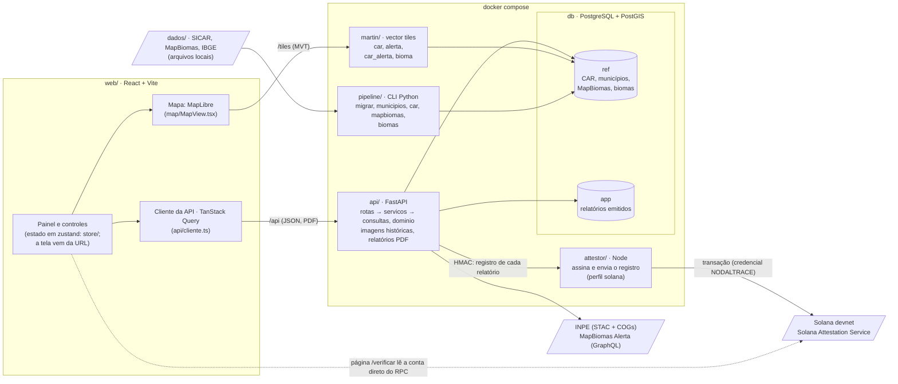

# NodalTrace — conformidade dos imóveis rurais sobre o CAR

Visão de mapa da situação socioambiental de qualquer imóvel rural do Brasil: os imóveis vêm da base real do CAR (SICAR), os alertas de desmatamento do MapBiomas Alerta e os biomas e municípios do IBGE. O operador encontra um imóvel no mapa ou pelo código do CAR, vê a situação dele no SICAR, o critério da EUDR pelos alertas, os biomas e imagens de satélite de antes e depois, e emite um relatório de análise imutável (com PDF) para um ou mais imóveis. Só dados reais: nada é simulado.

> **Branch `demo/hackathon`:** a demo pública do hackathon (https://nodaltrace-demo.up.railway.app), que nunca volta para
> a `dev`. Nela, telas, textos da API e PDF estão em inglês, o mapa é só o RS (com um aviso permanente explicando o
> recorte) e mostra o CAR a partir do zoom 8, o Início explica o que é o CAR e traz imóveis de exemplo, as imagens do INPE estão desligadas e o banco é uma
> amostra real: 25% dos imóveis ativos do RS, sorteados pelo estado.
> Comandos (da raiz, com o projeto do Railway ligado por `railway link`):
>
> - Banco reduzido e dump: `deploy/demo/reduzir.sh` (gera `deploy/demo/nodaltrace_demo.dump`, fora do Git).
> - Contorno e máscara do RS no mapa: `deploy/demo/contorno-rs.sh` (gera `web/src/map/rs.json`).
> - Subir um serviço depois de mudar o código: `railway up --service <db|martin|api|gateway> --detach`; o attestor,
>   `railway up attestor --path-as-root --service attestor --detach`.
> - Mapa de satélite: `railway variable set VITE_MAPBOX_TOKEN=pk.… --service gateway` (token restrito ao endereço da demo).
> - Custo e saúde: `railway usage`, `railway metrics --all`, `railway logs --service <nome>`.
> - Derrubar depois do hackathon: `railway delete` (projeto `nodaltrace-demo`) e trocar a chave do atestador.

> **Equipe:** para subir o app na sua máquina, siga [Como rodar](#como-rodar). Antes de mexer no código, leia [Configuração](#configuração), [Testes](#testes) e [Desenvolvimento](#desenvolvimento). Se algo não subir, veja [Problemas comuns](#problemas-comuns). Para publicar na nuvem, [Nuvem (Google Cloud)](#nuvem-google-cloud). Tudo sobre os dados (de onde vêm, como chegam ao banco, cada tabela, local × nuvem e as pegadinhas): [DATA_DOCUMENTATION.md](DATA_DOCUMENTATION.md).

## Sumário

- **Usar, configurar e desenvolver:** [Arquitetura](#arquitetura) · [Como rodar](#como-rodar) · [Configuração](#configuração) · [Testes](#testes) · [Desenvolvimento](#desenvolvimento) · [Problemas comuns](#problemas-comuns) · [Nuvem (Google Cloud)](#nuvem-google-cloud)
- **Por dentro:** [Diagramas (UML)](#diagramas-uml) · [Pipeline](#pipeline)
- **O produto:** [Interface](#interface) · [Imagens históricas](#imagens-históricas) · [Regras de conformidade](#regras-de-conformidade) · [RenovaBio](#renovabio) · [Registro na Solana](#registro-na-solana) · [Atestação na Solana (devnet)](#atestação-na-solana-devnet) · [Dados](#dados) · [Marca](#marca)

## Arquitetura

| Pasta | O que é |
|---|---|
| `web/` | Frontend (React, MapLibre, TanStack Query). Só exibe: todo cálculo e toda regra vêm da API. |
| `api/` | API em Python (FastAPI), em camadas: `rotas/` (só HTTP), `servicos/` (orquestração, fontes externas, PDF), `consultas/` (todo o SQL), `dominio/` (regras puras) e `modelos/` (as respostas, em Pydantic e snake_case, de onde saem os tipos do frontend); testes (pytest) |
| `pipeline/` | Ingestão das bases externas: CAR de todos os estados, municípios do IBGE, MapBiomas Alerta, biomas do IBGE |
| `db/` | Migrações SQL do PostGIS e `db/nt_db`, a conexão e a pasta das migrações para a pipeline |
| `martin/` | Configuração do servidor de vector tiles |
| `attestor/` | Serviço que assina e envia à Solana (devnet) o registro de cada relatório, com os cofres de chaves (ver [attestor/README.md](attestor/README.md) e [Registro na Solana](#registro-na-solana)) |
| `deploy/` | Implantação no Google Cloud (ver [Nuvem](#nuvem-google-cloud)), com o `kms-exec`, que decifra os segredos da atestação |
| `tests/` | Teste de paridade das regras copiadas entre a API e o banco (roda no host) e a amostra de dados reais do banco de testes (`tests/dados/`, montada por `tests/preparar_banco_teste.sh`) |
| `dados/` | Bases brutas baixadas, fora do Git (ver [dados/README.md](dados/README.md)) |
| `docs/` | Contrato do registro na Solana, vetores de teste e o verificador independente (`atestacao/`) |

O banco tem estes schemas:

- **`ref`**: os dados reais. CAR versionado por carga (histórico: uma linha nova só quando o imóvel muda), particionado por UF, com a ficha da versão que vale de cada imóvel já calculada na carga (`car_resumo`: situação, área, biomas, resumo dos alertas); municípios; alertas do MapBiomas (`camada` + `feicao_ambiental`) e o cruzamento alerta × imóvel (`car_alerta`), calculado sobre a versão carregada do CAR; biomas. Os embargos do IBAMA usam a mesma estrutura, ainda sem carga.
- **`app`**: o que o próprio app grava: os relatórios de análise emitidos (`app.relatorio`, só INSERT), numerados numa série por banco (`app.serie`), e o registro de cada um na Solana (`app.ancoragem`).

O navegador nunca recebe a base do CAR inteira: o Martin serve vector tiles direto do PostGIS (imóveis a partir do zoom 10; com o mapa mais afastado o CAR não aparece), e o mapa baixa só o recorte visível.

## Como rodar

Esta seção é o ambiente local, na sua máquina. Para a versão na nuvem, ver [Nuvem (Google Cloud)](#nuvem-google-cloud).

### Requisitos

O mesmo `./run.sh` roda igual no Linux, no macOS (Intel ou Apple Silicon) e no Windows pelo WSL 2 (ver [Windows](#windows-wsl-2)). As imagens do Compose têm versão fixa e existem em amd64 e arm64: ninguém roda emulado nem com versão diferente. `./run.sh diagnostico` confere tudo abaixo sem mudar nada.

- Docker com o plugin `docker compose` (Docker Desktop no Mac e no Windows; Docker Engine no Linux). O PostGIS do Compose está ajustado para 16 GB de RAM; com menos de 7 GB no Docker, o `./run.sh` reduz a memória do Postgres sozinho (ver [Configuração](#configuração)).
- Node 22.12+ (o `.nvmrc` diz a versão: `nvm install`). O frontend aceita também a linha 20 a partir da 20.19 (o Vite 8 pede `^20.19.0 || >=22.12.0`), mas o `attestor` pede 22.12+.
- Python 3 no host, só para o teste de paridade (`./run.sh test`). O resto do Python roda nos contêineres.
- Disco para as bases: com os 14 estados, o banco passa de 14 GB (9,5 GB só do CAR, com os índices); só com o RS, cerca de 3 GB. Some os arquivos brutos, enquanto estiverem em `dados/`.
- Opcional: um token público do Mapbox (`pk.…`) para a imagem de satélite. Sem ele, o mapa abre só no estilo neutro.

### Primeira vez

```bash
git clone https://github.com/nodaltrace/nodaltrace-demo.git
cd nodaltrace-demo
cp web/.env.example web/.env.local   # opcional: VITE_MAPBOX_TOKEN=pk.… para a imagem de satélite
# Baixe as bases para dados/ conforme dados/README.md (o CAR das UFs que interessam, o MapBiomas Alerta e os biomas).
./run.sh                             # confere a máquina, sobe tudo, aplica as migrações, carrega dados/ e abre o frontend
```

As bases não vêm no repositório. A equipe guarda as que usa no Drive do Google dela e no bucket da nuvem; também dá para baixá-las do SICAR, do MapBiomas e do IBGE (ver [dados/README.md](dados/README.md)). **A estrutura de pastas tem de ser exatamente a de `dados/README.md`**: um arquivo no lugar errado é pulado só com um aviso "Pulando…" (cópias antigas têm o CAR direto em `dados/AREA_IMOVEL/`, sem a pasta da UF). Como o dado chega ao banco e onde um clone novo costuma tropeçar: [DATA_DOCUMENTATION.md, seção 0](DATA_DOCUMENTATION.md#0-comece-aqui-onde-o-dado-mora-e-como-chega-ao-app).

A primeira execução demora: constrói as imagens (alguns minutos) e carrega as bases (com os 14 estados, cerca de 3 min de CAR e 11 min de MapBiomas; só com o RS, bem menos). Para conferir que subiu:

- `./run.sh status` mostra `db`, `martin` e `api` no ar;
- http://localhost:8000/saude responde `"status": "ok"` e lista as cargas do CAR por UF;
- http://localhost:5173 abre o mapa.

Ainda não há login: as contas de usuário entram numa etapa seguinte. Sem nenhuma base em `dados/`, o app sobe com o mapa sem imóveis; o que cada parte do app precisa está em [dados/README.md](dados/README.md).

Antes de subir, o `./run.sh` faz o diagnóstico e para se algo impede a subida (Docker parado, Node antigo, porta ocupada), dizendo como resolver no seu sistema; no Mac, ele mesmo abre o Docker Desktop. No fim, mostra as bases carregadas e o que falta.

### Windows (WSL 2)

No Windows, o projeto roda dentro do WSL 2, que é um Linux: o `run.sh` e os contêineres são os mesmos do Linux, sem script à parte.

1. Instale o WSL 2 com o Ubuntu (`wsl --install` num PowerShell de administrador) e o [Docker Desktop](https://docs.docker.com/desktop/setup/install/windows-install/), com **Settings → Resources → WSL integration** ligado para o Ubuntu.
2. No terminal do Ubuntu, instale o Node 22 (pelo [nvm](https://github.com/nvm-sh/nvm): `nvm install 22`) e siga a [Primeira vez](#primeira-vez) **dentro do WSL** (ex.: `~/nodaltrace-app`), não em `/mnt/c/...`: no disco do Windows o Docker fica lento e a API e o frontend não recarregam sozinhos (o `run.sh` avisa).
3. Abra http://localhost:5173 no navegador do Windows.

O `.gitattributes` mantém os finais de linha LF em qualquer sistema; sem ele, o Git do Windows trocaria por CRLF e o `run.sh` falharia com `$'\r': command not found`. No Git Bash, o `run.sh` recusa rodar e aponta para o WSL.

Bases num disco externo: no Mac, `DADOS_DIR="/Volumes/Nome do Disco/dados"` no `.env`; no Linux, o ponto de montagem (`/media/...`); no WSL, `/mnt/d/dados` (ler as bases de lá só deixa a carga mais lenta).

### Dia a dia

Nas vezes seguintes, `./run.sh infra` e `./run.sh web` bastam: o banco fica no volume `pgdata` e as cargas não se repetem (o `./run.sh` sozinho reimporta o CAR a cada execução enquanto os arquivos estiverem em `dados/`, o que leva minutos por estado sem mudar nada). Os recortes das imagens históricas do INPE ficam no volume `imagens` (`NT_IMAGENS_DIR=/imagens` na API): cada um é baixado uma vez só.

Depois de um `git pull` (ou de trocar de branch), confira o que mudou:

| Mudou | Rode |
|---|---|
| `db/*.sql` | `./run.sh migrar` (sem migração nova, só diz "migrações em dia") |
| `web/package.json` ou `web/package-lock.json` | Nada: o `./run.sh web` roda `npm ci` sozinho quando o `package-lock.json` muda |
| `api/Dockerfile` | `./run.sh infra` (reconstrói a imagem da API) |
| `pipeline/Dockerfile` | `docker compose build pipeline`. O `run --rm` não reconstrói sozinho |
| `martin/martin.yaml` | `docker compose up -d --force-recreate --no-deps martin` |

### Atalho: `run.sh`

O script `run.sh` faz todos os passos abaixo na ordem certa:

```bash
./run.sh            # infra + migrações + ingestão externa + frontend
```

Antes de abrir o frontend, se a atestação na Solana estiver desligada, o `./run.sh` pergunta se você quer ligá-la
(Enter pula). O "s" roda o `./run.sh solana`, e um erro ou um Ctrl+C dentro dele não impede o frontend de subir.

| Comando | O que faz |
|---|---|
| `./run.sh diagnostico` | Confere a máquina sem mudar nada: Docker (rodando, permissão, memória), Node, portas, disco, a pasta das bases e, com o banco no ar, o que está carregado. O `./run.sh` sozinho roda este passo antes de subir |
| `./run.sh infra` | Cria o `.env` (se faltar) e sobe PostGIS, Martin e API, reconstruindo as imagens que mudaram |
| `./run.sh migrar` | Aplica as migrações de `db/` e reinicia o Martin |
| `./run.sh dados` | Roda as cargas do pipeline: o CAR de todos os estados em `dados/AREA_IMOVEL/<UF>/` num comando só, em paralelo (com os municípios do IBGE que faltarem), depois o MapBiomas Alerta e os biomas do IBGE; pula as que não têm arquivo e avisa |
| `./run.sh web` | Confere o Node, `npm ci` (na primeira vez e quando o `package-lock.json` muda: as mesmas versões em toda máquina) e `npm run dev` em http://localhost:5173 |
| `./run.sh test` | Paridade entre a API e o banco (`tests/`), depois recria o banco de testes `nodaltrace_teste` com a amostra de `tests/dados/` e roda os testes da pipeline e da API nele. Não roda os do frontend nem os do attestor: ver [Testes](#testes) |
| `./run.sh tipos` | Regera `web/src/api/contrato.ts`, os tipos das respostas da API para o frontend, depois de mudar um modelo em `api/nodaltrace/modelos/` (a CI falha se o arquivo não estiver em dia) |
| `./run.sh deps` | Regera as travas das dependências Python (`api/requirements*.txt` e `pipeline/requirements.txt`, com hash) depois de mudar `api/pyproject.toml` ou `pipeline/requirements.in`; `--atualizar` sobe tudo até o limite das faixas |
| `./run.sh psql` | Abre o `psql` no banco |
| `./run.sh status` / `logs` / `down` | Containers, logs e parada (mantém os dados) |
| `./run.sh limpar` | Volta ao banco recém-migrado: apaga CAR, municípios, MapBiomas, biomas e os relatórios emitidos (que recomeçam numa série nova: os números da antiga podem já estar na Solana), mantendo containers, migrações e os arquivos de `dados/` (pede confirmação; `--sim` pula). Depois, `./run.sh dados` refaz as cargas |
| `./run.sh reset` | Para os containers e **apaga os volumes**: o banco (`pgdata`) e os recortes das imagens históricas (`imagens`). Pede confirmação |
| `./run.sh help` | Lista os comandos e as variáveis do script |

O `./run.sh solana` e os comandos `solana-*` estão em [Atestação na Solana (devnet)](#atestação-na-solana-devnet).

Os arquivos do SICAR e do MapBiomas não vêm no repositório. Sem eles, o `dados` pula as cargas correspondentes. Os estados e os caminhos mudam por variáveis de ambiente, por exemplo `UFS="RS SC" CAR_PUBLICADO_EM=2026-10-01 PARALELO=2 ./run.sh dados` (ver [Configuração](#configuração)).

### Passo a passo manual

```bash
cp .env.example .env                       # DADOS_DIR=./dados: ver dados/README.md para os arquivos esperados
docker compose up -d                        # PostGIS, Martin e API
docker compose run --rm pipeline migrar
docker compose run --rm pipeline car       # todos os estados de dados/AREA_IMOVEL/<UF>/ (ou --uf RS SC); a data sai do arquivo
docker compose run --rm pipeline mapbiomas --alertas /dados/alerts_with_intersections/alerts_with_intersections.shp
docker compose run --rm pipeline biomas --arquivo /dados/BIOMAS/lml_bioma_e250k_v20250911_A.shp
docker compose up -d --force-recreate --no-deps martin   # o Martin só vê as funções de tile que existiam quando subiu
cp web/.env.example web/.env.local          # token público do Mapbox (pk.…) para a imagem de satélite
cd web && npm install && npm run dev        # http://localhost:5173
```

Sem a API no ar, o app mostra uma tela explicando como subir o ambiente. Sem `VITE_MAPBOX_TOKEN` em `web/.env.local`, o mapa abre só no estilo neutro.

### Portas e acesso ao banco

Todas ficam só em `127.0.0.1`.

| Serviço | Endereço |
|---|---|
| Frontend | http://localhost:5173 (o Vite repassa `/api` para a API e `/tiles` para o Martin) |
| API | http://localhost:8000 (documentação interativa em `/docs`, estado em `/saude`) |
| Martin (tiles) | http://localhost:3000 |
| PostgreSQL/PostGIS | `127.0.0.1:5433`, banco, usuário e senha `nodaltrace` (a senha vem de `POSTGRES_PASSWORD` no `.env`) |

Para abrir o banco: `./run.sh psql`, ou conecte pgAdmin, DBeaver ou QGIS usando os dados da tabela. Para parar sem perder dados: `./run.sh down` (ou `docker compose down`, sem `-v`).

## Configuração

Nenhum arquivo de configuração local vai para o Git: `.env` e `web/.env.local` são de cada máquina, e os modelos versionados são `.env.example` e `web/.env.example`.

### `.env` (raiz)

Lido pelo Compose. O `./run.sh infra` o cria a partir do `.env.example` se faltar. Só para o ambiente local.

| Variável | Padrão | Para quê |
|---|---|---|
| `POSTGRES_PASSWORD` | `nodaltrace` | Senha do banco. Vale só quando o volume `pgdata` é criado (ver abaixo) |
| `DADOS_DIR` | `./dados` | Pasta das bases brutas, montada em `/dados` no pipeline. Pode apontar para outro disco; com espaço no nome, use aspas |
| `PG_SHARED_BUFFERS`, `PG_EFFECTIVE_CACHE_SIZE`, `PG_MAINTENANCE_WORK_MEM` | `3GB`, `8GB`, `1GB` | Memória do Postgres. O `./run.sh infra` grava valores proporcionais aqui quando o Docker tem menos de 7 GB (comum no Docker Desktop do Mac e do Windows). Depois de dar mais memória ao Docker, apague as linhas e rode `./run.sh infra` |
| `NT_SOLANA_RPC` | `https://api.devnet.solana.com` | RPC da devnet usado pela API e pelo `attestor`. O público tem limite de taxa |
| `NT_SOLANA_CLUSTER` | `devnet` | Rede do registro dos relatórios. Só a devnet é usada no app |
| `NT_SALDO_MINIMO_LAMPORTS` | `50000000` (0,05 SOL) | Abaixo desse saldo do `atestador`, o `attestor` recusa registrar (o relatório fica pendente e é tentado de novo) |
| `NT_URL_PUBLICA` | `http://localhost:5173` | Endereço público do app: o PDF do relatório leva a página de verificação (`<NT_URL_PUBLICA>/verificar/<id>`), também num QR code |

Segredos do registro (senhas dos cofres, segredo HMAC) **nunca** entram no `.env`: o `./run.sh solana-up` os pede ou gera a cada subida.

Depois de editar o `.env`:

- `DADOS_DIR` vale no próximo `docker compose run`;
- `NT_SOLANA_*` e `NT_SALDO_MINIMO_LAMPORTS`: rode `./run.sh solana-up`. Um `docker compose up -d` direto recriaria a API sem o segredo do attestor e desligaria o registro: os relatórios novos ficariam pendentes até o próximo `./run.sh solana-up` (o `./run.sh` e o `./run.sh infra` reaproveitam o segredo do attestor no ar);
- `POSTGRES_PASSWORD` num banco que já existe: não troque. API e Martin passariam a usar a senha nova, o banco continuaria com a antiga e a conexão falharia.

### `web/.env.local`

O Vite reinicia sozinho quando o arquivo muda ("changed, restarting server"); se não pegar, pare e rode `npm run dev` de novo.

| Variável | Padrão | Para quê |
|---|---|---|
| `VITE_MAPBOX_TOKEN` | vazio | Token público do Mapbox (`pk.…`). Com ele, o mapa abre na imagem de satélite. Se o token for restrito por URL no painel do Mapbox, libere `http://localhost:5173` |
| `VITE_SOLANA_RPC` | devnet pública | RPC que a página de verificação lê direto do navegador |
| `VITE_NT_AUTORIDADE` | vazio | Endereço público da autoridade da credencial `NODALTRACE` (o `solana-setup` imprime). Vazio, a verificação usa a autoridade que a API informa, com um aviso |

Na nuvem, o token vem do `web/.env.local` de quem roda `deploy/gcp.sh imagens` (ver [Nuvem](#nuvem-google-cloud)).

### Variáveis do `run.sh`

Valem só para o comando em que aparecem, por exemplo `UFS="RS SC" ./run.sh dados`.

| Variável | Padrão | Para quê |
|---|---|---|
| `UFS` | toda pasta em `dados/AREA_IMOVEL/<UF>/` | Estados do CAR a carregar |
| `PARALELO` | `4` | Estados do CAR carregados ao mesmo tempo |
| `CAR_PUBLICADO_EM` | — | Data de publicação (ou de download) dos arquivos do CAR no SICAR (`AAAA-MM-DD`); sem ela, cada carga vale pela atualização mais recente de um imóvel no arquivo (ver [Pipeline](#pipeline)) |
| `MAPBIOMAS_PUBLICADO_EM` | — | Idem, do arquivo do MapBiomas; sem ela, vale a detecção mais recente do arquivo |
| `ALERTAS_ARQUIVO` | `/dados/alerts_with_intersections/alerts_with_intersections.shp` | Shapefile dos alertas do MapBiomas |
| `BIOMAS_ARQUIVO` | `/dados/BIOMAS/lml_bioma_e250k_v20250911_A.shp` | Shapefile dos biomas do IBGE |

### Fixo no Compose

- **Imagens históricas:** a API recebe `NT_IMAGENS_DIR=/imagens` (volume `imagens`). Sem a variável, ela recortaria a imagem do INPE a cada pedido.
- **Memória do PostGIS:** `docker-compose.yml` sobe o Postgres com `shared_buffers=3GB`, `effective_cache_size=8GB` e `maintenance_work_mem=1GB`, pensando nas cargas de milhões de polígonos numa máquina de 16 GB. Os três vêm das variáveis `PG_*` do `.env` (ver acima), que o `./run.sh` ajusta quando o Docker tem pouca memória.
- **Imagens:** todas com versão fixa e em amd64 e arm64. O PostGIS é a `imresamu/postgis:17-3.5.2-bullseye` (o mesmo PostgreSQL 17.5, PostGIS 3.5.2 e Debian 11 da `postgis/postgis:17-3.5`, que só tem amd64 e rodava emulada no Mac com Apple Silicon); um banco criado com a antiga abre nela sem migração. Martin e GDAL na mesma versão da nuvem (`deploy/`).
- **Caches do Python:** os contêineres Python rodam como root com o código montado; `PYTHONDONTWRITEBYTECODE` e `PYTEST_ADDOPTS=-p no:cacheprovider` evitam que gravem `__pycache__` e `.pytest_cache` no repositório (no Linux, ficariam do root).

## Testes

| Suíte | Comando | Precisa de |
|---|---|---|
| Paridade entre a API e o banco | `python3 -m unittest discover -s tests` | Só o Python 3 do host |
| API (pytest) | `docker compose exec api pytest` | API no ar e o banco de testes montado (`./run.sh test` ou `./tests/preparar_banco_teste.sh`) |
| Frontend (Vitest) | `cd web && npm test` | `npm install` feito |
| Tipos do frontend | `cd web && npm run typecheck` | Idem (`npm run build` também checa os tipos, antes do build) |
| Pipeline | `docker compose run --rm --entrypoint python3 pipeline -m unittest discover -s tests` | Só o Docker. Os de integração (`test_carga_integracao.py`) só rodam no banco de testes, com `NT_BANCO_TESTE=1`, como no `./run.sh test` |
| Attestor | `cd attestor && npm install && npm test && npm run typecheck` | Node 22.12+ |
| Attestor, integração | `cd attestor && npm run test:integracao` | Rede: o Surfpool clona o SAS da devnet. Sem rede, pula |
| Registro de verdade na devnet | ver [Atestação na Solana (devnet)](#atestação-na-solana-devnet) | `./run.sh solana-up` e saldo: emita um relatório e confira em `/verificar/<id>` |

- **`./run.sh test`** roda paridade, monta o banco de testes e roda pipeline e API nele. Roda todas mesmo que uma falhe, e o código de saída diz se alguma falhou. Os testes do frontend e do attestor ficam de fora.
- **Banco de testes:** `tests/preparar_banco_teste.sh` apaga e recria o banco `nodaltrace_teste` (uns 7 s) pelos mesmos comandos da pipeline, com a amostra de dados reais de `tests/dados/`: 13 imóveis do RS em duas cargas do CAR (uma remoção, uma mudança de situação), 7 alertas do MapBiomas, os biomas recortados e 3 municípios. `tests/dados/casos.json` dá o código do imóvel de cada caso (pendente, suspenso, cancelado, alerta grande e pequeno depois do corte, alerta entre os cortes do RenovaBio e da EUDR…), as datas das cargas e o que elas deixam no banco; `tests/dados/extrair.sh` regera a amostra a partir do banco de desenvolvimento. O banco de desenvolvimento não é tocado.
- **Os testes da API rodam sempre no banco de testes:** `api/tests/conftest.py` troca o banco da `DATABASE_URL` por `nodaltrace_teste` e para com uma mensagem se ele não existir. Usam os imóveis de `casos.json`, sem "um imóvel qualquer" nem pulo por falta de dado. Os relatórios que criam ficam no banco de testes (a tabela só aceita INSERT; o banco é refeito a cada rodada) e nunca vão para a rede: o `./run.sh test` roda o pytest sem o attestor, e a API não registra relatórios de um banco `*_teste`. O envio é testado contra um attestor local que segue o contrato (`api/tests/test_ancoragem.py`).
- **CI:** o GitHub Actions (`.github/workflows/testes.yml`) roda a cada push: frontend (testes, tipos e build), attestor e backend (`./run.sh test` e a conferência de que `web/src/api/contrato.ts` está em dia com os modelos da API). Não precisa de `.env` nem de segredos.
- **Antes de cada commit**, rode pelo menos `./run.sh test` (ou, com o banco de testes montado, `docker compose exec api pytest`) e `cd web && npm test && npm run typecheck`. Mudou um modelo de resposta: `./run.sh tipos`. Mexeu numa regra copiada entre a API e o banco ou no attestor: rode também a suíte deles.
- **Tempo:** montar o banco de testes leva uns 7 s; as suítes da API e da pipeline, poucos segundos cada; as do frontend, também. Cada `docker compose run --rm` cria um contêiner novo, o que soma alguns segundos.
- **Um arquivo ou um teste só:**

  ```bash
  docker compose exec api pytest tests/test_imagens.py -x -k <parte-do-nome>
  cd web && npx vitest run src/map/escalaVista.test.ts
  cd web && npx vitest                          # modo watch, refaz ao salvar
  ```

- **No navegador:** http://localhost:8000/docs chama qualquer endpoint da API.

## Desenvolvimento

### Fluxo de trabalho

- **Commits** em [Conventional Commits](https://www.conventionalcommits.org/pt-br/v1.0.0/), em português: `tipo(escopo): descrição`, por exemplo `feat(web): comparação antes/depois das imagens no mapa` ou `fix(deploy): …`. Um commit por mudança lógica, cada um deixando o sistema funcionando.
- **Idioma:** textos da interface, comentários e documentação em português, no estilo do código vizinho.
- **Documentação:** mudou algo que aparece na tela, um comando ou uma variável? Atualize este README na mesma branch.

### O que recarrega sozinho

O código de `api/`, `pipeline/` e `db/` é montado nos contêineres: editar não exige reconstruir imagem.

| Pasta | Ao salvar | Quando é preciso mais |
|---|---|---|
| `web/` | O Vite atualiza o navegador; com `web/.env.local`, ele mesmo reinicia | Dependência nova: `npm install` |
| `api/` | O uvicorn (`--reload`) reinicia a API | Dependência nova: acrescente a faixa em `api/pyproject.toml`, rode `./run.sh deps` (as imagens instalam só as travas com hash) e `docker compose up -d --build api` |
| `pipeline/` | O próximo `docker compose run --rm pipeline …` já usa o código novo | Dependência nova: `pipeline/requirements.in`, `./run.sh deps` e `docker compose build pipeline` |
| `db/` | — | Migração nova: `./run.sh migrar` |
| `martin/` | — | `docker compose up -d --force-recreate --no-deps martin` |
| `attestor/` | — | `./run.sh solana-up` reconstrói a imagem e sobe de novo |

As imagens têm um par em `deploy/` para a nuvem, que copia o código em vez de montá-lo; o ambiente local não usa esses arquivos.

### Onde mexer

- **Princípio:** o frontend só exibe; status, critérios, rótulos e análises são calculados na API. Regra nova entra na API e chega ao web pelo JSON (até a tabela que pinta os imóveis no mapa vem de `GET /analises/regras`).
- **Regra de conformidade:** `api/nodaltrace/dominio/conformidade.py` (puro, sem banco), a única cópia de cada regra; endpoints, catálogo de análises e relatórios a usam (ver [Regras de conformidade](#regras-de-conformidade)).
- **Endpoint novo** (a mesma forma em todos):
  - a rota em `api/nodaltrace/rotas/` (registrada em `main.py`): só HTTP, abre a conexão (`with pool.connection() as con:`), chama uma consulta ou um serviço e devolve dados simples, com `response_model=` apontando o modelo;
  - o modelo da resposta em `api/nodaltrace/modelos/` (herda de `Modelo`, campos em snake_case, a docstring de cada campo logo abaixo dele, que vira comentário no frontend);
  - o SQL em `api/nodaltrace/consultas/`, uma função por pergunta, que recebe a conexão; nenhuma consulta se repete em outro módulo, e todo SQL qualifica o schema (`ref.` ou `app.`);
  - a orquestração (várias consultas, regras, fontes externas) em `api/nodaltrace/servicos/` e o cálculo puro em `api/nodaltrace/dominio/`;
  - erros com as classes de `api/nodaltrace/erros.py` (404, 422, 409, 502), nunca `HTTPException` fora das rotas; consulta que passa de 15 s é cancelada e vira 503;
  - no frontend, `./run.sh tipos` regera `web/src/api/contrato.ts`, `web/src/api/tipos.ts` dá o nome que o app usa e o hook do TanStack Query vai em `web/src/api/hooks.ts`.
- **Migração nova:** `db/NNN_nome.sql` com o próximo número. Cada arquivo roda uma vez só (registro em `public.migracao`), numa transação: não edite uma migração já aplicada, crie outra. Função de tile nova se registra em `martin/martin.yaml`. Na nuvem, `deploy/gcp.sh migrar`.
- **Análise nova:** registre-a em `ANALISES` (`api/nodaltrace/servicos/catalogo.py`), com as bases que ela usa (`fontes`, para o quadro de datas do relatório) e os `fatos` de cada resultado (a evidência em dados); o que mais de uma análise consulta fica em `Selecao`. Mudou um parâmetro ou a lógica de uma decisão: versão nova das regras (`VERSAO_REGRAS` e `api/nodaltrace/regras/versoes.json`; ver [Registro na Solana](#registro-na-solana)). Regra por bioma: `REGRAS_BIOMA` em `api/nodaltrace/dominio/conformidade.py`. RenovaBio: `api/nodaltrace/regras/renovabio.yaml` e `api/nodaltrace/dominio/renovabio.py` (ver [RenovaBio](#renovabio)).
- **Regras copiadas entre a API e o banco:** o corte da EUDR está em `dominio/conformidade.py`, nas funções de tile `ref.alerta_tiles` e `ref.car_alerta_tiles` (o `pos_corte` que o mapa pinta) e no resumo dos alertas da ficha de cada imóvel (`ref.resumir_alertas`). Mudou um, mude os outros (no banco, por migração nova) e rode a paridade (`python3 -m unittest discover -s tests`).
- **Frontend:** mapa em `web/src/map/` (`MapView.tsx` e as camadas); painel em `web/src/panel/`; cliente da API em `web/src/api/`; página de verificação dos relatórios em `web/src/verificar/`, com a leitura do documento e da rede em `web/src/atestacao/`. O estado (zustand) fica em `web/src/store/`, uma parte por assunto:
  - `rota.ts` e `caminhos.ts`: a tela do painel, que vem da URL (`/`, `/imovel/<código>`, `/selecao`, `/selecao/analises`, `/relatorio/<número>`); `navegar()` empilha no histórico do navegador e o voltar do painel é o dele. Tela nova ganha um caso em `Rota` e um caminho;
  - `mapa.ts`: camadas, mapa-base, ajustes, câmera e a comparação de imagens;
  - `selecao.ts`: a lista da seleção para análise e a correção em curso (guardadas no navegador);
  - `painel.ts`: painel aberto e seções abertas;
  - `acoes.ts`: as ações que mexem em mais de uma parte (abrir um imóvel, abrir a análise, abrir um relatório).

  O enquadramento do mapa fica no fim da URL (`#zoom/lat/lon`), escrito e lido por `web/src/map/hashMapa.ts`. Destaque de imóvel no mapa é por estado da feição (`setFeatureState`, pelo id que vem nos tiles do CAR), nunca por filtro ou expressão que mude a cada clique: isso faria o MapLibre refazer todos os tiles da fonte.
- **Botão só com ícone:** `BotaoIcone` (`web/src/components/ui.tsx`), com o `rotulo`, que é o nome dele para o leitor de tela e a dica que aparece ao passar o mouse ou chegar pelo teclado; outro controle só com ícone usa `useDica`, do mesmo arquivo. Nada de `title` do navegador nesses botões.

### Banco e dados no dia a dia

- `./run.sh psql` abre o banco. Os dados reais ficam em `ref`; os relatórios emitidos, em `app.relatorio`.
- Começar de novo sem rebaixar nada: `./run.sh limpar` apaga as bases carregadas e os relatórios e mantém os arquivos de `dados/` (depois, `./run.sh dados`). `./run.sh reset` apaga os volumes inteiros.

## Problemas comuns

| Sintoma | Causa e solução |
|---|---|
| O app abre numa tela explicando como subir a API | A API não está no ar. Rode `./run.sh infra`; se continuar, veja `docker compose logs api` |
| O Martin reinicia sem parar num banco novo | Normal até as migrações: ele sai por não achar o schema `ref` e tenta de novo. Rode `./run.sh migrar` |
| Imóveis do CAR ou alertas não aparecem no mapa | O CAR aparece a partir do zoom 10 e os alertas a partir do zoom dos ajustes (padrão 6). Se mesmo de perto nada aparece, a base não foi carregada (`./run.sh diagnostico` e http://localhost:8000/saude mostram as cargas do CAR) ou uma função de tile nova está esperando o Martin reiniciar |
| O mapa fica só no estilo neutro | Falta `VITE_MAPBOX_TOKEN` em `web/.env.local` (confira o nome da variável e o `pk.` do token). A foto também só aparece no Brasil, e a comparação de imagens usa sempre o neutro |
| `docker compose exec api pytest` para dizendo que o banco de testes está indisponível, ou falha com erro de tabela ou schema | O banco de testes falta ou ficou para trás de uma migração nova: `./run.sh test` (ou `./tests/preparar_banco_teste.sh`) o recria |
| O Vite avisa "Vite requires Node.js version…" e falha ao iniciar | Node fora de `^20.19.0 || >=22.12.0`: atualize para 22.12+ |
| Porta em uso (5433, 8000 ou 3000) | Outro processo ocupa a porta, que é fixa no `docker-compose.yml` (o `./run.sh diagnostico` aponta qual). Pare-o ou mude a porta num `docker-compose.override.yml` (fora do Git). A 5173 o Vite troca sozinho pela próxima livre, e avisa |
| `failed to connect to the docker API` ou `Cannot connect to the Docker daemon` | O Docker não está rodando. O `./run.sh` abre o Docker Desktop no Mac; no Windows, abra-o e confira a integração com o WSL; no Linux, `sudo systemctl start docker` |
| `permission denied while trying to connect to the Docker daemon socket` (Linux) | Seu usuário não está no grupo `docker`: `sudo usermod -aG docker "$USER"`, saia da sessão e entre de novo |
| `$'\r': command not found` ao rodar o `run.sh` | Clone feito no Windows antes do `.gitattributes`, com finais de linha CRLF. Clone de novo, dentro do WSL |
| O relatório fica em "Registrando na Solana…" | O attestor não está no ar (rode `./run.sh solana`, que faz só o que falta), ou um `docker compose up -d` direto recriou a API sem o segredo dele: rode `./run.sh solana-up`. O erro da última tentativa aparece no relatório; `./run.sh solana-saude` mostra o saldo do `atestador` e se ele é o assinante autorizado. Assim que o attestor volta, os pendentes saem sozinhos, em ordem |
| "A rede recusou o registro" (conflito) | A conta daquele número na série já existe com outro documento: um banco restaurado de um backup antigo reaproveitou números. Comece uma série nova (DATA_DOCUMENTATION, "Pegadinhas") |
| Erros de importação no frontend depois de um `git pull` | Dependências novas: o `./run.sh web` já roda `npm ci` quando o lock muda; rodando o Vite direto, `cd web && npm ci` |
| No Mac ou no Windows o frontend quebra (ex.: "does not provide an export named"), e no Linux não | Dois arquivos cujos nomes só diferem em maiúsculas: no Mac e no Windows o disco não distingue e o import abre o errado. O `web/src/nomes.test.ts` (`npm test`) acusa o par em qualquer sistema; renomeie um deles |
| O Git ou a remoção de um worktree reclama de permissão em `__pycache__` ou `.pytest_cache` (Linux) | Sobras de antes de os contêineres pararem de gravar esses caches (ver [Fixo no Compose](#fixo-no-compose)). Apague uma vez com `sudo find api pipeline \( -name __pycache__ -o -name .pytest_cache \) -prune -exec rm -rf {} +` |
| A comparação de imagens diz "imagem indisponível no INPE" | O INPE está fora do ar ou lento (a API responde 502). Tente mais tarde; ver as limitações em [Imagens históricas](#imagens-históricas) |

## Nuvem (Google Cloud)

A versão na nuvem fica no projeto `<projeto-gcp>`, região `southamerica-east1`, e é publicada para o cliente em https://app.nodaltrace.com. Tudo passa por `deploy/gcp.sh`; `deploy/gcp.sh help` lista os comandos e `deploy/gcp.sh status` mostra o que está ligado.

```
Navegador ─https─> Balanceador (IP fixo, certificado do Google, IAP: login Google + lista de acesso)
                       └─> Cloud Run "nodaltrace" (1 instância, gen2): nginx (frontend, /api, /tiles) + API + Martin + proxy do Cloud SQL
                                                                     + attestor (registro dos relatórios na Solana devnet)
                                ├─> bucket <projeto>-imagens montado em /imagens na API (recortes das imagens históricas)
                                └─> Cloud SQL PostgreSQL 17 + PostGIS ("nodaltrace-db", disco cresce sozinho, backup diário)
Jobs sob demanda (mesma imagem da pipeline): nt-migrar e nt-pipeline (bucket <projeto>-dados em /dados)
```

A API guarda os recortes das imagens do INPE no bucket `<projeto>-imagens`, montado como pasta (Cloud Storage FUSE) só no contêiner da API, com `NT_IMAGENS_DIR=/imagens`; a conta `nt-run` tem `roles/storage.objectUser` só nele. A montagem exige o ambiente de execução **gen2** do Cloud Run, que o `service.yaml` liga. Num projeto que ainda não tem esse bucket, rode `deploy/gcp.sh infra` uma vez (o `servico` recusa publicar sem ele); a primeira revisão gen2 vai por `candidata`, não por `teste` ou `producao`, para conferir antes de dar tráfego.

Os arquivos ficam em `deploy/`: um Dockerfile por imagem (`gateway`, `api`, `martin`, `pipeline`, `attestor` e `kms-exec`), `nginx.conf`, `cloudbuild.yaml` (constrói as imagens) e `service.yaml` (o serviço, preenchido pelo `gcp.sh`). O ambiente local não usa nenhum deles.

### Modos

| | Teste | Produção |
|---|---|---|
| Comando | `deploy/gcp.sh teste` | `deploy/gcp.sh producao` |
| Endereço | http://localhost:8090, por um túnel (`deploy/gcp.sh abrir`) | https://app.nodaltrace.com |
| Quem entra | quem tem papel no projeto e os colegas liberados com `testador`, todos com o `gcloud` logado | as contas Google liberadas com `acesso`, pelo navegador |
| Instância | desliga sem uso; a primeira página demora enquanto ela sobe | sempre ligada |
| Balanceador | desligado (sem custo) | ligado, com IAP |

Os dois modos usam o mesmo banco e as mesmas imagens. Trocar de modo republica o serviço e não mexe nos dados. `teste` desliga só as regras de encaminhamento: IP, certificado e IAP continuam lá para o próximo `producao`.

### Para quem opera

O `deploy/gcp.sh` roda igual no Linux, no macOS e no WSL.

- **Google Cloud CLI** ([instalação](https://cloud.google.com/sdk/docs/install)), logado com `gcloud auth login` numa conta **Proprietário** do projeto. Se o `gcloud` não estiver no `PATH`, o script procura em `~/google-cloud-sdk/bin/` ou usa `GCLOUD=/caminho/do/gcloud`.
- **Só para alguns comandos:**
  - `dump` e `conferir` precisam do Docker com o banco local no ar.
  - `conferir` precisa do `psql`.
  - `servico`, `teste` e `producao` precisam do `python3`.
  - `proxy` baixa o binário do Cloud SQL Proxy do seu sistema (Linux ou macOS, x86-64 ou ARM).
  - `solana` precisa do Docker e dos cofres de `attestor/chaves/` (ver [Atestação na nuvem](#atestação-na-nuvem)).
- **Estado local:** `deploy/.tag` (a última imagem construída) e `deploy/.modo` (`teste` ou `producao`) ficam fora do Git, na máquina de quem rodou. Num clone novo:
  - Rode `deploy/gcp.sh imagens` antes de publicar.
  - Use sempre `teste` ou `producao`, nunca `servico` sozinho. Sem `deploy/.modo`, o `servico` publica no modo de teste e tira a produção do ar.

### Dia a dia

| Tarefa | Comandos |
|---|---|
| Ver o que está ligado | `deploy/gcp.sh status` (banco em `ALWAYS` = ligado, `NEVER` = desligado; certificado `ACTIVE`) |
| Desligar entre demonstrações | `deploy/gcp.sh parar` |
| Religar | `deploy/gcp.sh retomar`, alguns minutos antes de usar |
| Usar no modo de teste | `deploy/gcp.sh abrir` e http://localhost:8090 (`PORTA_APP=8091 deploy/gcp.sh abrir` troca a porta) |
| Publicar código novo | `deploy/gcp.sh imagens`, depois `deploy/gcp.sh teste` ou `deploy/gcp.sh producao` |
| Testar uma revisão antes de dar tráfego a ela (modo de teste) | `deploy/gcp.sh candidata` (sobe com 0% e a tag `candidata`), `deploy/gcp.sh abrir candidata` para conferir, depois `deploy/gcp.sh promover`. Enquanto houver candidata, `migrar` e `parar` recusam rodar |
| Migração nova em `db/` | `deploy/gcp.sh migrar` (roda o job e publica nova revisão, para o Martin ver as funções de tile novas) |
| Carregar mais dados | envie os arquivos para `gs://<projeto-gcp>-dados/` com a estrutura de `dados/`, depois por exemplo `deploy/gcp.sh pipeline car --uf MT` (com `--publicado-em AAAA-MM-DD` se souber a data de publicação no SICAR) |

- **Empresas simuladas no banco da nuvem.** O banco da nuvem veio de um dump de antes da remoção das operações simuladas: os schemas `cadeia_*`/`analise_*` e `public.mock_dataset` continuam lá até o `deploy/gcp.sh migrar` aplicar a `026_sem_operacoes_simuladas.sql`, que os apaga (com os relatórios e as atestações gravados neles) e cria o schema `app`. A imagem nova da API depende do `app.relatorio`, de `ref.car_resumo` (`029`), dos tiles do CAR com id (`030`) e dos relatórios numa série com o registro na rede (`031`): rode o `migrar` antes de publicá-la. A `029` monta a ficha de cada imóvel já carregado; com os 14 estados do dump (6,6 milhões de imóveis), estimativa de uns 10 minutos e 3 GB, dentro da hora do job `nt-migrar`.
- **Mapbox.** O token vem de `web/.env.local` e entra na imagem do frontend no `imagens`. Se o token for restrito por URL no painel do Mapbox, libere `https://app.nodaltrace.com` e `http://localhost:8090`.
- **Custo** (aproximado, preços de São Paulo):
  - Cloud SQL ligado: cerca de US$ 0,20/h (US$ 150/mês).
  - Instância sempre ligada, só na produção: cerca de US$ 140/mês (com o attestor).
  - Balanceador, só na produção: cerca de US$ 20/mês.
  - Parados ficam só o disco, os backups e o IP reservado (cerca de US$ 7/mês), além do armazenamento.
  - O alerta de orçamento está configurado no Faturamento do Console.

### Dar acesso a outras pessoas

| Quem | O que consegue | Liberar | Retirar |
|---|---|---|---|
| Cliente ou convidado | usar https://app.nodaltrace.com (produção) pelo navegador | `deploy/gcp.sh acesso pessoa@cliente.com.br` | `deploy/gcp.sh remover pessoa@cliente.com.br` |
| Colega testando | usar o modo de teste pelo túnel | `deploy/gcp.sh testador colega@gmail.com` | `deploy/gcp.sh remover-testador colega@gmail.com` |
| Operador | rodar `deploy/gcp.sh`: publicar, ligar e desligar, dar acessos | Console → IAM e administrador → IAM → Conceder acesso → papel **Proprietário** | o mesmo, removendo o papel |

`deploy/gcp.sh acessos` lista quem entra na produção. A liberação leva um ou dois minutos para valer.

**Cliente (produção).** O IAP pede login com conta Google antes de qualquer página; o app em si ainda não tem login próprio.

- Gmail e contas Google Workspace funcionam direto.
- Com Google Workspace, `deploy/gcp.sh acesso domain:cliente.com.br` libera o domínio inteiro.
- Com e-mail corporativo da Microsoft ou de outro provedor: a pessoa cria uma conta Google com o próprio e-mail em https://accounts.google.com/signup ("Usar meu endereço de e-mail atual"). Depois, libere esse e-mail com `acesso`.

**Colega (teste).** Recebe só os papéis de ver e chamar o serviço, sem acesso ao resto do projeto. Para entrar:

1. Instala o [Google Cloud CLI](https://cloud.google.com/sdk/docs/install) e roda `gcloud auth login` com o e-mail liberado.
2. Com o repositório, roda `deploy/gcp.sh abrir`. Sem o repositório, roda:
   ```
   gcloud run services proxy nodaltrace --project <projeto-gcp> --region southamerica-east1 --port 8090
   ```
3. Abre http://localhost:8090.

O banco precisa estar ligado, e só um operador consegue rodar `retomar`.

**Operador.** O papel Proprietário dá controle total do projeto, inclusive do faturamento. Conceda só a quem vai operar a nuvem; quem só testa usa `testador`.

### Primeira implantação (do zero)

Já feita neste projeto. Fica registrada para refazer noutro projeto (`PROJETO=<id> deploy/gcp.sh ...`).

0. No Console, crie o projeto, vincule uma conta de faturamento e crie um alerta de orçamento.
1. `deploy/gcp.sh infra` cria:
   - as APIs;
   - o Artifact Registry e os buckets (`-dados`, para a pipeline, e `-imagens`, para os recortes das imagens históricas);
   - as contas de serviço `nt-run` e `nt-build`;
   - o Cloud SQL;
   - os segredos da conexão (`nt-database-url` e `nt-database-url-socket`; a senha só existe no Secret Manager).
2. `deploy/gcp.sh dump`, depois `deploy/gcp.sh importar`. O banco da nuvem vem do local, sem rodar a pipeline. Depois, com `deploy/gcp.sh proxy` aberto em outro terminal, rode `deploy/gcp.sh conferir`: ele compara as linhas tabela a tabela e atualiza as estatísticas.
3. `deploy/gcp.sh imagens`, depois `deploy/gcp.sh teste` e `deploy/gcp.sh abrir`.

### Publicar para o cliente (produção)

1. `deploy/gcp.sh producao`: publica o serviço com a instância sempre ligada e cria o balanceador. No fim, mostra o IP.
2. **Cloudflare:** crie um registro A `app` com esse IP (hoje 136.82.29.11), como **DNS only** (nuvem cinza). Com o proxy do Cloudflare (nuvem laranja), o certificado do Google não é emitido. O certificado fica `ACTIVE` de 15 a 60 min depois que o DNS apontar (`deploy/gcp.sh status`).
3. **Cliente OAuth**, uma vez só. Sem ele, o IAP só aceita contas da organização do projeto. No Console, em Google Auth Platform:
   - **Visão geral → Primeiros passos:** nome do app "NodalTrace", seu e-mail de suporte, público **Externo**.
   - **Público:** "Publicar app" (em produção). Só os escopos básicos, então não há verificação do Google.
   - **Clientes → Criar cliente:**
     - Tipo **Aplicativo da Web**.
     - Depois de criado, adicione o URI de redirecionamento `https://iap.googleapis.com/v1/oauth/clientIds/<CLIENT_ID>:handleRedirect`.
     - Guarde o ID e a chave secreta.

   Depois, `deploy/gcp.sh iap <CLIENT_ID> <CLIENT_SECRET>`. OAuth e IAP não cobram.
4. `deploy/gcp.sh acesso <seu e-mail>`. Teste https://app.nodaltrace.com numa janela anônima e depois libere o cliente (ver [Dar acesso a outras pessoas](#dar-acesso-a-outras-pessoas)).

Para tirar do ar sem perder nada, use `deploy/gcp.sh teste` (desliga o balanceador e a instância fixa) e, se ninguém for usar, `deploy/gcp.sh parar`.

### Atestação na nuvem

O `attestor` é mais um contêiner da instância, e a API o alcança pelo localhost, como no Compose. A rede é só a devnet.
**Ainda não aplicado:** a nuvem roda a versão de 13/10, com o Kora e as quatro chaves; os arquivos de `deploy/` já são os
da versão com duas chaves e sem Kora, e valem na próxima publicação.

**Segredos sem senha guardada.** No Compose, o `./run.sh solana-up` pede a senha do cofre a cada subida. Na nuvem não há quem a digite, e ela não fica guardada em lugar nenhum:

1. `deploy/gcp.sh solana` (num terminal) pede a senha uma vez e abre o cofre do `atestador` nesta máquina, num contêiner sem rede.
2. A chave vai, por pipe, para o **Cloud KMS**, que a cifra. O Secret Manager guarda só o texto cifrado (`nt-solana-atestador`), junto com o segredo HMAC entre API e attestor, cifrado do mesmo jeito.
3. Na subida da instância, o `kms-exec` (`deploy/kms-exec/`) de cada contêiner decifra o que é dele com a conta do serviço (`nt-run`), a única com o papel de decifrar na chave `nodaltrace/segredos` do KMS.

O cofre e a senha da `autoridade` nunca vão para a nuvem: criar a credencial e o schema, e trocar o assinante, continua sendo o `./run.sh solana-setup`, local. As chaves são as mesmas do ambiente local, com a mesma credencial `NODALTRACE`.

Na primeira vez, ou depois de trocar a chave:

```bash
CHAVES_DIR=/caminho/para/attestor/chaves deploy/gcp.sh solana   # padrão: attestor/chaves deste repositório
deploy/gcp.sh migrar                                              # relatórios numa série e o registro na rede (031)
deploy/gcp.sh imagens                                             # leva a autoridade para a página de verificação
deploy/gcp.sh teste                                               # ou producao
```

- `deploy/gcp.sh solana-logs` mostra a subida do attestor (rede, credencial, endereços) e erros do `kms-exec`.
- `deploy/gcp.sh solana-rotacionar` troca o segredo HMAC e republica.
- Sem os segredos `nt-solana-*`, `teste` e `producao` recusam publicar. Se a decifragem falhar na subida, o resto da instância sobe e os relatórios ficam pendentes. O attestor sobe de novo sozinho se cair.
- `NT_URL_PUBLICA` da API (o endereço da página de verificação no PDF) entra no `service.yaml` junto com o domínio público.

**Verificação pública.** O balanceador da produção manda `/verificar` e `/verificar/<id>`, os arquivos estáticos do frontend e `GET /api/verificacao/<id>` para um backend sem IAP (`nt-publico`), para auditores abrirem a página de verificação sem o login do Google. A página só lê: os dados do registro e onde conferir na rede, nada dos imóveis. O resto do app continua atrás do IAP.

## Diagramas (UML)

Duas vistas do estado atual, em Mermaid (o GitHub desenha direto no README). O dicionário das tabelas está no
[DATA_DOCUMENTATION.md](DATA_DOCUMENTATION.md).

### Componentes

Quem fala com quem. O Vite repassa `/api` para a API e `/tiles` para o Martin; a pipeline roda sob demanda (`docker compose run --rm pipeline <comando>`).



### Uma requisição à API

A rota abre a conexão e passa adiante: o serviço junta as consultas (o SQL, com o schema escrito: `ref.` ou `app.`) e as
regras puras de `dominio/`, e a resposta sai pelo modelo Pydantic. Não há estado de sessão nem cache do domínio entre
requisições.

```mermaid
sequenceDiagram
  autonumber
  actor U as Usuário
  participant W as web (TanStack Query)
  participant V as Vite (proxy)
  participant R as rotas/car.py
  participant S as servicos/imoveis.py
  participant Q as consultas/
  participant D as dominio/conformidade.py
  participant DB as PostGIS

  U->>W: clica num imóvel do CAR no mapa
  W->>V: GET /api/car/feicao/{id} (os tiles só levam o id; vem o código)
  W->>V: GET /api/car/RS-4311155-…
  V->>R: GET /car/RS-4311155-…
  R->>S: ficha(con, cod)
  S->>Q: versões, alertas, camada vigente, biomas
  Q->>DB: SQL (ref.car_resumo, ref.car_imovel, ref.car_alerta, ref.camada…)
  DB-->>Q: linhas
  Q-->>S: dicts
  S->>D: situação do CAR, alertas contra o corte da EUDR, pequena propriedade
  D-->>S: status e evidências
  S-->>R: dados
  R-->>W: JSON validado pelo modelo (modelos/car.py)
  Note over W,DB: Tiles não passam pela API: o MapLibre pede /tiles/{fonte}/{z}/{x}/{y} e o Martin lê só ref.*
```

## Pipeline

A pipeline é reservada à ingestão e ao tratamento das bases externas. A conexão e a pasta das migrações ficam em `db/nt_db`, no `PYTHONPATH=/db` do Compose.

Todos os comandos rodam com `docker compose run --rm pipeline <comando>`. Os arquivos ficam em `/dados`, que é a pasta `DADOS_DIR` do `.env` (por padrão `dados/` do repositório, fora do Git; a estrutura esperada está em `dados/README.md`). Na nuvem, os mesmos comandos rodam com `deploy/gcp.sh pipeline <comando>`, lendo o bucket em `/dados`.

| Comando | O que faz | RS |
|---|---|---|
| `migrar` | Aplica as migrações de `db/` | — |
| `municipios --uf RS` | Malha e nomes dos municípios (API do IBGE). O `car` já carrega os das UFs que ainda não os têm. | 497 municípios |
| `car [--uf RS SC …] [--arquivo …] [--paralelo 4] [--publicado-em AAAA-MM-DD]` | Carga do tema Área do Imóvel do SICAR (shapefile, GeoPackage ou o `.zip` baixado, sem descompactar). Sem `--uf`, carrega todos os estados com pasta em `/dados/AREA_IMOVEL/<UF>/` (`ufs-car` lista quais), vários ao mesmo tempo e os maiores primeiro; cada UF tem partição, staging e trava próprias, e a falha de uma não para as outras. Lê todas as partes da pasta numa carga só (`--arquivo` troca as partes, com uma UF). Compara com a versão vigente: grava só o que mudou e fecha as versões substituídas; recarregar o mesmo arquivo não cria versões. Na mesma transação, cruza os imóveis que mudaram com os alertas e refaz a ficha deles em `ref.car_resumo`. Arquivo com dados mais antigos que a última carga da UF é recusado (o histórico ficaria fora de ordem). Polígonos com coordenadas fora de latitude e longitude (um no MA, em UTM declarado em graus) ficam de fora, com o código no log e a contagem em `car_carga.descartados`. | Os 14 estados de `dados/` (6,6 milhões de imóveis, 9,5 GB com índices) em 3 min, 4 em paralelo; recarregar o RS sem mudanças, 40 s |
| `mapbiomas --alertas … [--publicado-em AAAA-MM-DD]` | Alertas do MapBiomas Alerta (Brasil inteiro), cruzados com a última versão de cada imóvel do CAR carregado (`ref.car_alerta`, UF por UF, sem área mínima). Cada carga vira uma camada nova e apaga as anteriores; recarregar o mesmo arquivo não faz nada, e arquivo com alertas mais antigos que os da camada carregada é recusado. Refaz também o resumo dos alertas na ficha de cada imóvel (`ref.car_resumo`). Depois, cada carga do `car` refaz o cruzamento só dos imóveis novos ou alterados. | 528 mil alertas; com os 14 estados de `dados/`, 831 mil pares (12 mil no RS) em 11 min |
| `ufs-car` | Lista as UFs com arquivos do CAR em `/dados/AREA_IMOVEL/<UF>/` | — |
| `limpar` | Apaga as referências carregadas e os relatórios emitidos, voltando ao banco recém-migrado (o que `./run.sh limpar` usa) | — |
| `biomas --arquivo … [--edicao 2025]` | Biomas do IBGE (Biomas e Sistema Costeiro-Marinho do Brasil, 1:250.000). Grava o polígono original e partes simplificadas por faixa de zoom, com as divisas simplificadas uma vez só para os biomas continuarem encaixados. Recarregar o mesmo arquivo não faz nada; um arquivo novo refaz os biomas da ficha de todos os imóveis (`ref.car_resumo`; no RS, cerca de um minuto). | 6 biomas em 40 s |

Para outro estado, baixe o arquivo dele no SICAR para `dados/AREA_IMOVEL/<UF>/` e rode `car` de novo: os estados já carregados só gravam o que mudou.

**Datas das cargas.** Cada base guarda três datas, que nunca são a do relatório:

- **dados até** (`dados_ate`): até onde vão os dados, tirada deles. No SICAR, a atualização mais recente de um imóvel no arquivo (`dat_atuali`); no MapBiomas, o alerta detectado mais recente (`DETECTAT`). Data depois do dia da carga não conta (erro na origem).
- **publicado em** (`publicado_em`): a data de publicação (ou de download) na fonte, quando se sabe: `--publicado-em` na carga (`CAR_PUBLICADO_EM` e `MAPBIOMAS_PUBLICADO_EM` no `run.sh`). Sem ela, fica em branco.
- **carregado em** (`carregado_em`): quando a carga entrou no banco.

A data de referência da carga (o `valido_de`/`valido_ate` das versões do CAR) é a de publicação ou, sem ela, a dos dados; sem nenhuma das duas, a carga recusa. O relatório lista as bases que usou com as três datas, separadas da data de emissão: emitido em 10/10, com o SICAR atualizado até 05/10, por exemplo.

## Interface

O app abre direto no mapa; ainda não há login (as contas de usuário entram numa etapa seguinte). Na nuvem, quem controla
a entrada é o login Google do IAP, antes do app (ver [Dar acesso a outras pessoas](#dar-acesso-a-outras-pessoas)).

- **Painel** (à esquerda, com o trilho): o início mostra como começar, as bases reais carregadas no banco (o CAR de cada UF e a camada do MapBiomas, com até quando vão os dados, a publicação na fonte, se informada, e quando foram carregados) e os relatórios emitidos por último. A busca aceita o código do CAR e abre o imóvel (na análise, inclui o imóvel na seleção). O trilho tem, de cima para baixo, o recolher do painel, uma entrada por seção (Início e Análise, com o número de imóveis da seleção) e, no pé, o tema (escuro, o padrão, ou claro; ver [Marca](#marca)); a borda direita do painel arrasta para mudar a largura (de 320 a 640 px, guardada no navegador; duplo clique volta à padrão, e com o foco nela as setas também mudam); cada botão só com ícone mostra o nome numa dica. Cada tela tem o seu endereço, que dá para recarregar e compartilhar: `/imovel/<código>`, `/selecao`, `/selecao/analises` e `/relatorio/<número>`; o fim da URL guarda o enquadramento do mapa (`#zoom/lat/lon`). "Voltar" e o voltar do navegador percorrem as telas sem mexer na câmera; um link de imóvel ou de relatório sem enquadramento leva o mapa até ele.
- **Mapa** (categorias recolhidas à direita): plano e só com o Brasil. Fora dele (o mar e os vizinhos) o mapa é uma cor lisa, sem fronteiras, vias nem nomes (quase preta no tema escuro e cinza-clara no claro); ele abre com o país inteiro na área visível ao lado do painel, não afasta além disso e não deixa arrastar para longe: a câmera anda até a borda da caixa do Brasil e, aproximada, não se afasta do contorno mais que um terço da tela (`web/src/map/limites.ts`). Mapa-base em imagem de satélite (padrão, Mapbox Satellite com o logo e os créditos que os termos pedem; precisa do token) ou neutro, guardado no navegador. A foto aparece a partir do zoom 5,5; com o país inteiro na tela, o mapa-base é desenhado só com GeoJSON local, sem tiles do OpenFreeMap nem do Mapbox. O recorte do Brasil: com o país inteiro na tela, a união das UFs do IBGE (`web/scripts/geo.mjs` gera `web/src/map/brasil.json` a partir de `web/public/geo/uf.json`); aproximado, essa borda simplificada cortaria terra na costa e nas divisas, então o mar sai dos tiles do OpenFreeMap e os vizinhos, com o token, dos polígonos do próprio Mapbox (Mapbox Countries v1, como na técnica de máscara da documentação do Mapbox; a borda do Brasil sai da mesma geometria), com uma máscara local ~11 km além do contorno onde não há tile do Mapbox; sem o token, a máscara local começa ~3 km além do contorno e a borda é a dos tiles do OpenFreeMap. Para não pagar pelos vizinhos, um protocolo do MapLibre, `nt-mapbox://`, só pede ao Mapbox os tiles da foto e dos países que tocam o contorno do Brasil das UFs; o zoom vai até 17. No painel do mapa ficam também a fonte das imagens históricas dos imóveis (MapBiomas, CBERS-4A ou Sentinel-2, guardada no navegador; ver [Imagens históricas](#imagens-históricas)), os rótulos do mapa-base (só os nomes de lugares do Brasil) e uma chave para cada base de referência (CAR, alertas do MapBiomas, biomas). Em "Ajustes de exibição", a partir de que zoom cada camada aparece e as opacidades (guardados no navegador, com "Restaurar padrões"). "Regras de compliance" e "Legenda de compliance" mostram as regras em vigor e as cores, as duas lidas de `GET /analises/regras`.
- **Exibição:** bases de referência desligadas por padrão; com barra de escala ≥ 500 km, as bases ficam ocultas e desativadas. A regra fica em `AFASTADO` (`web/src/map/escalaVista.ts`), lida pelo painel e pelas camadas. Selecionar um imóvel não move a câmera; use os botões explícitos "Ver imóvel" ou "Ver no mapa" para navegar. O CAR aparece apenas como imóveis ao aproximar, sem agregações por município ou hexágonos. Na análise (seleção e relatório), cada imóvel ganha um ponto com halo e um anel que pulsa, por cima de todas as camadas, até o polígono ficar grande o bastante para achar no meio dos outros (some entre os zooms 11,5 e 12,5); com movimento reduzido no sistema, o anel fica parado.
- **Camadas do CAR:** imóveis coloridos pela situação no SICAR, com a tabela situação → status que a API aplica (`GET /analises/regras`, `situacoes_car`). Os tiles levam só a situação e o id de cada imóvel (o da versão vigente); o código chega da API no clique (`GET /car/feicao/{id}`). O imóvel aberto ganha contorno, desenhado pela geometria da ficha: aparece em qualquer zoom, também com o CAR desligado.
- **Escala, coordenadas e menu do mapa:** no canto inferior direito, num bloco só acima do logo e dos créditos, a escala da vista (zoom, altitude aproximada da câmera, barra e escala numérica 1:N, com uma nota de como os alertas e o CAR estão aparecendo naquele zoom) e a latitude e longitude do cursor (em tela estreita, só a escala). O botão direito abre o menu do ponto: copiar as coordenadas e, sobre um imóvel do CAR, abri-lo.
- **Alertas do MapBiomas:** ocultos com o mapa afastado. A partir do zoom escolhido nos ajustes (padrão 5; o servidor de tiles entrega alertas do zoom 5 em diante, `martin/martin.yaml`), aparece o polígono de cada alerta: depois do corte em terracota; antes, em cinza. Abaixo do zoom 10, o alerta menor que um pixel de tela aparece como uma bolinha da mesma cor (`ref.alerta_tiles` o manda como ponto). Com os imóveis do CAR visíveis, a parte de cada alerta dentro de um imóvel aparece destacada e abre o imóvel ao clicar.
- **Imóvel:** clique num polígono ou busque o código do CAR para ver os dados do SICAR, a situação como critério, o critério EUDR pelos alertas do MapBiomas, os biomas e o histórico de versões, todos calculados pela API. "Comparar imagens" abre duas imagens do imóvel lado a lado no mapa (ver [Imagens históricas](#imagens-históricas)).
- **Seleção para análise:** a Análise, no trilho à esquerda, liga os imóveis do CAR e faz o clique no mapa incluir ou retirar imóveis (também pela busca do código); até 200 imóveis, numa lista guardada no navegador. Os selecionados ficam em azul no mapa (com o mapa afastado, um ponto dentro de cada um). "Enviar seleção" abre o catálogo de análises, todas marcadas; as que dependem de base não carregada (embargos) aparecem desligadas. O resultado sai por imóvel e por análise, com os imóveis na cor do resultado no mapa; "Prova deste imóvel" (em cada imóvel) baixa a prova parcial dele e "Gerar documento oficial (PDF)" o PDF; voltar dele leva à lista de imóveis. Num relatório aberto, o clique no mapa abre o imóvel. O relatório mostra a data de emissão e, separadas dela, as bases usadas com as datas dos dados (ver [Pipeline](#pipeline), "Datas das cargas"), no app e no quadro "Bases de dados" do PDF. Cada execução vira um registro imutável em `app.relatorio` (número `NT-AAAA-NNNNNN` na série do banco, documento em folhas de Merkle) e é registrada na Solana logo depois: a seção "Registro na Solana" acompanha o envio, baixa o documento registrado ("Documento (JSON)") e leva à conta, à transação e à página de verificação (ver [Registro na Solana](#registro-na-solana)); o PDF é gerado pela API a partir do registro. "Emitir correção" leva a lista e as análises do relatório para a seleção e pede o motivo: o relatório novo substitui o antigo, que continua igual e passa a apontar para a correção. Análise nova entra registrando-a em `api/nodaltrace/servicos/catalogo.py`.
- **Verificação** (`/verificar` e `/verificar/<id>`): página pública, sem o mapa. Com o documento do relatório (ou uma prova parcial), recalcula a raiz de Merkle no navegador e a confere com a conta do relatório lida direto do RPC da Solana, sem passar pela API; pelo id, mostra também o que o NodalTrace informa do registro (número, emissão, raiz, correção).

## Imagens históricas

No detalhe de um imóvel do CAR, a seção "Comparar imagens" escolhe duas datas (ou um alerta do MapBiomas) e "Abrir comparação" mostra as duas imagens numa moldura sobre o mapa, com um divisor arrastável (pelo losango ou pela linha; com o foco no losango, as setas do teclado): à esquerda o antes, à direita o depois. Pan e zoom em qualquer metade movem as duas, e o mapa principal acompanha atrás da moldura. Fecha com Esc, com o × e ao sair do imóvel. A fonte fica em Controles › Mapa › Imagem histórica:

| Fonte | Resolução | Período | Licença | Crédito mostrado (literal, vem da API) |
|---|---|---|---|---|
| Sentinel-2, mosaico trimestral do INPE/BDC | 10 m | 2018 → | aviso legal do Copernicus (uso livre) | "Contains modified Copernicus Sentinel data {anos} · mosaico INPE/BDC" |
| CBERS-4A/WPM colorido, cenas do INPE | 2 m | mar/2023 → | CC BY 4.0 | "CBERS-4A/WPM © INPE · CC BY 4.0 · recortado e reprojetado" |
| Imagens dos alertas do MapBiomas (beta) | ~3 m (PlanetScope; algumas Sentinel-2) | por alerta | CC BY 4.0 (o uso comercial das imagens PlanetScope não está confirmado) | "MapBiomas Alerta – High-Resolution Deforestation Alert Validation and Refinement System. Accessed on {data} by https://alerta.mapbiomas.org · imagens {constelações}" |

- **Datas sugeridas:** com um alerta no período das imagens, a última imagem antes da detecção e a primeira depois (no Sentinel-2, o trimestre da detecção fica de fora: ele mistura dias de antes e de depois); sem alerta, a mais antiga e a mais recente. No MapBiomas, o alerta mais recente com imagem.
- **MapBiomas:** alerta sem imagem publicada aparece "sem imagem", com atalho para ver antes e depois da detecção no Sentinel-2 (ou no CBERS-4A, se a detecção é de mar/2023 em diante). Alerta fora da base de imóveis do MapBiomas tem imagem mas não tem posição: a comparação abre sem mapa, com as duas fotos e o mesmo divisor, sem pan nem zoom.
- **Cache:** a API recorta cada imagem do INPE uma vez e guarda o recorte (`NT_IMAGENS_DIR`: volume `imagens` no Compose, bucket `<projeto>-imagens` na nuvem); o navegador guarda a imagem como imutável (`?v=` muda só quando a geometria do imóvel muda). As do MapBiomas o navegador carrega direto de lá.
- **Custo:** a comparação usa o mapa neutro, sem tiles do Mapbox.
- **Limitações:** o INPE não garante a disponibilidade (502 vira "imagem indisponível no INPE" na legenda). O CBERS-4A não tem informação de nuvens e tem buracos em época de chuva (datas que não cobrem o imóvel ficam fora da lista), e o `tci` dele sai escuro (a camada sobe o brilho e o contraste no mapa). No Sentinel-2 faltam 2020-T2 e 2024-T3, e alguns arquivos do INPE têm trechos corrompidos na resolução cheia: a imagem sai de 20 m ou mais e a legenda diz "resolução reduzida: arquivo do INPE com defeito neste trecho" (imóvel grande também perde resolução, até 2048 px no lado maior: "resolução reduzida pelo tamanho do imóvel"). O MapBiomas só tem imagem onde há alerta, e nem todo alerta tem.
- **API:** `GET /car/{cod}/imagens?fonte=sentinel2|cbers4a|mapbiomas` (datas, créditos, cantos, contorno e alertas) e `GET /car/{cod}/imagens/{fonte}/{data}?v={versao}` (a imagem do INPE, só `sentinel2` e `cbers4a`; `v` só invalida o cache do navegador quando a geometria do imóvel muda). A imagem vem com `X-Resolucao-Metros` (a resolução real no terreno, nunca melhor que a da fonte) e, quando ela é pior que a da fonte, `X-Reducao`: `defeito-inpe` (arquivo do INPE corrompido, com `Cache-Control: no-store`) ou `tamanho` (o imóvel passa de 2048 px; imagem imutável). Erros: 404 imóvel inexistente ou data que não cobre o imóvel, 422 fonte inválida, 502 quando o INPE ou o MapBiomas falha. Código em `api/nodaltrace/dominio/imagens.py` (recorte, opções e sugestões, sem rede), `servicos/imagens.py` (INPE, MapBiomas, recorte e cache) e `rotas/imagens.py`; esquema completo em http://localhost:8000/docs.

## Regras de conformidade

Todas em `api/nodaltrace/dominio/conformidade.py`, a única cópia de cada regra. A API devolve o status e a evidência; o
frontend só exibe (a tabela que pinta os imóveis no mapa vem de `GET /analises/regras`).

- **Situação do CAR no SICAR:** ativo (AT) é conforme; pendente (PE) pede atenção; suspenso (SU) ou cancelado (CA) não é
  conforme. O imóvel que saiu da carga mais recente do SICAR pede atenção (vale a última versão conhecida). Sem
  situação informada, pendente.
- **EUDR (MapBiomas Alerta):** só contam os alertas detectados depois de 31/12/2020. Algum com 1 ha ou mais de
  interseção com o imóvel deixa o imóvel não conforme; só menores, em atenção (pode ser ruído de borda e pede revisão).
  Alerta anterior ao corte não conta.
- **Bioma (IBGE):** informativo, sem efeito no status por enquanto. Uma regra por bioma entra em `REGRAS_BIOMA`.
- **Pequena propriedade:** até 4 módulos fiscais (Lei 12.651/2012, art. 3º, V); informativo no detalhe do imóvel.

Os status vão do melhor ao pior: conforme, pendente, atenção, não conforme. O de um relatório é o pior entre os imóveis.

## RenovaBio

O motor de elegibilidade aplica as regras de imóvel do conjunto versionado em [`api/nodaltrace/regras/renovabio.yaml`](api/nodaltrace/regras/renovabio.yaml) (Resolução ANP 984/2025, com o detalhe operacional da minuta do Informe Técnico 02/SBQ v.6). A lógica de cada regra fica em `api/nodaltrace/dominio/renovabio.py`, pelo id, e as duas entram no catálogo de análises (e no relatório e no PDF), citando a versão e o SHA-256 do arquivo:

- **RB-01**, sem supressão de vegetação nativa depois de 27/11/2018 (alertas do MapBiomas: 1 ha ou mais torna o imóvel inelegível, abaixo disso pede revisão), com os cruzamentos com a EUDR (X-01, evidência reaproveitável; X-02, alerta entre os dois cortes: inelegível no RenovaBio, conforme na EUDR);
- **RB-02**, CAR ativo ou pendente no SICAR (pendente é aceito, ao contrário do critério do CAR acima).

O imóvel do CAR é sempre nacional, e o app não sabe se a biomassa é residual: as regras valem como para biomassa não residual de produtor nacional. Os níveis de produtor e de unidade industrial do YAML (perfil agrícola, CPF/CNPJ, fração elegível por balanço de massa) dependem de dados que o app não tem e não são avaliados. `GET /renovabio/regras` mostra o conjunto em vigor.

Limites: é triagem. O informe exige laudo assinado com comparação de imagens, e análise só automática não é aceita; o MapBiomas Alerta começa em 01/01/2019, então o fim de 2018 e a janela de transição ficam para o laudo; a regra vale para a área dedicada à biomassa, e a triagem cruza o imóvel inteiro.

## Registro na Solana

Todo relatório de análise é registrado na Solana (devnet) logo depois da emissão, automaticamente, para auditoria: se
alguém disser que um relatório foi alterado no banco depois de emitido (um veredito, os critérios, os dados), a prova
de que não foi está na rede, onde ninguém altera nada. Contrato completo em
[`docs/atestacao/CONTRATO.md`](docs/atestacao/CONTRATO.md).

- **O documento** do relatório é a lista das folhas de uma árvore de Merkle: o cabeçalho (número, série, emissão, versão
  e parâmetros das regras, bases com as datas, análises, a correção), o resumo e um item por imóvel, com os resultados e
  os `fatos` de cada um (ids e áreas dos alertas do MapBiomas, situação no SICAR, biomas), cada um com um sal aleatório.
  Fica em `app.relatorio` e é baixado byte a byte em "Documento (JSON)".
- **Na rede**, numa conta do Solana Attestation Service da credencial `NODALTRACE`, vão só a raiz da árvore, a série, o
  número, o instante da emissão, a versão das regras e o número do relatório substituído. Nada dos imóveis, do cliente
  ou dos resultados. A conta de cada número é única: outro documento com o mesmo número não cabe.
- **Quem confere é o terceiro:** com o documento, recalcula a raiz e a compara com a rede, em `/verificar` (no
  navegador, lendo o RPC direto) ou com `docs/atestacao/verificar.py` (Python, sem nenhum servidor do NodalTrace). A
  identidade a conferir é o endereço da autoridade da credencial (ver [Atestação na Solana (devnet)](#atestação-na-solana-devnet)).
- **Prova parcial:** "Prova deste imóvel" revela só o cabeçalho e aquele imóvel, com os hashes até a raiz: confere do
  mesmo jeito, sem mostrar os outros imóveis do relatório.
- **Correção:** um relatório errado não muda. "Emitir correção" emite outro, com o motivo, que diz qual substitui, e os
  dois ficam registrados. Os números são sequenciais, sem lacuna: um relatório que sumisse do banco faria falta na rede.
- **Regras com versão:** `VERSAO_REGRAS` vai no cabeçalho e na rede, e `api/nodaltrace/regras/versoes.json` registra o
  hash dos parâmetros de cada versão (um teste falha se mudarem sem versão nova).
- **O que não prova:** que a análise ou as bases estavam certas. O relatório diz quais bases e regras usou, e os fatos
  podem ser conferidos nas fontes. Na devnet, a rede de testes da Solana, o histórico não tem garantia de ficar: o PDF e
  a página dizem a rede.

**Identidade publicada (devnet).** Autoridade `2B1bKsw9hg7BMF5BrUAEzeABB2a38ESKoNvzSUHaF5VF`, credencial `NODALTRACE` `4Vz1LpLi79ufM6McFm8Hv1JmsgyDXAe9RR1Cy1x8w83G`, schema
`NT_RELATORIO` v1 `FNM5eBAVgo6Fn6B8eFirWr6CkwvWF2bZn6A9qWPcdLCL`. A página de verificação e o `verificar.py` acham a conta de cada
relatório a partir do endereço da autoridade; quem confere o tira daqui (ou de outro canal do NodalTrace), nunca do
arquivo nem da API:

```bash
pip install rfc8785
python3 docs/atestacao/verificar.py relatorio-NT-2026-000001.json --autoridade 2B1bKsw9hg7BMF5BrUAEzeABB2a38ESKoNvzSUHaF5VF
```

### Demonstração

Com a atestação ligada (`./run.sh solana-up`), em uns 10 minutos:

1. Selecione alguns imóveis e rode as análises: o relatório sai com "Registrando na Solana…" e passa a "Registrado na
   Solana" em segundos, sem recarregar.
2. "Conta na rede" e "Transação" abrem o Solana Explorer: a conta do SAS da credencial `NODALTRACE`, com a raiz, a série
   e o número.
3. Baixe o PDF (seção "Registro na Solana", com o QR code) e o "Documento (JSON)".
4. Em `/verificar`, solte o JSON: tudo confere.
5. Mude um resultado no JSON (ex.: `"conforme"` → `"nao_conforme"`) e solte de novo: a raiz de Merkle diverge.
6. No `psql`, um `UPDATE` em `app.relatorio` é recusado pelo banco. Mesmo quem passa por cima da trava não engana a
   rede: mudar só o documento deixa o relatório com `integro = false` na API, e mudar o documento e a raiz juntos deixa
   o banco coerente, mas a verificação contra a rede falha.
7. "Prova deste imóvel", solta em `/verificar`, confere sem mostrar os outros imóveis do relatório.
8. "Emitir correção", com o motivo: o relatório novo leva o número do antigo em `replaces`, na rede, e o antigo mostra
   "Substituído pelo relatório…".
9. `python3 docs/atestacao/verificar.py <documento>.json --autoridade <autoridade>`: a mesma conferência, lendo a devnet
   direto, sem nenhum servidor do NodalTrace.

Para a numeração começar em `NT-AAAA-000001`, rode antes `./run.sh limpar` e `./run.sh dados`: os relatórios recomeçam
numa série nova, e os já registrados continuam na rede sem conflito.

## Atestação na Solana (devnet)

Fluxo: a emissão grava o relatório com o registro pendente → um trabalhador da API (`servicos/ancoragem.py`) manda os
pendentes ao `attestor` (HMAC, rede interna), em ordem de número → o `attestor` assina e envia ao Solana Attestation
Service na **devnet**, pagando a taxa e o aluguel. Erro passageiro (rede, saldo, attestor fora do ar) tenta de novo com
espera crescente; reenviar é seguro (a conta deriva da série e do número). O `attestor` fica no perfil `solana` do
compose: sem ele, a API sobe normalmente e os relatórios ficam pendentes até ele voltar.

Duas chaves, cada uma num cofre cifrado (scrypt + AES-256-GCM) em `attestor/chaves/<nome>.json`, fora do Git:

| chave | papel | precisa de SOL |
|---|---|---|
| `autoridade` | dona da credencial `NODALTRACE`: cria o schema `NT_RELATORIO` e define o assinante autorizado; usada só no setup, com senha própria. O endereço dela é a identidade pública do NodalTrace na rede | sim, pouco (0,05 SOL sobra) |
| `atestador` | assinante autorizado; paga a taxa e o aluguel de cada registro (uns milésimos de SOL por relatório) | sim (1 SOL sobra) |

Tudo de uma vez, perguntando:

```bash
./run.sh solana
```

1. **Contas.** Se falta algum cofre, pergunta: criar contas novas ou usar as que você já tem (arquivo `.json` do
   solana-cli; Enter cria uma nova). O par entra pelo stdin do container e só o cofre cifrado fica em
   `attestor/chaves/`; não ponha os pares no repositório.
2. **Saldo.** Com contas novas, pede 1 SOL ao faucet do RPC da devnet para as que estão abaixo do piso; com as suas,
   pergunta antes. O faucet público tem limite por IP e por dia: se recusar, o script mostra os endereços e espera.
   Também dá para abastecer de uma carteira do solana-cli: `solana transfer <endereço> 1 --url devnet --allow-unfunded-recipient`.
3. **Setup do SAS.** Se faltar a credencial, o schema ou o assinante, mostra o plano e pede um "s" e a senha da
   autoridade antes de enviar.
4. **`solana-up` e `solana-saude`.**

Pode rodar de novo: o que já está feito é pulado. Os passos, um a um:

```bash
./run.sh solana-chaves              # gera os cofres que faltam (senha do atestador + senha própria da autoridade)
# abasteça as duas contas (faucet.solana.com, rede devnet, ou solana transfer); este comando não pede airdrop
./run.sh solana-setup               # plano: o que será criado no SAS, sem enviar nada
./run.sh solana-setup --confirmar   # pede a senha da autoridade e cria credencial e schema, depois de revisar o plano
./run.sh solana-up                  # pede a senha do atestador, sobe o attestor e recria só a API com o segredo novo
./run.sh solana-saude               # rede, credencial, schema, assinante autorizado e saldo
./run.sh solana-down                # para e remove o attestor
```

Segredos: duas senhas, lidas sem eco e nunca gravadas: `NT_CHAVES_SENHA` (o atestador) e `NT_CHAVES_SENHA_AUTORIDADE`
(só a autoridade, pedida apenas no `solana-chaves` e no `solana-setup --confirmar`). O servidor `attestor` monta só
`atestador.json` e recebe só a senha dele: nem `docker compose exec` nem uma falha no servidor chegam à chave da
credencial, que só é decifrada no serviço descartável `attestor-setup`. O `solana-up` gera, a cada subida, o segredo
HMAC entre API e `attestor`; nenhum vai para arquivo. O `attestor` não publica porta no host.

Risco que fica: env de container não some enquanto ele existe. A senha do atestador e o segredo HMAC ficam na
`Config.Env` do Docker (`docker inspect`) e em `/proc/1/environ` enquanto a pilha roda; quem tem acesso ao Docker do
host os lê. `./run.sh solana-down` remove o container e essas envs junto.

**Troca de chave.** Se o `atestador` vazar: gere outro (apague o cofre dele e rode `./run.sh solana-chaves`), abasteça,
rode `./run.sh solana-setup --confirmar` (ele deixa o novo como o único assinante autorizado) e `./run.sh solana-up`.
Os registros feitos antes continuam válidos; o antigo deixa de conseguir registrar. A credencial, e com ela a
identidade publicada, não muda.

Saldo: o `attestor` recusa registrar (erro `saldo`, 503; o relatório fica pendente) quando o `atestador` tem menos que
`NT_SALDO_MINIMO_LAMPORTS` (padrão 50 000 000 = 0,05 SOL; troque no `.env`).

O `./run.sh` e o `./run.sh infra` recriam a API com o segredo do attestor que está no ar, lido da env dele (nada é
gravado). Um `docker compose up -d` direto não faz isso e deixa os relatórios novos pendentes até o próximo
`./run.sh solana-up`. A rede é só a devnet; `NT_SOLANA_RPC` no `.env` troca o RPC (e `VITE_SOLANA_RPC` em
`web/.env.local`, o da página de verificação).

## Dados

Só dados reais e públicos: imóveis do CAR (SICAR), municípios e biomas do IBGE (biomas 1:250.000, edição 2025) e alertas
do MapBiomas Alerta, com o cruzamento alerta × imóvel calculado pelo NodalTrace sobre a versão carregada do CAR. As
imagens históricas vêm do INPE (Sentinel-2 e CBERS-4A) e do MapBiomas, na hora. De onde tirar e como carregar:
[dados/README.md](dados/README.md); tudo sobre o banco: [DATA_DOCUMENTATION.md](DATA_DOCUMENTATION.md).

## Marca

A linguagem visual do app, para as telas novas seguirem o mesmo padrão.

**Logo.** Os originais ficam em `web/public/brand/` (`logo.svg`, `simbolo.svg` e os PNGs de 480 px). `web/src/components/Marca.tsx` os desenha com as folhas sempre nos quatro verdes da marca e o nome na cor do texto do tema; nos temas escuros, o símbolo vai num ladrilho claro, onde as duas folhas escuras não somem. O trilho mostra o símbolo no ladrilho e o painel, só o nome (o símbolo não se repete lado a lado); o logo inteiro, com o "ESG & Traceability", fica para lugares com 40 px de altura ou mais (a página de verificação, a tela da API fora do ar). Favicons e ícones do app (`web/public/favicon.*`, `apple-touch-icon.png`, `icon-192.png`, `icon-512.png`) são o símbolo no ladrilho claro.

**Cores.** Os quatro verdes da marca: `#123f0d`, `#16660e`, `#7d992e` e `#a9c642` (`--nt-verde-1` a `4`). Tudo o que tem cor na interface vem dos tokens de `web/src/styles/nodaltrace-ui.css`; componente não usa cor fixa. Dois temas, pelo botão do trilho (que troca um pelo outro) e guardados no navegador:

| Tema | Trilho e painel | Ação, seleção e foco |
|---|---|---|
| **Escuro** (o padrão) | preto, com um fundo de verde nos cinzas | `#a9c642`, com `#7d992e` nos detalhes |
| **Claro** | branco, com um fundo de verde nos cinzas | `#16660e`, com `#123f0d` no hover |

O verde da marca é da interface e não quer dizer "conforme": as cores de status continuam (verde, âmbar, vermelho e cinza; `STATUS` em `web/src/formato.ts` para as formas e o mapa, `--st-*` para o texto em cada tema), cada status tem também uma forma própria (círculo, triângulo, losango e anel), e a cor nunca é o único sinal. O Brasil no mapa é o mesmo nos dois temas (`web/src/map/cores.ts`): cinza-escuro, onde status, alertas e biomas aparecem bem; fora dele, quase preto no escuro e cinza-claro no claro; os imóveis escolhidos para a análise ficam em azul, longe dos verdes e das cores de status. O PDF do relatório tem a sua própria paleta, igual em qualquer tema.

**Componentes.** Botão com texto sempre tem fundo ou borda, para não parecer texto solto: `nt-btn--primary` para a ação principal da tela (uma só), `nt-btn--outline` para as outras e `nt-btn--perigo` para o que apaga, no tamanho padrão ou em `nt-btn--sm`; o que baixa um arquivo leva a seta para baixo e o que abre outra aba, a seta para fora. Link sublinhado só dentro de uma frase. Linha de lista que leva a outra tela tem a seta à direita. Botão só com ícone é `BotaoIcone`, com a dica (ver [Onde mexer](#onde-mexer)); explicação de um botão com texto vai numa dica (`useDica`), nunca no `title` do navegador. A seção aberta no trilho e a categoria aberta nos controles do mapa ficam no fundo suave do destaque, com uma barra na borda do trilho. Tipografia: Montserrat nos títulos e botões, Inter no texto e JetBrains Mono nos dados (códigos, números, hashes).
